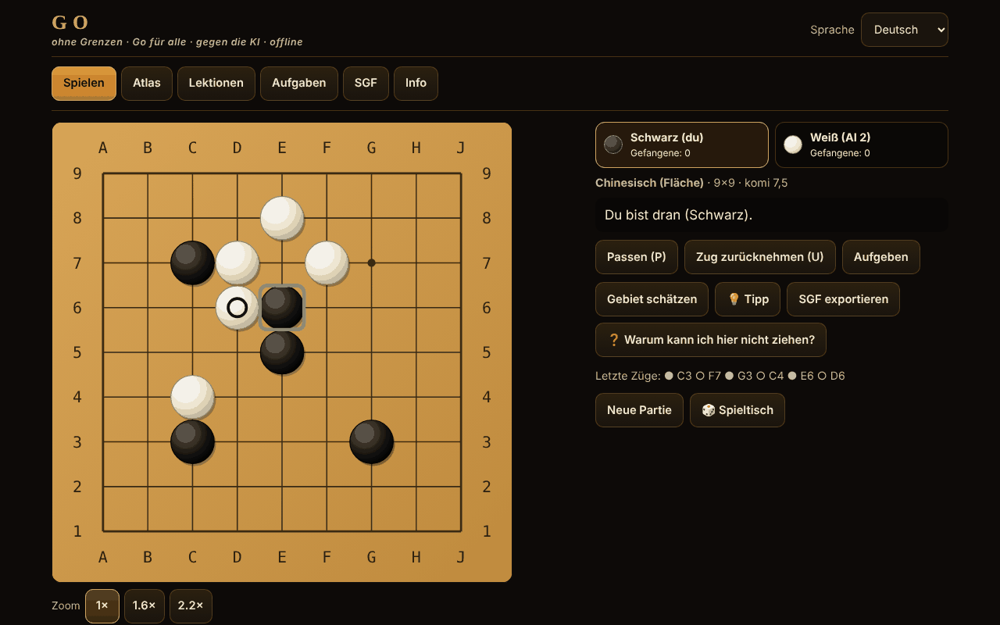

# Go fără frontiere

[English](README.md) · [Română](README.ro.md) · [Français](README.fr.md) · [Italiano](README.it.md) · [Español](README.es.md) · [Português](README.pt.md) · **Deutsch** · [Magyar](README.hu.md)

**Version:** 1.2.5 · **Zuletzt aktualisiert:** 2026-10-22

Oberflächensprachen: **Română, English, Français, Italiano, Español, Português (PT), Deutsch, Magyar**

Go (Baduk, Weiqi, Igo) in einer einzigen Offline-HTML-Datei: Brett von 5×5 bis 19×19, vier Regelwerke, KI-Gegner (MCTS), 12 spielbare Varianten, Lektionen, von einem Solver geprüfte Tsumego-Aufgaben und SGF.

**Online-Anwendung:** https://chiuta.github.io/Go-fara-frontiere/

## Was es ist

Ein Atlas (18 Datenblätter: Ursprung, Regeln, Näherungen ⚠, Quellen) und ein richtiges Go-Spiel gegen einen lokalen KI-Gegner (Monte-Carlo-Baumsuche, kein LLM, kein neuronales Netz). Die Regel-Engine ist von der Oberfläche getrennt und in Node getestet. Keine Netzwerkanfragen.

## Funktionen (in Code und Tests geprüft)

- **Bretter:** 5×5, 7×7, 9×9, 13×13, 19×19; Hoshi, Koordinaten, große Steine in skalierbarem SVG; Markierungen: letzter Zug, Ko, geschätztes Gebiet; Vorschau beim Überfahren mit dem Cursor.
- **Regeln im Code:** Schlagen nach Freiheiten der Kette; Selbstmord verboten (japanisch, chinesisch, AGA) oder erlaubt (Tromp–Taylor / benutzerdefiniert); einfaches Ko, positionelles Superko (PSK) und situatives Superko (SSK).
- **Regelwerke:** japanisch (Gebiet + Gefangene, Komi 6,5, ⚠), chinesisch (Fläche, 7,5, ⚠), AGA (Fläche; Passsteine zählen nur für die Parität, sie werden NICHT zur Flächenwertung addiert, 7,5, ⚠), Tromp–Taylor (formal, automatische Wertung, keine Markierung toter Steine, 7,5), benutzerdefiniert. Komi bearbeitbar; bei Vorgabe: japanisch/TT 0,5, AGA 0,5+(h−1), chinesisch h.
- **Vorgabe (Handicap) 2–9** mit Standardpositionen auf 9×9, 13×13, 19×19.
- **Spielende:** zwei Pässe → Markierung der toten Steine (Klick auf eine Gruppe) mit automatischem Vorschlag der KI (mit Bestätigung) → detaillierte Wertung (Steine, Gebiet, Gefangene, Komi, neutrale Punkte).
- **Modi:** gegen die KI (Sie wählen die Farbe oder zufällig), zwei Spieler am selben Bildschirm, Rengo 2 gegen 2 (Partner und Gegner können KI sein), Phantom Go ⚠ gegen die KI.
- **KI:** MCTS (UCT + RAVE) mit leichten Simulationen (Schlagen/Befreien aus Atari, 3×3-Muster, füllt keine eigenen Augen, vermeidet Self-Atari), 5 Stufen mit konfigurierbaren Iterationen und Zeit, Schaltfläche „Anhalten / weniger nachdenken“, läuft in einem Web Worker (aus einem Blob) und, wenn das nicht erlaubt ist, im Hauptthread in Scheiben von ~20 ms.
- **Spielbare Atlas-Varianten:** Atari-Go (Capture Go / Ponnuki-Go: erster Schlag; optional Ziel von 5 oder 10 Steinen), Go auf kleinem Brett (5×5, 7×7), NoGo, Rengo, Phantom Go ⚠, Byo-yomi mit funktionierender Uhr (Grundzeit + Perioden).
- **Hinweis** (💡, in Partien mit sichtbaren Steinen): Die lokale KI schlägt Ihnen einen Zug vor (Monte-Carlo-Suche, Richtwert), angezeigt als Zug, der zu bestätigen oder zu verwerfen ist.
- **Automatisches Speichern:** Eine unfertige Partie wird nach jedem Zug lokal gespeichert; beim nächsten Öffnen bietet der Reiter „Spielen“ „Partie fortsetzen“ oder „Speicherstand löschen“ an (durch Wiedergabe geprüft; beschädigte Speicherstände werden abgelehnt).
- **Interaktive Lektionen** (6): Steine, Freiheiten, Schlagen, Ko, zwei Augen, Seki.
- **12 Tsumego-Aufgaben**, jede mit einer von einem Brute-Force-Solver bestätigten Lösung (siehe „Was der Solver garantiert“); Rückmeldung richtig/falsch mit der Antwort der Verteidigung; „Lösung zeigen“ Schritt für Schritt.
- **SGF:** Export (mit Zügen, Vorgabe, Komi, Ergebnis); Import und Wiedergabe mit strengem Parser (FF[4], nur Hauptvariante, Grenzen: 2 MB, 30.000 Knoten, Tiefe 256; nichts wird ausgeführt); „Spiel ab hier fortsetzen“.
- **Oberfläche:** vollständige Tastaturbedienung (Pfeile + Eingabe, P = Pass, U = Zurücknehmen), Modus „Zug bestätigen“ (auf Touchscreens Standard), Zoom 1×/1,6×/2,2× auf dem Handy, 390 px ohne horizontales Scrollen; Zurücknehmen nur gegen die KI oder mit Bestätigung; keine Töne.
- **Oberfläche und Inhalt in 8 Sprachen** (RO/EN/FR/IT/ES/PT/DE/HU; FR/IT/ES/PT/DE/HU sind maschinell übersetzt, nicht von Muttersprachlern geprüft) mit automatischer Erkennung; auch die langen Texte (Atlas, 6 interaktive Lektionen, Namen der Tsume-Aufgaben, „Über“, Komi-Hinweis) sind in alle Sprachen übersetzt. Unverändert bleiben: das Feld „Quellen“ der Atlaskarten (Zitate, Eigennamen) und der Künstlername „Ecoul Stringurilor“. Die Schlüsselparität wird per Skript geprüft. Die Go-Terminologie (z. B. hu „felület“ für Flächenwertung) sollte von einem muttersprachlichen Spieler geprüft werden.
- **Zufall:** `crypto.getRandomValues` mit Rejection Sampling (zufällige Farbe, KI-Seeds); Option „Seed“ für reproduzierbare Partien.
- **Barrierefreiheit:** aria-live, sichtbarer Fokus, Touch-Ziele ≥ 44 px (gemessen), Kontrast ≥ 4,5:1 (gemessen), `prefers-reduced-motion`, `<noscript>`, dynamisches `lang`.

## Neue Funktionen (1.1.0)

Alle öffnen sich über die Schaltfläche „Spieltisch“ (Zweispielerpartien, Analyse, Tagesaufgabe, Turnier, Barrierefreiheit). Es gibt keinen Server, und es werden keine Netzwerkanfragen über die folgenden hinaus hinzugefügt.

- **Zweispielerpartie über FFF.p2p** (WebRTC, manuelle Signalisierung per Text oder QR-Code, ohne Server). Der Host ist maßgeblich; der Gast wendet nur die vom Host zurückgegebenen nummerierten Züge an (Lockstep, mit Positionsprüfsumme). Zug, Pass, Aufgabe, Markierung toter Steine und Bestätigung der Wertung werden synchronisiert; Remis/neue Partie werden vorgeschlagen und angenommen. Grenzen: keine Uhr, keine KI, kein Zurücknehmen von Zügen in der Online-Partie, keine Wiederaufnahme nach dem Neuladen der Seite. Die IP-Adresse ist für den Gegner sichtbar; ein symmetrisches NAT kann STUN/TURN erfordern (öffentliches STUN optional, nur mit ausdrücklicher Zustimmung im Dialog).
- **Lokaler Analysator**: Schätzung von Gewinnwahrscheinlichkeit und Wertung mit MCTS mit festem Seed (800/500/250 Iterationen je nach Brettgröße), daher dasselbe Ergebnis für dieselbe Stellung; „Auswertung“ der aktuellen Partie mit Diagramm und den Zügen, die die Bewertung um ≥ 20 Punkte verändern. Es ist eine statistische Schätzung, keine Engine auf Profi-Niveau.
- **Tagesaufgabe**: 9×9-Brett mit aus dem Kalenderdatum gesetzten Steinen (am selben Tag für alle gleich), plus die Tsumego-Aufgabe des Tages aus den 12 vorhandenen; Serie aufeinanderfolgender Tage lokal gespeichert. Ohne Netzwerk.
- **„Warum kann ich nicht ziehen?“**: Jeder regelwidrige Zug erhält eine Erklärung (besetzter Punkt, Ko mit dem verbotenen Zug, Superko mit der Zugnummer, Selbstmord mit der Kettengröße, NoGo usw.), auch für Screenreader angesagt; eigene Schaltfläche und Taste `?`.
- **Tastatur und Audioansagen**: Cursor auf dem Brett mit den Pfeilen, Eingabe/Leertaste zum Spielen, `W` (Stand), `C` (Koordinaten), `L` (letzter Zug), `S` (Wertung); aria-live-Region und optional Sprache (Web Speech, lokal) über das `tts`-Modul des Kits.
- **Lokales Elo-Turnier**: Sie + KI-Gegner (Elo 500 + 200·Stufe), Hin- und Rückrunde, aus den Ergebnissen neu berechnete Rangliste; Partien zwischen KIs werden auf 5×5/7×7/9×9 mit reduzierten Iterationen simuliert (Tromp–Taylor); die Elo-Rangliste ist relativ und ein Richtwert.
- **FFF-Kit** angewendet: `core, label, bundle, qr, p2p, tts` (das Transparenzfenster, `app.json`). Die CSP bleibt `default-src 'none'`; nur die Skript-Hashes wurden neu berechnet.

## Varianten

| Name | Spielbar? | ⚠ Näherungen |
|---|---|---|
| Go (klassisch), 9×9 / 13×13 / 19×19 | ja | — |
| Japanische Regeln (Gebiet) | ja | ⚠ Seki: Augen innerhalb eines Seki werden nicht erkannt; einfaches Ko (ohne „kein Ergebnis“); keine Schiedsregeln |
| Chinesische Regeln (Fläche) | ja | ⚠ positionelles Superko statt der offiziellen Wiederholungsregel; Komi 7,5 (der moderne Wert) |
| AGA-Regeln | ja | ⚠ im Audit gegen den AGA-Text von 1991 geprüft; situatives Superko für die Wiederholung gewählt; ohne Schiedsentscheidung |
| Tromp–Taylor | ja | — (formal; Selbstmord erlaubt, automatische Wertung) |
| Go auf kleinem Brett (5×5, 7×7) | ja | — |
| Vorgabe 2–9 | ja | ⚠ traditionelle Positionen nur auf 19×19; auf 9×9/13×13 extrapoliert (im Audit geprüft) |
| Atari-Go / Capture Go / Ponnuki-Go (Ziel 1, 5 oder 10) | ja | — |
| NoGo | ja | — (wer keinen legalen Zug mehr hat, verliert) |
| Rengo 2 gegen 2 | ja | — (die Spieler des Teams ziehen abwechselnd; KI für freie Plätze) |
| Phantom Go | ja | ⚠ die KI kennt Ihre verdeckten Steine nicht und kann besetzte Punkte versuchen; Flächenwertung; kein SGF-Export während der Partie |
| Byo-yomi | ja | — (Uhr mit Perioden; bei Überschreitung verliert man) |
| Paar-Go, toroidal, hexagonal, zu dritt, Ing, Neuseeland | nur im Atlas | — |

## Was der Tsumego-Solver garantiert

Für jede Aufgabe hat eine Alpha-Beta-Suche mit Transpositionstabelle auf dem kleinen angezeigten Bereich bestätigt, dass der angegebene erste Zug dem Spieler erlaubt, das Ziel (Zielgruppe geschlagen oder nach dem Benson-Algorithmus unbedingt lebendig) in höchstens D Halbzügen gegen JEDE Verteidigung, einschließlich eines Passes, zu erzwingen; die Menge der gewinnenden Züge wurde auch bei D+2 geprüft. Nicht garantiert wird: Ko, Seki oder „lebendig im Seki“ zählen nicht als Erfolg; nur einfaches Ko; der Bereich ist isoliert (die mit einem Quadrat markierten Mauern sind dauerhaft); es wird keine Eindeutigkeit in der ganzen Partie behauptet. Die 12 Aufgaben sind: 6 Augenraumformen (3 in einer Reihe, 3 gebogen, 4 T, 4 Quadrat, 5 Haufen, 5 Kreuz), die zu töten sind, 4 zum Lebendigmachen und 2 kleine Schläge, die per Suche gefunden wurden. Ein reichhaltigerer Satz von Tesuji (Snapback, Leiter, Netz) wurde nicht aufgenommen: Ich habe keine Aufgaben gefunden, die der Solver bestätigt und die zugleich natürlich sind.

## Bedienungsanleitung

1. Reiter „Spielen“: Wählen Sie Variante, Brett, Regelwerk, Modus und KI-Stufe; „Partie beginnen“. (Oder aus „Atlas“ → „▶ Spielen“ für eine Voreinstellung.)
2. Ziehen Sie per Klick/Tippen (auf dem Handy bestätigen Sie den Zug) oder mit der Tastatur: Pfeile = Cursor, Eingabe = Stein setzen, P = Pass, U = Zurücknehmen.
3. Die Schaltfläche „Gebiet schätzen“ zeigt eine statistische Schätzung; „Anhalten / weniger nachdenken“ verkürzt das Nachdenken der KI.
4. Nach zwei Pässen markieren Sie die toten Steine: Klick auf eine Gruppe (oder „Automatisch vorschlagen“), dann „Wertung bestätigen“. Bei Tromp–Taylor ist die Wertung automatisch.
5. „SGF exportieren“ lädt die Partie herunter; der Reiter „SGF“ lädt und gibt eine Datei oder einen eingefügten Text wieder.
6. „Lektionen“ und „Aufgaben“ geben sofortige Rückmeldung; der Fortschritt wird lokal gespeichert (wenn der Browser es zulässt).

## KI-Stärke (ehrliche Beschreibung)

Sie ist kein LLM und hat kein neuronales Netz. MCTS mit leichten Simulationen: ~7.700 Simulationen/s auf 9×9 und ~1.600/s auf 19×19 in Node (dem Testrechner); im Browser variiert es. Die Stufen 1–5 bedeuten 0 / 100 / 500 / 2.500 / 10.000 Iterationen (mit Zeitlimit). Gemessen auf 9×9, Komi 7,5, chinesische Regeln, abwechselnde Farben (`tests/match.js`, `tests/vs_random.js`):

| Begegnung (9×9, Komi 7,5, abwechselnde Farben) | Ergebnis | Partien |
|---|---|---|
| Stufe 1 (heuristisch, 0 Iterationen) gegen Zufall | 34–6 (85 %) | 40 |
| Stufe 2 (100 Iterationen) gegen Zufall | 100–0 (100 %) | 100 |
| Stufe 3 (500 Iterationen) gegen Zufall | 40–0 (100 %) | 40 |
| Stufe 2 gegen Stufe 1 | 40–0 | 40 |
| Stufe 3 gegen Stufe 2 | 31–9 (78 %) | 40 |
| Stufe 4 (2.500) gegen Stufe 3 | 21–9 (70 %) | 30 |
| Stufe 5 (10.000) gegen Stufe 4 | 15–5 (75 %) | 20 |

Bei 20–40 Partien liegt das Konfidenzintervall (95 %) in der Größenordnung von ±15–20 Prozentpunkten für die Zeilen mit ≤ 40 Partien; die Unterschiede zwischen den Stufen sind real, die genauen Werte aber nicht. Die Begegnungen sind KI gegen KI (dieselbe Engine), daher sind die Stärkeunterschiede zwischen den Stufen gegenüber Menschen wahrscheinlich überschätzt.

Der Rang wird NICHT gemessen (in der Build-Umgebung gibt es keine bewertete Engine und keine menschlichen Referenzspieler); jedes Kyu-Äquivalent wäre Spekulation, daher wird keines behauptet. Die Stufen 1–2 sind für absolute Anfänger. Auf 19×19 ist sie viel schwächer und langsamer. Die KI schummelt nicht: Sie erhält nur das Brett, die Zughistorie und die Regeln; beim Phantom Go spielt sie nur mit ihren eigenen und den aufgedeckten Steinen.

## Tests (Runde 8)

`tests/fff-r8.test.mjs` (Playwright, Netzwerk gesperrt, `node tests/fff-r8.test.mjs`): 10 Abschnitte, 120 Prüfungen, 0 Fehlschläge — P2P zwischen zwei Seiten (Loopback), deterministischer Analysator, vom Datum bestimmte Tagesaufgabe, Erklärungen für regelwidrige Züge, Tastatur, Elo-Turnier, axe-core mit 0 Verstößen (einschließlich Dialogen und dem Kit-Fenster), 0 `pageerror`/CSP-Verstöße, kein horizontaler Überlauf bei 360×740 und 1280×800. Die Anwendung gibt es nur im dunklen Design, daher wird der Kontrast in einem einzigen Design geprüft.

## Frühere Tests (außerhalb des Pakets)

Ausgeführt aus `scratchpad/new/games_work/Go-fara-frontiere/` (außerhalb des Pakets):

- `node tests/run.js` — 158 Prüfungen, 0 Fehlschläge: klassische Konfigurationen (Leiter/Ladder und Snapback per Suche gefunden und mit der Referenzimplementierung wiedergegeben, Ko, Seki, Selbstmord, Schlagen vor Selbstmord), Superko, japanische vs. chinesische Wertung bei Stellungen mit von Hand berechnetem Ergebnis (Wertungsidentität: Flächendifferenz minus Gebietsdifferenz = von Schwarz gesetzte Steine minus von Weiß gesetzte Steine, laut Sensei's Library), Vorgabe, Byo-yomi-Uhr, SGF (Round-Trip an 600 erzeugten Partien; Ablehnung zu großer, zu tief verschachtelter, mit riesigen Werten versehener oder fehlerhafter Dateien).
- Vergleich mit einer unabhängigen Referenzimplementierung (Brute-Force-Flood-Fill): 100.000 Zufallsstellungen in 588 Partien, 602.976 Legalitätsprüfungen, 0 Abweichungen (in `tests/run.js`).
- `node tests/fuzz.js 9 500` — 500 KI-gegen-KI-Partien auf 9×9 (52.291 Züge), jeder Zug von der Referenz validiert: 0 regelwidrige Züge, 0 verletzte Invarianten. `node tests/fuzz.js 13 100` — 100 Partien auf 13×13 (20.839 Züge): 0 regelwidrig. `node tests/fuzz.js var 120` — NoGo / Capture-Go: 0 regelwidrig.
- `node tests/vs_random.js 100 100` — MCTS mit 100 Iterationen schlägt den Zufallsspieler 100–0 auf 9×9 (Anforderung ≥ 95 %).
- `node tests/tsume_verify.js` — löst die 12 Aufgaben erneut: die gespeicherte Lösung, die minimale Tiefe, die Stabilität bei D+2, die Widerlegung jedes falschen Zuges.
- `node tests/i18n-parity.js` — 254 Schlüssel × 7 Sprachen, identische Platzhalter, alle im Code verwendeten Schlüssel existieren. `node tests/rng.js` (Gleichverteilung von `secureInt`, reproduzierbarer Seed), `node tests/contrast.js` (≥ 4,5:1), `node tests/stamp_overflow.js` (Regression für einen in langen Partien gefundenen Fehler: Überlauf des Int32-Zählers im Flood-Fill).
- Playwright (`pw/ui.js`, `pw/ui2.js`, `pw/ui3.js`): 84 UI-Prüfungen, 0 Fehlschläge — Tastatur, Zurücknehmen, Sprachwechsel, SGF-Export/-Import, ungültiges SGF abgelehnt, Lösen aller 12 Aufgaben über die UI, vollständige 5×5-Partie bis zur Markierung und Wertung, alle 12 spielbaren Voreinstellungen, Gebietsschätzung, Byo-yomi-Uhr, Handy 390 px (kein horizontales Scrollen, Ziele ≥ 44 px, Zugbestätigung), gesperrter `localStorage`, ohne Worker (Fallback), 0 Netzwerkanfragen, 0 Konsolenfehler.

## Datenschutz und Netzwerk

Ohne Konto oder Telemetrie; standardmäßig keinerlei Netzwerkanfragen. Nur wenn Sie ausdrücklich „Zweispielerpartie“ starten, wird eine direkte WebRTC-Verbindung zum Gegner geöffnet (Signalisierung manuell kopiert; öffentliches STUN nur mit ausdrücklicher Zustimmung). Strenge CSP (`default-src 'none'`, Skript nur per SHA-256-Hash erlaubt, `worker-src blob:`, kein `connect-src`). `localStorage` (in try/catch) nur für Sprache, Einstellungen, gelöste Aufgaben, lokale Statistiken und das automatische Speichern einer einzigen unfertigen Partie (`gff.save.v1`: die Einstellungen, die Züge, Ihre Farbe und der Seed; nicht für Phantom Go oder Partien mit Uhr; wird am Ende der Partie oder mit „Speicherstand löschen“ gelöscht). Die Buy-Me-a-Coffee-Links in der Fußzeile öffnen sich nur per Klick (`rel=noopener`).

## Grenzen und Hinweise

- Die Regeln (Komi, Ko, Selbstmord, Seki, Wertung, Vorgabe) wurden im Audit gegen Wikipedia „Rules of Go“/„Komi“, den AGA-Text von 1991 (British Go Association) und die japanischen Regeln von 1989 (CMU) geprüft; daraus ergaben sich Korrekturen (AGA-Passsteine, Komi bei Vorgabe). Die offiziellen chinesischen Regeln und die der Nihon Ki-in 2003 konnten nicht vollständig gelesen werden (⚠).
- „Seed“ reproduziert die Partie nur, wenn die KI nicht durch das Zeitlimit angehalten wird (die Iterationen können je nach Rechnergeschwindigkeit variieren).
- Seki: Punkte mit gemeinsamen Freiheiten sind neutral, aber Augen innerhalb eines Seki werden nicht erkannt; einfaches Ko ohne „kein Ergebnis“ bei den japanischen Regeln; Sicherheitsgrenze bei 4·n² Zügen (Remis).
- Die Gebietsschätzung und der Vorschlag für tote Steine sind statistisch und können falsch liegen.
- Phantom Go ist angenähert (die KI hat keine Informationen über Ihre verdeckten Steine; sie kann besetzte Punkte versuchen).
- Die KI ist auf 19×19 schwach; sie ist kein Spieler auf Vereinsniveau.
- Die Varianten „nur im Atlas“ sind nicht implementiert.
- Zweispielerpartie: ohne Uhr/KI/Zurücknehmen, ohne Wiederaufnahme nach dem Neuladen; das SGF und die Schläge werden nicht gesondert synchronisiert. Der Analysator und die Turniersimulationen verwenden reduzierte Iterationen und sind näherungsweise.

## Quellen

Sensei's Library (Japanese rules, Chinese rules, AGA rules, Tromp–Taylor rules, Ko, Superko, Komi, Handicap, Seki, Scoring) · die Tromp–Taylor-Regeln · American Go Association · die SGF-Spezifikation FF[4] · D. B. Benson (1976, unbedingtes Leben) · Kocsis & Szepesvári (2006, UCT) · Gelly & Silver (2007, RAVE). Im Audit teilweise online geprüft (siehe den Auditbericht).

## Lokal ausführen

Laden Sie `index.html` herunter und öffnen Sie sie im Browser; sie funktioniert ohne Internet.

## Verlauf / Changelog

### 1.2.5 — 2026-10-22

fff-kit 1.1.2: PBKDF2 mit 600.000 Iterationen, Schutz vor Clickjacking.

### 1.2.4 — 2026-10-22

das Ersetzen einer laufenden Partie (aus dem Atlas, aus einer SGF-Aufzeichnung oder beim Start einer Online-Partie) fragt im Inline-Dialog des Kits (in 8 Sprachen übersetzt) statt im blockierenden `window.confirm()` nach; sichtbarer Tastaturfokus; Kontrollkästchen von mindestens 24 px; Test `tests/r9-confirm.test.mjs`.

### 1.2.3 — 2026-10-22
- Der Link „Skip“ und die Brettarten im Varianten-Atlas (toroidal, hexagonal) sind übersetzt; die Quellenzeile zu NoGo mischt nicht mehr Rumänisch und Englisch; Name und Beschreibung im Transparenz-Panel (fff-info) und in der Meta-Description folgen jetzt der Oberflächensprache und werden bei einem Wechsel aktualisiert.

### 1.2.2 — 2026-10-22
- Übersetzungskorrektur: Die Quellenangabe zu Rengo enthält keinen rumänischen Text mehr.

### 1.2.1 — 2026-10-19
- Alle langen Texte („Über“, 6 Lektionen, 12 Tsume-Namen, Stufentexte, Komi-Hinweis, die Atlaskarten) sind nach fr, it, es, pt, de, hu übersetzt; der Hinweis „Text auf Englisch“ erscheint nicht mehr. Maschinelle Übersetzungen, nicht von Muttersprachlern geprüft.

### 14. Oktober 2026 — Version 1.1.0
- Zweispielerpartie über FFF.p2p (Lockstep), lokaler Analysator, Tagesaufgabe, „Warum kann ich nicht ziehen?“, Tastaturspiel mit Audioansagen, lokales Elo-Turnier; ungarische Sprache (teilweise); FFF-Kit (`core,label,bundle,qr,p2p,tts`); Tests `tests/fff-r8.test.mjs`. Keine Regelregressionen (Spiel-Engine unverändert).

### 12. Oktober 2026 — Version 1.0.0
- 1.0.0 — 2026-10-12: Version und Datum der letzten Aktualisierung werden in der Anwendung angezeigt

### 11. Oktober 2026 (dritter Durchgang)
- Die Anmerkung zum Komi bei Vorgabe (RO/EN): AGA „h−0,5“ und „0,5 + (h−1)“ sind derselbe Wert, jetzt auch so formuliert (zuvor wirkte es, als gäbe es zwei Formeln). CSP: Hash neu berechnet.

### 11. Oktober 2026 (zweiter Durchgang)
- Automatisches Speichern der laufenden Partie mit „Partie fortsetzen“ (strenge Validierung + Wiedergabe, neuer Text in allen 7 Sprachen); Schaltfläche „Hinweis“, die mit der lokalen MCTS-Engine einen Zug vorschlägt; CSP: Hash neu berechnet.

### 11. Oktober 2026
- Barrierefreiheit: Die Reiterleiste ist in ein `<nav>`-Landmark eingefasst, das Unterstützungs-Widget hat eine Landmark-Rolle; axe-core meldet 0 Verstöße bei 1280 und 360 px.
- HTML repariert: ein doppeltes `</body></html>` am Dateiende entfernt; der CSP-Hash des Skripts wurde neu berechnet (mit aktiver CSP geprüft, ohne Umgehung).
- Lizenz: Der Hinweis „Lizenz nicht deklariert“ in der Anwendung wurde durch die MIT-Lizenz ersetzt, entsprechend der Datei `LICENSE`.

## Lizenz

MIT — siehe die Datei `LICENSE`

## Autor

Alexio — Alexandru-Ionuț Chiuță · alexio@trom.tf

## Zusammenfassung

Offline-Go in einer Datei (Baduk/Weiqi/Igo): 5×5–19×19, japanische/chinesische/AGA-/Tromp–Taylor-Regeln (⚠ Näherungen dokumentiert), Vorgabe 2–9, MCTS-KI (5 Stufen, Web Worker), Zweispieler, Rengo 2 gegen 2, Atari-Go/Ponnuki-Go, NoGo, Phantom Go ⚠, Byo-yomi-Uhr, 6 interaktive Lektionen, 12 Tsumego-Aufgaben, jede von einem Brute-Force-Solver bestätigt, SGF-Import/-Export mit strengem Parser. Oberfläche in 8 Sprachen (6 maschinell übersetzt, ungeprüft), lange Texte ebenfalls übersetzt. Neu in 1.1.0: Zweispielerpartie über WebRTC mit manueller/QR-Signalisierung (ohne Server, Lockstep), lokaler MCTS-Analysator mit festem Seed und Partieauswertung, datumsbasierte Tagesaufgabe, Erklärungen „Warum kann ich nicht ziehen?“, Tastaturspiel mit gesprochenen Ansagen, lokales Elo-Turnier. Engine gegen eine unabhängige Flood-Fill-Referenz an 100.000 Zufallsstellungen getestet, 500 KI-gegen-KI-Partien auf 9×9 und 100 auf 13×13 ohne regelwidrige Züge. Kein Netzwerk, keine Telemetrie. Lizenz: MIT (siehe LICENSE).
