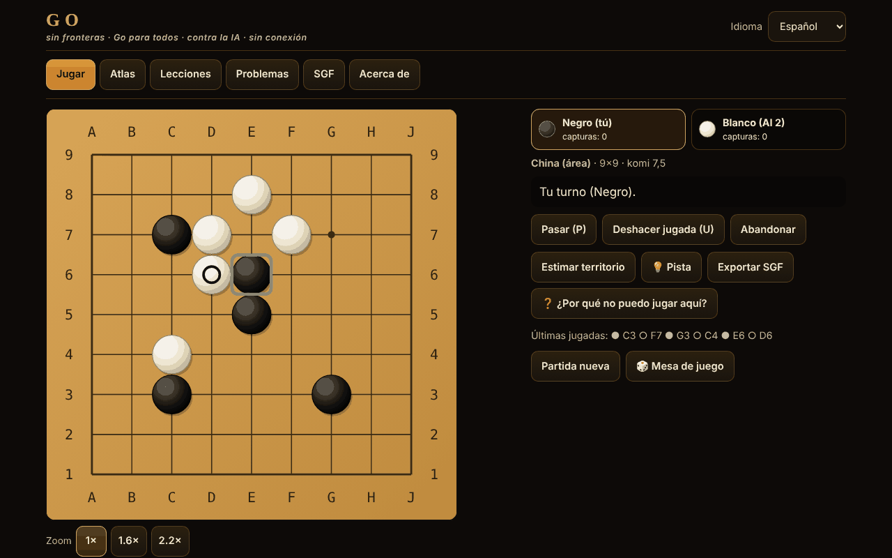

# Go fără frontiere

[English](README.md) · [Română](README.ro.md) · [Français](README.fr.md) · [Italiano](README.it.md) · **Español** · [Português](README.pt.md) · [Deutsch](README.de.md) · [Magyar](README.hu.md)

**Versión:** 2.1.0 · **Última actualización:** 2026-10-27

Idiomas de la interfaz: **Română, English, Français, Italiano, Español, Português (PT), Deutsch, Magyar**

El Go (Baduk, Weiqi, Igo) en un único archivo HTML sin conexión: tablero de 5×5 a 19×19, cuatro conjuntos de reglas, oponente de IA (MCTS), 12 variantes jugables, lecciones, problemas de tsumego verificados por un solucionador y SGF.

**Aplicación en línea:** https://chiuta.github.io/Go-fara-frontiere/

## Qué es

Un atlas (18 fichas: origen, reglas, aproximaciones ⚠, fuentes) y una partida real de Go contra un oponente de IA local (búsqueda de árbol Monte-Carlo, no un LLM, no una red neuronal). El motor de reglas está separado de la interfaz y probado en Node. Ninguna solicitud de red.

## Funciones (verificadas en el código y en las pruebas)

- **Tableros:** 5×5, 7×7, 9×9, 13×13, 19×19; hoshi, coordenadas, piedras grandes en SVG escalable; marcas: última jugada, ko, territorio estimado; vista previa al pasar el cursor.
- **Reglas en el código:** captura por libertades de la cadena; suicidio prohibido (japonesas, chinas, AGA) o permitido (Tromp–Taylor / personalizado); ko simple, superko posicional (PSK) y situacional (SSK).
- **Conjuntos de reglas:** japonesas (territorio + prisioneros, komi 6,5, ⚠), chinas (área, 7,5, ⚠), AGA (área; las piedras de pase cuentan solo para la paridad, NO se suman a la puntuación por área, 7,5, ⚠), Tromp–Taylor (formales, puntuación automática, sin marcado de piedras muertas, 7,5), personalizado. Komi editable; con handicap: japonesas/TT 0,5, AGA 0,5+(h−1), chinas h.
- **Handicap 2–9** con posiciones estándar en 9×9, 13×13, 19×19.
- **Final de la partida:** dos pases → marcado de las piedras muertas (clic en un grupo) con sugerencia automática de la IA (con confirmación) → puntuación detallada (piedras, territorio, prisioneros, komi, puntos neutros).
- **Modos:** contra la IA (eliges el color, o al azar), dos jugadores en la misma pantalla, Rengo 2 contra 2 (el compañero y los rivales pueden ser IA), Phantom Go ⚠ contra la IA.
- **IA:** MCTS (UCT + RAVE) con simulaciones ligeras (capturas/escapes de atari, patrones 3×3, no rellena sus propios ojos, evita el self-atari), 5 niveles con iteraciones y tiempo configurables, botón «Detener / pensar menos», se ejecuta en un Web Worker (desde un Blob) y, si no está permitido, en el hilo principal en porciones de ~20 ms.
- **Variantes del atlas jugables:** Atari-Go (Capture Go / Ponnuki-Go: primera captura; opcionalmente objetivo de 5 o 10 piedras), Go en tablero pequeño (5×5, 7×7), NoGo, Rengo, Phantom Go ⚠, Byo-yomi con reloj funcional (tiempo base + periodos).
- **Sugerencia** (💡, en partidas con piedras visibles): la IA local propone una jugada para ti (búsqueda Monte-Carlo, orientativa), mostrada como jugada que confirmar o cancelar.
- **Guardado automático:** una partida sin terminar se guarda en local tras cada jugada; en la siguiente apertura, la pestaña «Jugar» ofrece «Continuar la partida» o «Borrar el guardado» (verificado mediante repetición; los guardados corruptos se rechazan).
- **Lecciones interactivas** (6): piedras, libertades, captura, ko, dos ojos, seki.
- **12 problemas de tsumego**, cada uno con una solución confirmada por un solucionador de fuerza bruta (véase «Qué garantiza el solucionador»); respuesta correcta/incorrecta con la réplica de la defensa; «Mostrar la solución» paso a paso.
- **SGF:** exportación (con jugadas, handicap, komi, resultado); importación y reproducción con un analizador estricto (FF[4], solo la línea principal, límites: 2 MB, 30 000 nodos, profundidad 256; no se ejecuta nada); «Continuar el juego desde aquí».
- **Interfaz:** teclado completo (flechas + Intro, P = pasar, U = deshacer), modo «confirmar la jugada» (predeterminado en pantalla táctil), zoom 1×/1,6×/2,2× en móvil, 390 px sin desplazamiento horizontal; deshacer solo contra la IA o con confirmación; sin sonidos.
- **Interfaz y contenido en 8 idiomas** (RO/EN/FR/IT/ES/PT/DE/HU; FR/IT/ES/PT/DE/HU son traducciones automáticas, no verificadas por hablantes nativos) con detección automática; los textos largos (atlas, 6 lecciones interactivas, nombres de los problemas de tsume, «Acerca de», nota sobre el komi) también están traducidos a todos los idiomas. Permanecen sin cambios: el campo «fuentes» de las fichas del atlas (citas, nombres propios) y el nombre artístico «Ecoul Stringurilor». La paridad de claves se comprueba con un script. La terminología del go (p. ej. hu «felület» para la puntuación por área) merece la revisión de un jugador nativo.
- **Aleatoriedad:** `crypto.getRandomValues` con muestreo por rechazo (color aleatorio, semillas de la IA); opción «Semilla» para partidas reproducibles.
- **Accesibilidad:** aria-live, foco visible, objetivos táctiles ≥ 44 px (medido), contraste ≥ 4,5:1 (medido), `prefers-reduced-motion`, `<noscript>`, `lang` dinámico.

## Funciones nuevas (1.1.0)

Todas se abren desde el botón «Mesa de juego» (partidas de dos, análisis, reto del día, torneo, accesibilidad). No hay servidor y no se añaden solicitudes de red aparte de las siguientes.

- **Partida de dos mediante FFF.p2p** (WebRTC, señalización manual por texto o código QR, sin servidor). El anfitrión es la autoridad; el invitado aplica solo las jugadas numeradas que devuelve el anfitrión (lockstep, con suma de comprobación de la posición). Jugada, pase, abandono, marcado de piedras muertas y confirmación de la puntuación están sincronizados; las tablas/nueva partida se proponen y se aceptan. Límites: sin reloj, sin IA, sin deshacer jugadas en la partida en línea, sin reanudación tras recargar la página. La dirección IP es visible para el rival; un NAT simétrico puede requerir STUN/TURN (STUN público opcional, solo con consentimiento explícito en el diálogo).
- **Analizador local**: estimación de la probabilidad de victoria y de la puntuación con MCTS de semilla fija (800/500/250 iteraciones según el tamaño del tablero), por lo que el resultado es el mismo para la misma posición; «Revisión» de la partida actual con gráfico y las jugadas que cambian la evaluación en ≥ 20 puntos. Es una estimación estadística, no un motor de nivel profesional.
- **Reto del día**: tablero 9×9 con piedras colocadas a partir de la fecha del calendario (la misma para todos el mismo día), más el problema de tsumego del día entre los 12 existentes; racha de días consecutivos almacenada en local. Sin red.
- **«¿Por qué no puedo jugar?»**: toda jugada ilegal recibe una explicación (punto ocupado, ko con la jugada prohibida, superko con el número de jugada, suicidio con el tamaño de la cadena, NoGo, etc.), anunciada también para lectores de pantalla; botón dedicado y tecla `?`.
- **Teclado y anuncios de audio**: cursor en el tablero con las flechas, Intro/Espacio para jugar, `W` (estado), `C` (coordenadas), `L` (última jugada), `S` (puntuación); región aria-live y, opcionalmente, voz (Web Speech, local) mediante el módulo `tts` del kit.
- **Torneo Elo local**: tú + oponentes de IA (Elo 500 + 200·nivel), ida y vuelta, clasificación recalculada a partir de los resultados; las partidas entre IA se simulan en 5×5/7×7/9×9 con iteraciones reducidas (Tromp–Taylor); la clasificación Elo es relativa y orientativa.
- **Kit FFF** aplicado: `core, label, bundle, qr, p2p, tts` (la ventana de transparencia, `app.json`). La CSP sigue siendo `default-src 'none'`; solo se recalcularon los hashes de los scripts.

## Variantes

| Nombre | ¿Jugable? | ⚠ Aproximaciones |
|---|---|---|
| Go (clásico), 9×9 / 13×13 / 19×19 | sí | — |
| Reglas japonesas (territorio) | sí | ⚠ seki: no se detectan los ojos dentro de un seki; ko simple (sin «sin resultado»); sin reglas de arbitraje |
| Reglas chinas (área) | sí | ⚠ superko posicional en lugar de la regla oficial de repetición; komi 7,5 (el valor moderno) |
| Reglas AGA | sí | ⚠ verificadas en la auditoría frente al texto AGA de 1991; situacional elegido para la repetición; sin arbitraje |
| Tromp–Taylor | sí | — (formales; suicidio permitido, puntuación automática) |
| Go en tablero pequeño (5×5, 7×7) | sí | — |
| Handicap 2–9 | sí | ⚠ posiciones tradicionales solo en 19×19; en 9×9/13×13 extrapoladas (verificado en la auditoría) |
| Atari-Go / Capture Go / Ponnuki-Go (objetivo 1, 5 o 10) | sí | — |
| NoGo | sí | — (pierde quien se queda sin jugada legal) |
| Rengo 2 contra 2 | sí | — (los jugadores del equipo juegan por turnos; IA para los puestos libres) |
| Phantom Go | sí | ⚠ la IA no conoce tus piedras ocultas y puede intentar puntos ocupados; puntuación por área; sin exportación SGF durante la partida |
| Byo-yomi | sí | — (reloj con periodos; se pierde al excederse) |
| Go por parejas, toroidal, hexagonal, a tres, Ing, Nueva Zelanda | solo en el atlas | — |

## Qué garantiza el solucionador de tsumego

Para cada problema, una búsqueda alfa-beta con tabla de transposición, en la pequeña zona mostrada, confirmó que la primera jugada indicada permite al jugador forzar el objetivo (grupo objetivo capturado, o vivo incondicionalmente según el algoritmo de Benson) en como máximo D semijugadas contra CUALQUIER defensa, incluido un pase; el conjunto de jugadas ganadoras se verificó también a D+2. No garantiza: el ko, el seki o «vivo en seki» no cuentan como éxito; solo ko simple; la zona está aislada (los muros marcados con un cuadrado son permanentes); no pretende unicidad en la partida completa. Los 12 problemas son: 6 formas de espacio de ojos (3 en línea, 3 doblado, 4 en T, 4 cuadrado, 5 racimo, 5 cruz) que matar, 4 que hacer vivas, y 2 capturas pequeñas encontradas mediante búsqueda. No se incluyó un conjunto más rico de tesuji (snapback, escalera, red): no encontré problemas que el solucionador confirme y que además sean naturales.

## Manual de uso

1. Pestaña «Jugar»: elige la variante, el tablero, el conjunto de reglas, el modo y el nivel de la IA; «Empezar la partida». (O desde «Atlas» → «▶ Jugar» para un preajuste.)
2. Juega con clic/toque (en móvil confirmas la jugada) o con el teclado: flechas = cursor, Intro = colocar la piedra, P = pasar, U = deshacer.
3. El botón «Estimar el territorio» muestra una estimación estadística; «Detener / pensar menos» acorta el pensamiento de la IA.
4. Tras dos pases marcas las piedras muertas: clic en un grupo (o «Sugerir automáticamente»), luego «Confirmar la puntuación». En Tromp–Taylor la puntuación es automática.
5. «Exportar SGF» descarga la partida; la pestaña «SGF» carga y reproduce un archivo o un texto pegado.
6. «Lecciones» y «Problemas» dan respuesta inmediata; el progreso se conserva en local (si el navegador lo permite).

## Nivel de la IA (descripción honesta)

No es un LLM y no tiene red neuronal. MCTS con simulaciones ligeras: ~7700 simulaciones/s en 9×9 y ~1600/s en 19×19 en Node (la máquina de pruebas); en el navegador varía. Los niveles 1–5 significan 0 / 100 / 500 / 2500 / 10 000 iteraciones (con límite de tiempo). Medido en 9×9, komi 7,5, reglas chinas, colores alternados (`tests/match.js`, `tests/vs_random.js`):

| Encuentro (9×9, komi 7,5, colores alternados) | Resultado | Partidas |
|---|---|---|
| Nivel 1 (heurístico, 0 iteraciones) contra aleatorio | 34–6 (85 %) | 40 |
| Nivel 2 (100 iteraciones) contra aleatorio | 100–0 (100 %) | 100 |
| Nivel 3 (500 iteraciones) contra aleatorio | 40–0 (100 %) | 40 |
| Nivel 2 contra nivel 1 | 40–0 | 40 |
| Nivel 3 contra nivel 2 | 31–9 (78 %) | 40 |
| Nivel 4 (2500) contra nivel 3 | 21–9 (70 %) | 30 |
| Nivel 5 (10 000) contra nivel 4 | 15–5 (75 %) | 20 |

Con 20–40 partidas, el intervalo de confianza (95 %) es del orden de ±15–20 puntos porcentuales para las filas con ≤ 40 partidas; las diferencias entre niveles son reales, pero los valores exactos no. Los encuentros son IA contra IA (el mismo motor), por lo que las diferencias de fuerza entre niveles probablemente están sobrestimadas respecto de los humanos.

El rango NO se ha medido (no hay un motor clasificado ni jugadores humanos de referencia en el entorno de compilación); cualquier equivalente en kyu sería especulación, por lo que no se afirma ninguno. Los niveles 1–2 son para principiantes absolutos. En 19×19 es mucho más débil y lenta. La IA no hace trampas: recibe solo el tablero, el historial de jugadas y las reglas; en Phantom Go juega únicamente con sus propias piedras y las reveladas.

## Pruebas (ronda 8)

`tests/fff-r8.test.mjs` (Playwright, red bloqueada, `node tests/fff-r8.test.mjs`): 10 secciones, 120 comprobaciones, 0 fallos — P2P entre dos páginas (loopback), analizador determinista, reto del día determinado por la fecha, explicaciones de jugadas ilegales, teclado, torneo Elo, axe-core con 0 infracciones (incluidos los diálogos y la ventana del kit), 0 `pageerror`/infracciones de CSP, sin desbordamiento horizontal a 360×740 y 1280×800. La aplicación solo tiene tema oscuro, por lo que el contraste se verifica en un único tema.

## Pruebas anteriores (fuera del paquete)

Ejecutadas desde `scratchpad/new/games_work/Go-fara-frontiere/` (fuera del paquete):

- `node tests/run.js` — 158 comprobaciones, 0 fallos: configuraciones clásicas (escalera/ladder y snapback encontrados mediante búsqueda y repetidos con la implementación de referencia, ko, seki, suicidio, captura antes del suicidio), superko, puntuación japonesa vs china en posiciones con resultado calculado a mano (identidad de puntuación: diferencia de área menos diferencia de territorio = piedras colocadas por Negro menos piedras colocadas por Blanco, según Sensei's Library), handicap, reloj byo-yomi, SGF (ida y vuelta en 600 partidas generadas; rechazo de archivos demasiado grandes, con anidamiento demasiado profundo, con valores enormes o malformados).
- Comparación con una implementación de referencia independiente (flood-fill de fuerza bruta): 100 000 posiciones aleatorias en 588 partidas, 602 976 comprobaciones de legalidad, 0 divergencias (en `tests/run.js`).
- `node tests/fuzz.js 9 500` — 500 partidas IA contra IA en 9×9 (52 291 jugadas), cada jugada validada por la referencia: 0 jugadas ilegales, 0 invariantes violados. `node tests/fuzz.js 13 100` — 100 partidas en 13×13 (20 839 jugadas): 0 ilegales. `node tests/fuzz.js var 120` — NoGo / Capture-Go: 0 ilegales.
- `node tests/vs_random.js 100 100` — el MCTS con 100 iteraciones vence al jugador aleatorio 100–0 en 9×9 (requisito ≥ 95 %).
- `node tests/tsume_verify.js` — vuelve a resolver los 12 problemas: la solución almacenada, la profundidad mínima, la estabilidad a D+2, la refutación de cada jugada errónea.
- `node tests/i18n-parity.js` — 254 claves × 7 idiomas, marcadores de posición idénticos, todas las claves usadas en el código existen. `node tests/rng.js` (uniformidad de `secureInt`, semilla reproducible), `node tests/contrast.js` (≥ 4,5:1), `node tests/stamp_overflow.js` (regresión de un error hallado en partidas largas: desbordamiento del contador Int32 del flood-fill).
- Playwright (`pw/ui.js`, `pw/ui2.js`, `pw/ui3.js`): 84 comprobaciones de IU, 0 fallos — teclado, deshacer, cambio de idioma, exportación/importación SGF, SGF no válido rechazado, resolución por la IU de los 12 problemas, partida 5×5 completa hasta el marcado y la puntuación, los 12 preajustes jugables, estimación de territorio, reloj byo-yomi, móvil 390 px (sin desplazamiento horizontal, objetivos ≥ 44 px, confirmación de la jugada), `localStorage` bloqueado, sin Worker (alternativa), 0 solicitudes de red, 0 errores de consola.

## Privacidad y red

Sin cuenta ni telemetría; por defecto, ninguna solicitud de red. Solo si inicias explícitamente «Partida de dos» se abre una conexión WebRTC directa con el rival (señalización copiada manualmente; STUN público solo con consentimiento explícito). CSP estricta (`default-src 'none'`, script permitido solo mediante hash SHA-256, `worker-src blob:`, sin `connect-src`). `localStorage` (en try/catch) solo para el idioma, los ajustes, los problemas resueltos, las estadísticas locales y el guardado automático de una única partida sin terminar (`go-fara-frontiere.save.v1`: los ajustes, las jugadas, tu color y la semilla; no para Phantom Go ni para partidas con reloj; se borra al terminar la partida o con «Borrar el guardado»). Los enlaces de Buy Me a Coffee del pie se abren solo al hacer clic (`rel=noopener`).

## Límites y advertencias

- Las reglas (komi, ko, suicidio, seki, puntuación, handicap) se verificaron en la auditoría frente a Wikipedia «Rules of Go»/«Komi», el texto AGA de 1991 (British Go Association) y las reglas japonesas de 1989 (CMU); de ello resultaron correcciones (piedras de pase AGA, komi con handicap). Las reglas chinas oficiales y las de la Nihon Ki-in 2003 no se pudieron leer por completo (⚠).
- «Semilla» reproduce la partida solo si la IA no se detiene por el límite de tiempo (las iteraciones pueden variar según la velocidad de la máquina).
- Seki: los puntos con libertades comunes son neutros, pero los ojos dentro de un seki no se detectan; ko simple sin «sin resultado» en las reglas japonesas; límite de seguridad en 4·n² jugadas (tablas).
- La estimación del territorio y la sugerencia de piedras muertas son estadísticas y pueden equivocarse.
- Phantom Go está aproximado (la IA no tiene información sobre tus piedras ocultas; puede intentar puntos ocupados).
- La IA es débil en 19×19; no es un jugador de nivel de club.
- Las variantes «solo en el atlas» no están implementadas.
- Partida de dos: sin reloj/IA/deshacer, sin reanudación tras recargar; el SGF y las capturas no se sincronizan por separado. El analizador y las simulaciones del torneo usan iteraciones reducidas y son aproximados.

## Fuentes

Sensei's Library (Japanese rules, Chinese rules, AGA rules, Tromp–Taylor rules, Ko, Superko, Komi, Handicap, Seki, Scoring) · las reglas Tromp–Taylor · American Go Association · la especificación SGF FF[4] · D. B. Benson (1976, vida incondicional) · Kocsis & Szepesvári (2006, UCT) · Gelly & Silver (2007, RAVE). Verificadas parcialmente en línea en la auditoría (véase el informe de auditoría).

## Ejecución local

Descarga `index.html` y ábrelo en el navegador; funciona sin internet.

## Historial / Changelog

### 1.2.9 — 2026-10-23

- Fix: the version shown in the footer was stale (1.2.6); CSP hashes recalculated.

### 1.2.8 — 2026-10-23

- Almacenamiento: las claves llevan ahora el prefijo de la aplicación (`go-fara-frontiere.prefs.v1`, `go-fara-frontiere.save.v1`, `go-fara-frontiere.r8.*`); los datos existentes se migran automáticamente al iniciar desde las claves antiguas (`gff.prefs.v1`, `gff.save.v1`, `gff_r8_*`) y las copias `.fff.json` antiguas se siguen importando (fff-kit 1.2.0).
- Diálogos: los cuadros nativos `alert`/`confirm`/`prompt` se sustituyeron por diálogos `FFF.dialog` accesibles y traducidos (teclado, trampa de foco, Esc), con el mismo comportamiento (fff-kit 1.2.0).

### 1.2.6 — 2026-10-22

fff-kit 1.1.4: áreas táctiles y texto mínimo. Áreas táctiles/texto corregidos en la aplicación.

### 1.2.5 — 2026-10-22

fff-kit 1.1.2: PBKDF2 con 600.000 iteraciones, protección anti-clickjacking.

### 1.2.4 — 2026-10-22

reemplazar una partida en curso (desde el atlas, desde un registro SGF o al iniciar una partida en línea) pide confirmación en el diálogo integrado del kit (traducido a 8 idiomas) en lugar del `window.confirm()` bloqueante; foco de teclado visible; casillas de al menos 24 px; prueba `tests/r9-confirm.test.mjs`.

### 1.2.3 — 2026-10-22
- El enlace «Skip» y los tipos de tablero del atlas de variantes (toroidal, hexagonal) están traducidos; la línea de fuentes de NoGo ya no mezcla rumano e inglés; el nombre y la descripción del panel de transparencia (fff-info) y de la meta description siguen ahora el idioma de la interfaz y se actualizan al cambiarlo.

### 1.2.2 — 2026-10-22
- Corrección de traducción: la referencia de fuente de Rengo ya no contiene texto en rumano.

### 1.2.1 — 2026-10-19
- Todos los textos largos («Acerca de», 6 lecciones, 12 nombres de problemas de tsume, textos de nivel, nota sobre el komi, las fichas del atlas) están traducidos a fr, it, es, pt, de, hu; la nota «texto en inglés» ya no aparece. Traducciones automáticas, no verificadas por hablantes nativos.

### 14 de octubre de 2026 — versión 1.1.0
- Partida de dos mediante FFF.p2p (lockstep), analizador local, reto del día, «¿por qué no puedo jugar?», juego con teclado y anuncios de audio, torneo Elo local; idioma húngaro (parcial); kit FFF (`core,label,bundle,qr,p2p,tts`); pruebas `tests/fff-r8.test.mjs`. Sin regresiones de reglas (motor de juego sin modificar).

### 12 de octubre de 2026 — versión 1.0.0
- 1.0.0 — 2026-10-12: la versión y la fecha de la última actualización se muestran en la aplicación

### 11 de octubre de 2026 (tercera pasada)
- La nota sobre el komi con handicap (RO/EN): AGA «h−0,5» y «0,5 + (h−1)» son el mismo valor, ahora formulado como tal (antes parecía que eran dos fórmulas). CSP: hash recalculado.

### 11 de octubre de 2026 (segunda pasada)
- Guardado automático de la partida en curso con «Continuar la partida» (validación estricta + repetición, texto nuevo en los 7 idiomas); botón «Sugerencia» que propone una jugada con el motor MCTS local; CSP: hash recalculado.

### 11 de octubre de 2026
- Accesibilidad: la barra de pestañas está envuelta en una región `<nav>`, el widget de apoyo tiene rol de región; axe-core informa de 0 infracciones a 1280 y 360 px.
- HTML reparado: se eliminó un `</body></html>` duplicado al final del archivo; el hash CSP del script se recalculó (verificado con CSP activa, sin elusión).
- Licencia: la mención «licencia no declarada» de la aplicación se sustituyó por la licencia MIT, conforme al archivo `LICENSE`.

## Licencia

MIT — véase el archivo `LICENSE`

## Autor

Alexio — Alexandru-Ionuț Chiuță · alexio@trom.tf

## Resumen

Go sin conexión en un único archivo (Baduk/Weiqi/Igo): 5×5–19×19, reglas japonesas/chinas/AGA/Tromp–Taylor (aproximaciones ⚠ documentadas), handicap 2–9, IA MCTS (5 niveles, Web Worker), dos jugadores, Rengo 2 contra 2, Atari-Go/Ponnuki-Go, NoGo, Phantom Go ⚠, reloj byo-yomi, 6 lecciones interactivas, 12 problemas de tsumego confirmados cada uno por un solucionador de fuerza bruta, importación/exportación SGF con analizador estricto. Interfaz en 8 idiomas (6 traducidos automáticamente, sin verificar), textos largos también traducidos. Novedades de la 1.1.0: partida de dos mediante WebRTC con señalización manual/QR (sin servidor, lockstep), analizador MCTS local de semilla fija y revisión de partida, reto del día basado en la fecha, explicaciones «¿por qué no puedo jugar?», juego con teclado y anuncios hablados, torneo Elo local. Motor probado frente a una referencia independiente de flood-fill con 100 000 posiciones aleatorias, 500 partidas IA contra IA en 9×9 y 100 en 13×13 sin jugadas ilegales. Sin red, sin telemetría. Licencia: MIT (véase LICENSE).
