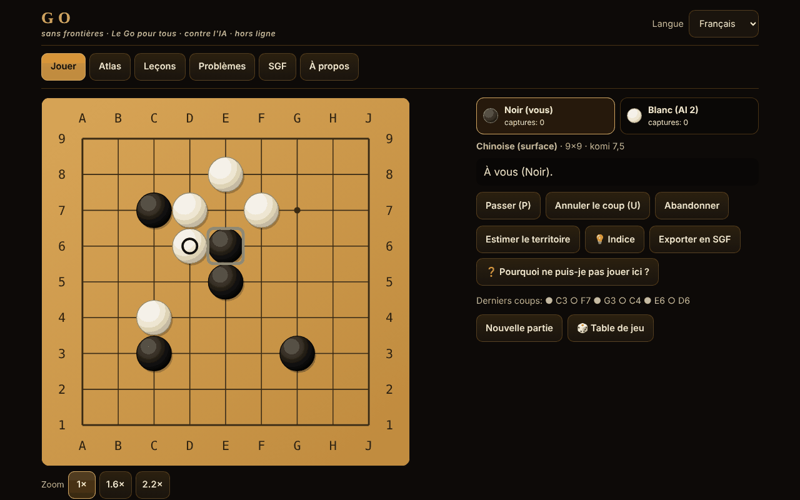

# Go fără frontiere

[English](README.md) · [Română](README.ro.md) · **Français** · [Italiano](README.it.md) · [Español](README.es.md) · [Português](README.pt.md) · [Deutsch](README.de.md) · [Magyar](README.hu.md)

**Version :** 1.2.1 · **Dernière mise à jour :** 2026-10-19

Langues de l'interface : **Română, English, Français, Italiano, Español, Português (PT), Deutsch, Magyar**

Le go (Baduk, Weiqi, Igo) dans un seul fichier HTML hors ligne : goban 5×5–19×19, quatre jeux de règles, adversaire IA (MCTS), 12 variantes jouables, leçons, problèmes de tsumego vérifiés par un solveur, et SGF.

**Application en ligne :** https://chiuta.github.io/Go-fara-frontiere/

## De quoi s'agit-il

Un atlas (18 fiches : origine, règles, approximations ⚠, sources) et une véritable partie de go contre un adversaire IA local (recherche arborescente Monte-Carlo, ni LLM ni réseau de neurones). Le moteur de règles est séparé de l'interface et testé sous Node. Aucune requête réseau.

## Fonctions (vérifiées dans le code et les tests)

- **Gobans :** 5×5, 7×7, 9×9, 13×13, 19×19 ; hoshi, coordonnées, grosses pierres en SVG redimensionnable ; marqueurs : dernier coup, ko, territoire estimé ; aperçu au survol.
- **Règles dans le code :** capture par libertés de chaîne ; suicide interdit (japonaises, chinoises, AGA) ou permis (Tromp–Taylor / personnalisé) ; ko simple, superko positionnel (PSK) et situationnel (SSK).
- **Jeux de règles :** japonaises (territoire + prisonniers, komi 6,5, ⚠), chinoises (surface, 7,5, ⚠), AGA (surface ; les pierres de passe ne comptent que pour la parité, elles ne s'ajoutent PAS au score en surface, 7,5, ⚠), Tromp–Taylor (formelles, score automatique, sans marquage des pierres mortes, 7,5), personnalisé. Komi modifiable ; avec handicap : japonaises/TT 0,5, AGA 0,5+(h−1), chinoises h.
- **Handicap 2–9** avec les positions standard sur 9×9, 13×13, 19×19.
- **Fin de partie :** deux passes → marquage des pierres mortes (clic sur un groupe) avec suggestion automatique de l'IA (avec confirmation) → score détaillé (pierres, territoire, prisonniers, komi, points neutres).
- **Modes :** contre l'IA (vous choisissez la couleur, ou au hasard), deux joueurs sur le même écran, Rengo 2 contre 2 (le partenaire et les adversaires peuvent être des IA), Phantom Go ⚠ contre l'IA.
- **IA :** MCTS (UCT + RAVE) avec simulations légères (captures/échappées d'atari, motifs 3×3, ne remplit pas ses propres yeux, évite le self-atari), 5 niveaux avec itérations et temps configurables, bouton « Arrêter / réfléchir moins », s'exécute dans un Web Worker (depuis un Blob) et, si ce n'est pas permis, sur le fil principal par tranches d'environ 20 ms.
- **Variantes d'atlas jouables :** Atari-Go (Capture Go / Ponnuki-Go : première capture ; en option objectif de 5 ou 10 pierres), go sur petit goban (5×5, 7×7), NoGo, Rengo, Phantom Go ⚠, byo-yomi avec pendule fonctionnelle (temps de base + périodes).
- **Suggestion** (💡, dans les parties à pierres visibles) : l'IA locale propose un coup pour vous (recherche Monte-Carlo, indicative), affiché comme un coup à confirmer ou annuler.
- **Sauvegarde automatique :** une partie inachevée est enregistrée localement après chaque coup ; à la prochaine ouverture, l'onglet « Jouer » propose « Continuer la partie » ou « Supprimer la sauvegarde » (vérifiée par rejeu ; les sauvegardes corrompues sont rejetées).
- **Leçons interactives** (6) : pierres, libertés, capture, ko, deux yeux, seki.
- **12 problèmes de tsumego**, chacun avec une solution confirmée par un solveur en force brute (voir « Ce que garantit le solveur ») ; retour correct/erroné avec la réponse de la défense ; « Montrer la solution » pas à pas.
- **SGF :** export (avec coups, handicap, komi, résultat) ; import et relecture avec un analyseur strict (FF[4], ligne principale uniquement, limites : 2 Mo, 30 000 nœuds, profondeur 256 ; rien n'est exécuté) ; « Continuer la partie d'ici ».
- **Interface :** clavier complet (flèches + Entrée, P = passer, U = annuler), mode « confirmer le coup » (par défaut sur écran tactile), zoom 1×/1,6×/2,2× sur mobile, 390 px sans défilement horizontal ; annulation seulement contre l'IA ou avec confirmation ; sans sons.
- **Interface en 8 langues** (RO/EN/FR/IT/ES/PT/DE/HU ; FR/IT/ES/PT/DE/HU sont traduites automatiquement, non vérifiées par des locuteurs natifs) avec détection automatique ; textes longs (atlas, leçons, « À propos ») : RO + EN ; en FR/IT/ES/PT/DE/HU, l'anglais est affiché, avec la note « texte en anglais ». La parité des clés est vérifiée par script.
- **Aléatoire :** `crypto.getRandomValues` avec échantillonnage par rejet (couleur aléatoire, graines de l'IA) ; option « Graine » pour des parties reproductibles.
- **Accessibilité :** aria-live, focus visible, cibles tactiles ≥ 44 px (mesuré), contraste ≥ 4,5:1 (mesuré), `prefers-reduced-motion`, `<noscript>`, `lang` dynamique.

## Nouvelles fonctions (1.1.0)

Toutes s'ouvrent depuis le bouton « Table de jeu » (parties à deux, analyse, défi du jour, tournoi, accessibilité). Il n'y a pas de serveur et aucune requête réseau n'est ajoutée en dehors de celles ci-dessous.

- **Partie à deux via FFF.p2p** (WebRTC, signalisation manuelle par texte ou code QR, sans serveur). L'hôte fait autorité ; l'invité n'applique que les coups numérotés renvoyés par l'hôte (lockstep, avec somme de contrôle de la position). Coup, passe, abandon, marquage des pierres mortes et confirmation du score sont synchronisés ; la nulle/nouvelle partie se proposent et s'acceptent. Limites : pas de pendule, pas d'IA, pas d'annulation de coup dans la partie en ligne, pas de reprise après rechargement de la page. L'adresse IP est visible de l'adversaire ; un NAT symétrique peut nécessiter STUN/TURN (STUN public facultatif, uniquement avec l'accord explicite dans la boîte de dialogue).
- **Analyseur local** : estimation de la probabilité de victoire et du score par MCTS à graine fixe (800/500/250 itérations selon la taille du goban), donc même résultat pour la même position ; « Revue » de la partie en cours avec graphique et les coups qui changent l'évaluation d'au moins 20 points. C'est une estimation statistique, pas un moteur de niveau professionnel.
- **Défi du jour** : goban 9×9 avec des pierres placées à partir de la date du calendrier (le même pour tous le même jour), plus le problème de tsumego du jour parmi les 12 existants ; série de jours consécutifs stockée localement. Sans réseau.
- **« Pourquoi je ne peux pas jouer ? »** : tout coup illégal reçoit une explication (point occupé, ko avec le coup interdit, superko avec le numéro du coup, suicide avec la taille de la chaîne, NoGo, etc.), annoncée aussi pour les lecteurs d'écran ; bouton dédié et touche `?`.
- **Clavier et annonces audio** : curseur sur le goban avec les flèches, Entrée/Espace pour jouer, `W` (état), `C` (coordonnées), `L` (dernier coup), `S` (score) ; région aria-live et, en option, voix (Web Speech, locale) via le module `tts` du kit.
- **Tournoi Elo local** : vous + adversaires IA (Elo 500 + 200·niveau), aller-retour, classement recalculé d'après les résultats ; les parties entre IA sont simulées sur 5×5/7×7/9×9 avec des itérations réduites (Tromp–Taylor) ; le classement Elo est relatif et indicatif.
- **Kit FFF** appliqué : `core, label, bundle, qr, p2p, tts` (la fenêtre de transparence, `app.json`). La CSP reste `default-src 'none'` ; seuls les hash des scripts ont été recalculés.

## Variantes

| Nom | Jouable ? | ⚠ Approximations |
|---|---|---|
| Go (classique), 9×9 / 13×13 / 19×19 | oui | — |
| Règles japonaises (territoire) | oui | ⚠ seki : les yeux à l'intérieur d'un seki ne sont pas détectés ; ko simple (sans « sans résultat ») ; pas de règles d'arbitrage |
| Règles chinoises (surface) | oui | ⚠ superko positionnel au lieu de la règle officielle de répétition ; komi 7,5 (valeur moderne) |
| Règles AGA | oui | ⚠ vérifiées à l'audit par rapport au texte AGA de 1991 ; situationnel choisi pour la répétition ; sans arbitrage |
| Tromp–Taylor | oui | — (formelles ; suicide permis, score automatique) |
| Go sur petit goban (5×5, 7×7) | oui | — |
| Handicap 2–9 | oui | ⚠ positions traditionnelles seulement sur 19×19 ; sur 9×9/13×13 extrapolées (vérifié à l'audit) |
| Atari-Go / Capture Go / Ponnuki-Go (objectif 1, 5 ou 10) | oui | — |
| NoGo | oui | — (celui qui n'a plus de coup légal perd) |
| Rengo 2 contre 2 | oui | — (les joueurs de l'équipe jouent à tour de rôle ; IA pour les places libres) |
| Phantom Go | oui | ⚠ l'IA ne connaît pas vos pierres cachées et peut essayer des points occupés ; score en surface ; pas d'export SGF pendant la partie |
| Byo-yomi | oui | — (pendule avec périodes ; on perd au dépassement) |
| Go en paire, torique, hexagonal, à trois, Ing, Nouvelle-Zélande | seulement dans l'atlas | — |

## Ce que garantit le solveur de tsumego

Pour chaque problème, une recherche alpha-bêta avec table de transposition, sur la petite zone affichée, a confirmé que le premier coup indiqué permet au joueur de forcer l'objectif (groupe cible capturé, ou vivant inconditionnellement selon l'algorithme de Benson) en au plus D demi-coups contre TOUTE défense, y compris une passe ; l'ensemble des coups gagnants a aussi été vérifié à D+2. Il ne garantit pas : le ko, le seki ou « vivant en seki » ne comptent pas comme un succès ; seulement le ko simple ; la zone est isolée (les murs marqués d'un carré sont permanents) ; il ne prétend pas à l'unicité dans la partie entière. Les 12 problèmes sont : 6 formes d'espace d'yeux (3 en ligne, 3 coudé, 4 en T, 4 carré, 5 en tas, 5 en croix) à tuer, 4 à rendre vivantes, et 2 petites captures trouvées par la recherche. Un ensemble plus riche de tesuji (snapback, échelle, filet) n'a pas été inclus : je n'ai pas trouvé de problèmes que le solveur confirme et qui soient en même temps naturels.

## Mode d'emploi

1. Onglet « Jouer » : choisissez la variante, le goban, le jeu de règles, le mode et le niveau de l'IA ; « Commencer la partie ». (Ou depuis « Atlas » → « ▶ Jouer » pour un préréglage.)
2. Jouez par clic/toucher (sur mobile vous confirmez le coup) ou au clavier : flèches = curseur, Entrée = poser la pierre, P = passer, U = annuler.
3. Le bouton « Estimer le territoire » affiche une estimation statistique ; « Arrêter / réfléchir moins » raccourcit la réflexion de l'IA.
4. Après deux passes, vous marquez les pierres mortes : clic sur un groupe (ou « Suggérer automatiquement »), puis « Confirmer le score ». En Tromp–Taylor, le score est automatique.
5. « Exporter SGF » télécharge la partie ; l'onglet « SGF » charge et rejoue un fichier ou un texte collé.
6. « Leçons » et « Problèmes » donnent un retour immédiat ; la progression est conservée localement (si le navigateur le permet).

## Niveau de l'IA (description honnête)

Ce n'est pas un LLM et elle n'a pas de réseau de neurones. MCTS avec simulations légères : ~7 700 simulations/s sur 9×9 et ~1 600/s sur 19×19 sous Node (la machine de test) ; dans le navigateur, cela varie. Les niveaux 1–5 correspondent à 0 / 100 / 500 / 2 500 / 10 000 itérations (avec limite de temps). Mesuré sur 9×9, komi 7,5, règles chinoises, couleurs alternées (`tests/match.js`, `tests/vs_random.js`) :

| Match (9×9, komi 7,5, couleurs alternées) | Résultat | Parties |
|---|---|---|
| Niveau 1 (heuristique, 0 itération) contre aléatoire | 34–6 (85 %) | 40 |
| Niveau 2 (100 itérations) contre aléatoire | 100–0 (100 %) | 100 |
| Niveau 3 (500 itérations) contre aléatoire | 40–0 (100 %) | 40 |
| Niveau 2 contre niveau 1 | 40–0 | 40 |
| Niveau 3 contre niveau 2 | 31–9 (78 %) | 40 |
| Niveau 4 (2 500) contre niveau 3 | 21–9 (70 %) | 30 |
| Niveau 5 (10 000) contre niveau 4 | 15–5 (75 %) | 20 |

Avec 20 à 40 parties, l'intervalle de confiance (95 %) est de l'ordre de ±15–20 points de pourcentage pour les lignes de ≤ 40 parties ; les écarts entre niveaux sont réels, mais les valeurs exactes ne le sont pas. Les matchs sont IA contre IA (même moteur), donc les écarts de force entre niveaux sont probablement surestimés par rapport à des humains.

Le rang n'est PAS mesuré (il n'y a pas de moteur classé ni de joueurs humains de référence dans l'environnement de construction) ; tout équivalent en kyu serait de la spéculation, donc aucun n'est affirmé. Les niveaux 1–2 s'adressent aux débutants absolus. Sur 19×19, elle est beaucoup plus faible et plus lente. L'IA ne triche pas : elle reçoit seulement le goban, l'historique des coups et les règles ; en Phantom Go, elle ne joue qu'avec ses propres pierres et celles qui ont été révélées.

## Tests (tour 8)

`tests/fff-r8.test.mjs` (Playwright, réseau bloqué, `node tests/fff-r8.test.mjs`) : 10 sections, 120 vérifications, 0 échec — P2P entre deux pages (loopback), analyseur déterministe, défi du jour déterminé par la date, explications des coups illégaux, clavier, tournoi Elo, axe-core avec 0 violation (y compris les boîtes de dialogue et la fenêtre du kit), 0 `pageerror`/violation de CSP, sans débordement horizontal à 360×740 et 1280×800. L'application n'existe qu'en thème sombre, donc le contraste n'est vérifié que dans un seul thème.

## Tests antérieurs (hors du paquet)

Exécutés depuis `scratchpad/new/games_work/Go-fara-frontiere/` (hors du paquet) :

- `node tests/run.js` — 158 vérifications, 0 échec : configurations classiques (échelle/ladder et snapback trouvés par recherche et rejoués avec l'implémentation de référence, ko, seki, suicide, capture avant suicide), superko, score japonais vs chinois sur des positions au résultat calculé à la main (identité de score : différence de surface moins différence de territoire = pierres posées par Noir moins pierres posées par Blanc, d'après Sensei's Library), handicap, pendule byo-yomi, SGF (aller-retour sur 600 parties générées ; rejet des fichiers trop gros, trop profondément imbriqués, aux valeurs énormes ou malformés).
- Comparaison avec une implémentation de référence indépendante (flood-fill brut) : 100 000 positions aléatoires dans 588 parties, 602 976 vérifications de légalité, 0 divergence (dans `tests/run.js`).
- `node tests/fuzz.js 9 500` — 500 parties IA contre IA sur 9×9 (52 291 coups), chaque coup validé par la référence : 0 coup illégal, 0 invariant violé. `node tests/fuzz.js 13 100` — 100 parties sur 13×13 (20 839 coups) : 0 illégal. `node tests/fuzz.js var 120` — NoGo / Capture-Go : 0 illégal.
- `node tests/vs_random.js 100 100` — le MCTS à 100 itérations bat le joueur aléatoire 100–0 sur 9×9 (exigence ≥ 95 %).
- `node tests/tsume_verify.js` — résout à nouveau les 12 problèmes : solution stockée, profondeur minimale, stabilité à D+2, réfutation de chaque mauvais coup.
- `node tests/i18n-parity.js` — 254 clés × 7 langues, espaces réservés identiques, toutes les clés utilisées dans le code existent. `node tests/rng.js` (uniformité de `secureInt`, graine reproductible), `node tests/contrast.js` (≥ 4,5:1), `node tests/stamp_overflow.js` (régression pour une erreur trouvée dans les longues parties : dépassement du compteur Int32 du flood-fill).
- Playwright (`pw/ui.js`, `pw/ui2.js`, `pw/ui3.js`) : 84 vérifications d'interface, 0 échec — clavier, annulation, changement de langue, export/import SGF, SGF invalide rejeté, résolution par l'interface des 12 problèmes, partie 5×5 complète jusqu'au marquage et au score, les 12 préréglages jouables, estimation du territoire, pendule byo-yomi, mobile 390 px (sans défilement horizontal, cibles ≥ 44 px, confirmation du coup), `localStorage` bloqué, sans Worker (repli), 0 requête réseau, 0 erreur de console.

## Confidentialité et réseau

Sans compte ni télémétrie ; par défaut, aucune requête réseau. Ce n'est que si vous lancez explicitement « Partie à deux » qu'une connexion WebRTC directe s'ouvre vers l'adversaire (signalisation copiée manuellement ; STUN public seulement avec accord explicite). CSP stricte (`default-src 'none'`, script autorisé uniquement par hash SHA-256, `worker-src blob:`, sans `connect-src`). `localStorage` (dans un try/catch) uniquement pour la langue, les réglages, les problèmes résolus, les statistiques locales et la sauvegarde automatique d'une seule partie inachevée (`gff.save.v1` : les réglages, les coups, votre couleur et la graine ; pas pour Phantom Go ni les parties avec pendule ; supprimée à la fin de la partie ou avec « Supprimer la sauvegarde »). Les liens Buy Me a Coffee du pied de page ne s'ouvrent qu'au clic (`rel=noopener`).

## Limites et avertissements

- Les règles (komi, ko, suicide, seki, score, handicap) ont été vérifiées à l'audit par rapport à Wikipédia « Rules of Go »/« Komi », au texte AGA de 1991 (British Go Association) et aux règles japonaises de 1989 (CMU) ; des corrections en ont résulté (pierres de passe AGA, komi avec handicap). Les règles chinoises officielles et celles de la Nihon Ki-in 2003 n'ont pas pu être lues en entier (⚠).
- « Graine » ne reproduit la partie que si l'IA n'est pas arrêtée par la limite de temps (les itérations peuvent varier selon la vitesse de la machine).
- Seki : les points à libertés communes sont neutres, mais les yeux à l'intérieur d'un seki ne sont pas détectés ; ko simple sans « sans résultat » aux règles japonaises ; limite de sécurité à 4·n² coups (nulle).
- L'estimation du territoire et la suggestion des pierres mortes sont statistiques et peuvent se tromper.
- Phantom Go est approximé (l'IA n'a aucune information sur vos pierres cachées ; elle peut essayer des points occupés).
- L'IA est faible sur 19×19 ; ce n'est pas un joueur de niveau club.
- Les variantes « seulement dans l'atlas » ne sont pas implémentées.
- Partie à deux : sans pendule/IA/annulation, sans reprise après rechargement ; le SGF et les captures ne sont pas synchronisés séparément. L'analyseur et les simulations du tournoi utilisent des itérations réduites et sont approximatifs.

## Sources

Sensei's Library (Japanese rules, Chinese rules, AGA rules, Tromp–Taylor rules, Ko, Superko, Komi, Handicap, Seki, Scoring) · les règles Tromp–Taylor · American Go Association · la spécification SGF FF[4] · D. B. Benson (1976, vie inconditionnelle) · Kocsis & Szepesvári (2006, UCT) · Gelly & Silver (2007, RAVE). Partiellement vérifiées en ligne lors de l'audit (voir le rapport d'audit).

## Exécution locale

Téléchargez `index.html` et ouvrez-le dans un navigateur ; il fonctionne sans internet.

## Historique / Changelog

### 14 octobre 2026 — version 1.1.0
- Partie à deux via FFF.p2p (lockstep), analyseur local, défi du jour, « pourquoi je ne peux pas jouer ? », jeu au clavier avec annonces audio, tournoi Elo local ; langue hongroise (partielle) ; kit FFF (`core,label,bundle,qr,p2p,tts`) ; tests `tests/fff-r8.test.mjs`. Sans régression des règles (moteur de jeu inchangé).

### 12 octobre 2026 — version 1.0.0
- 1.0.0 — 2026-10-12 : la version et la date de dernière mise à jour sont affichées dans l'application

### 11 octobre 2026 (troisième passe)
- Note sur le komi avec handicap (RO/EN) : AGA « h−0,5 » et « 0,5 + (h−1) » sont la même valeur, désormais formulée comme telle (auparavant on aurait cru à deux formules). CSP : hash recalculé.

### 11 octobre 2026 (deuxième passe)
- Sauvegarde automatique de la partie en cours avec « Continuer la partie » (validation stricte + rejeu, nouveau texte dans les 7 langues) ; bouton « Suggestion » qui propose un coup avec le moteur MCTS local ; CSP : hash recalculé.

### 11 octobre 2026
- Accessibilité : la barre d'onglets est encadrée par un repère `<nav>`, le widget de soutien a un rôle de repère ; axe-core signale 0 violation à 1280 et 360 px.
- HTML réparé : suppression d'un `</body></html>` en double à la fin du fichier ; le hash CSP du script a été recalculé (vérifié avec la CSP active, sans contournement).
- Licence : la mention « licence non déclarée » de l'application a été remplacée par la licence MIT, conformément au fichier `LICENSE`.

## Licence

MIT — voir le fichier `LICENSE`

## Auteur

Alexio — Alexandru-Ionuț Chiuță · alexio@trom.tf

## Résumé

Go hors ligne en un seul fichier (Baduk/Weiqi/Igo) : 5×5–19×19, règles japonaises/chinoises/AGA/Tromp–Taylor (approximations ⚠ documentées), handicap 2–9, IA MCTS (5 niveaux, Web Worker), deux joueurs, Rengo 2 contre 2, Atari-Go/Ponnuki-Go, NoGo, Phantom Go ⚠, pendule byo-yomi, 6 leçons interactives, 12 problèmes de tsumego confirmés chacun par un solveur en force brute, import/export SGF avec analyseur strict. Interface en 8 langues (6 traduites automatiquement, non vérifiées ), textes longs RO+EN. Nouveautés de la 1.1.0 : partie à deux via WebRTC avec signalisation manuelle/QR (sans serveur, lockstep), analyseur MCTS local à graine fixe et revue de partie, défi du jour fondé sur la date, explications « pourquoi je ne peux pas jouer ? », jeu au clavier avec annonces vocales, tournoi Elo local. Moteur testé contre une référence indépendante par flood-fill sur 100 000 positions aléatoires, 500 parties IA contre IA sur 9×9 et 100 sur 13×13 sans coup illégal. Sans réseau, sans télémétrie. Licence : MIT (voir LICENSE).
