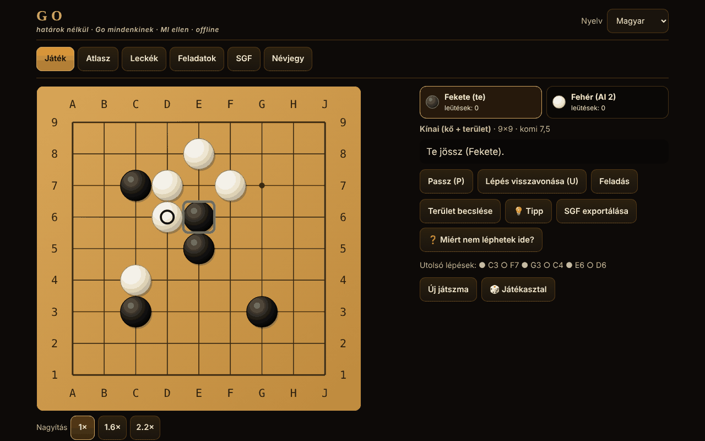

# Go fără frontiere

[English](README.md) · [Română](README.ro.md) · [Français](README.fr.md) · [Italiano](README.it.md) · [Español](README.es.md) · [Português](README.pt.md) · [Deutsch](README.de.md) · **Magyar**

**Verzió:** 1.2.8 · **Utolsó frissítés:** 2026-10-23

A felület nyelvei: **Română, English, Français, Italiano, Español, Português (PT), Deutsch, Magyar**

A Go (Baduk, Weiqi, Igo) egyetlen offline HTML-fájlban: 5×5–19×19-es tábla, négy szabályrendszer, MI-ellenfél (MCTS), 12 játszható változat, leckék, megoldóval ellenőrzött tsumego-feladatok és SGF.

**Online alkalmazás:** https://chiuta.github.io/Go-fara-frontiere/

## Mi ez

Egy atlasz (18 adatlap: eredet, szabályok, közelítések ⚠, források) és egy valódi Go-játszma egy helyi MI-ellenfél ellen (Monte-Carlo fakeresés, nem LLM, nem neurális háló). A szabálymotor el van választva a felülettől, és Node-ban tesztelt. Nincsenek hálózati kérések.

## Funkciók (a kódban és a tesztekben ellenőrizve)

- **Táblák:** 5×5, 7×7, 9×9, 13×13, 19×19; hoshi, koordináták, nagy kövek skálázható SVG-ben; jelölések: utolsó lépés, ko, becsült terület; előnézet az egérmutató fölé húzáskor.
- **Szabályok a kódban:** leütés a lánc szabadságai szerint; öngyilkosság tiltott (japán, kínai, AGA) vagy megengedett (Tromp–Taylor / egyéni); egyszerű ko, pozíciós szuperko (PSK) és szituációs szuperko (SSK).
- **Szabályrendszerek:** japán (terület + foglyok, komi 6,5, ⚠), kínai (felület, 7,5, ⚠), AGA (felület; a passzkövek csak a paritás miatt számítanak, NEM adódnak hozzá a felületi pontszámhoz, 7,5, ⚠), Tromp–Taylor (formális, automatikus pontozás, a halott kövek jelölése nélkül, 7,5), egyéni. A komi szerkeszthető; előnyadással: japán/TT 0,5, AGA 0,5+(h−1), kínai h.
- **Előnyadás 2–9** szabványos pozíciókkal 9×9, 13×13, 19×19 táblán.
- **A játszma vége:** két passz → a halott kövek jelölése (kattintás egy csoportra) az MI automatikus javaslatával (megerősítéssel) → részletes pontszám (kövek, terület, foglyok, komi, semleges pontok).
- **Módok:** MI ellen (te választod a színt, vagy véletlenszerű), két játékos ugyanazon a képernyőn, 2:2 Rengo (a társ és az ellenfelek lehetnek MI-k), Phantom Go ⚠ MI ellen.
- **MI:** MCTS (UCT + RAVE) könnyű szimulációkkal (leütések/menekülések atariból, 3×3-as minták, nem tölti ki a saját szemeit, kerüli a self-atarit), 5 szint beállítható iterációkkal és idővel, „Leállítás / kevesebb gondolkodás” gomb, Web Workerben fut (Blobból), és ha ez nem engedélyezett, a fő szálon ~20 ms-os szeletekben.
- **Játszható atlaszváltozatok:** Atari-Go (Capture Go / Ponnuki-Go: az első leütés; opcionálisan 5 vagy 10 kő a cél), Go kis táblán (5×5, 7×7), NoGo, Rengo, Phantom Go ⚠, Byo-yomi működő órával (alapidő + periódusok).
- **Tipp** (💡, látható köves játszmákban): a helyi MI javasol neked egy lépést (Monte-Carlo-keresés, tájékoztató jellegű), megerősítendő vagy visszavonandó lépésként megjelenítve.
- **Automatikus mentés:** a befejezetlen játszma minden lépés után helyben mentődik; a következő megnyitáskor a „Játék” fül a „Játszma folytatása” vagy a „Mentés törlése” lehetőséget kínálja (visszajátszással ellenőrizve; a sérült mentések elutasításra kerülnek).
- **Interaktív leckék** (6): kövek, szabadságok, leütés, ko, két szem, seki.
- **12 tsumego-feladat**, mindegyikhez nyers erős megoldóval megerősített megoldás tartozik (lásd „Mit garantál a megoldó”); helyes/hibás visszajelzés a védekezés válaszával; „A megoldás mutatása” lépésről lépésre.
- **SGF:** export (lépésekkel, előnyadással, komival, eredménnyel); import és visszajátszás szigorú elemzővel (FF[4], csak a főág, korlátok: 2 MB, 30 000 csomópont, 256 mélység; semmi nem hajtódik végre); „A játék folytatása innen”.
- **Felület:** teljes billentyűzetes vezérlés (nyilak + Enter, P = passz, U = visszavonás), „lépés megerősítése” mód (érintőképernyőn alapértelmezett), 1×/1,6×/2,2×-es nagyítás mobilon, 390 px vízszintes görgetés nélkül; visszavonás csak MI ellen vagy megerősítéssel; hangok nélkül.
- **Felület és tartalom 8 nyelven** (RO/EN/FR/IT/ES/PT/DE/HU; az FR/IT/ES/PT/DE/HU gépi fordítás, anyanyelvi beszélők nem ellenőrizték) automatikus felismeréssel; a hosszú szövegek (az atlasz, a 6 interaktív lecke, a tsume-feladatok nevei, a „Névjegy”, a komi-megjegyzés) szintén le vannak fordítva minden nyelvre. Változatlanul marad: az atlaszlapok „források” mezője (hivatkozások, tulajdonnevek) és az „Ecoul Stringurilor” művésznév. A kulcsok paritását szkript ellenőrzi. A go-terminológiát (pl. hu „felület” a területpontozásra) érdemes anyanyelvi játékossal átnézetni.
- **Véletlenszerűség:** `crypto.getRandomValues` elutasításos mintavételezéssel (véletlen szín, az MI seedjei); „Seed” opció reprodukálható játszmákhoz.
- **Hozzáférhetőség:** aria-live, látható fókusz, érintési célpontok ≥ 44 px (mérve), kontraszt ≥ 4,5:1 (mérve), `prefers-reduced-motion`, `<noscript>`, dinamikus `lang`.

## Új funkciók (1.1.0)

Mindegyik a „Játékasztal” gombról nyílik meg (kétszemélyes játszmák, elemzés, a nap kihívása, torna, hozzáférhetőség). Nincs szerver, és az alábbiakon kívül nem adódnak hozzá hálózati kérések.

- **Kétszemélyes játék az FFF.p2p-n keresztül** (WebRTC, kézi jelzés szövegen vagy QR-kódon keresztül, szerver nélkül). A házigazda a mérvadó; a vendég csak a házigazda által visszaadott, számozott lépéseket alkalmazza (lockstep, a pozíció ellenőrző összegével). A lépés, a passz, a feladás, a halott kövek jelölése és a pontszám megerősítése szinkronizált; a döntetlent/új játszmát javasolják és elfogadják. Korlátok: nincs óra, nincs MI, nincs lépésvisszavonás az online játszmában, nincs folytatás az oldal újratöltése után. Az IP-cím látható az ellenfél számára; a szimmetrikus NAT STUN/TURN-t igényelhet (nyilvános STUN opcionális, csak a párbeszédablakban adott kifejezett hozzájárulással).
- **Helyi elemző**: nyerési valószínűség és pontszám becslése rögzített seedű MCTS-sel (800/500/250 iteráció a tábla méretétől függően), tehát ugyanarra a pozícióra ugyanaz az eredmény; az aktuális játszma „Áttekintése” grafikonnal és az értékelést ≥ 20 ponttal megváltoztató lépésekkel. Statisztikai becslés, nem professzionális szintű motor.
- **A nap kihívása**: 9×9-es tábla a naptári dátumból elhelyezett kövekkel (ugyanazon a napon mindenkinek ugyanaz), valamint a nap tsumego-feladata a meglévő 12-ből; az egymást követő napok sorozata helyben tárolva. Hálózat nélkül.
- **„Miért nem léphetek?”**: minden szabálytalan lépés magyarázatot kap (foglalt pont, ko a tiltott lépéssel, szuperko a lépés számával, öngyilkosság a lánc méretével, NoGo stb.), amelyet képernyőolvasók számára is bemondanak; külön gomb és a `?` billentyű.
- **Billentyűzet és hangbejelentések**: kurzor a táblán a nyilakkal, Enter/Szóköz a lépéshez, `W` (állás), `C` (koordináták), `L` (utolsó lépés), `S` (pontszám); aria-live régió és opcionálisan hang (Web Speech, helyi) a kit `tts` moduljával.
- **Helyi Elo-torna**: te + MI-ellenfelek (Elo 500 + 200·szint), oda-vissza vágó, az eredményekből újraszámolt ranglista; az MI-k közötti játszmák 5×5/7×7/9×9 táblán, csökkentett iterációkkal szimulálódnak (Tromp–Taylor); az Elo-ranglista relatív és tájékoztató jellegű.
- **FFF kit** alkalmazva: `core, label, bundle, qr, p2p, tts` (az átláthatósági ablak, `app.json`). A CSP továbbra is `default-src 'none'`; csak a szkriptek hash-ei lettek újraszámolva.

## Változatok

| Név | Játszható? | ⚠ Közelítések |
|---|---|---|
| Go (klasszikus), 9×9 / 13×13 / 19×19 | igen | — |
| Japán szabályok (terület) | igen | ⚠ seki: a sekin belüli szemeket nem ismeri fel; egyszerű ko (az „eredmény nélkül” hiányzik); nincsenek döntőbírói szabályok |
| Kínai szabályok (felület) | igen | ⚠ pozíciós szuperko a hivatalos ismétlési szabály helyett; komi 7,5 (a modern érték) |
| AGA-szabályok | igen | ⚠ az auditban az 1991-es AGA-szöveggel összevetve ellenőrizve; az ismétléshez szituációs szuperko van választva; döntőbíráskodás nélkül |
| Tromp–Taylor | igen | — (formális; az öngyilkosság megengedett, automatikus pontozás) |
| Go kis táblán (5×5, 7×7) | igen | — |
| Előnyadás 2–9 | igen | ⚠ hagyományos pozíciók csak 19×19-en; 9×9/13×13-on extrapolált (az auditban ellenőrizve) |
| Atari-Go / Capture Go / Ponnuki-Go (cél 1, 5 vagy 10) | igen | — |
| NoGo | igen | — (az veszít, akinek nincs több szabályos lépése) |
| 2:2 Rengo | igen | — (a csapat játékosai felváltva lépnek; MI a szabad helyekre) |
| Phantom Go | igen | ⚠ az MI nem ismeri a rejtett köveidet, és foglalt pontokat próbálhat; felületi pontozás; játék közben nincs SGF-export |
| Byo-yomi | igen | — (periódusos óra; túllépéskor veszítesz) |
| Páros Go, toroidális, hexagonális, hármas, Ing, új-zélandi | csak az atlaszban | — |

## Mit garantál a tsumego-megoldó

Minden feladatnál egy transzpozíciós táblás alfa-béta keresés a megjelenített kis területen megerősítette, hogy a jelzett első lépés lehetővé teszi a játékos számára a cél kikényszerítését (a célcsoport leütése, vagy Benson algoritmusa szerint feltétel nélkül él) legfeljebb D fél lépésben BÁRMILYEN védekezés ellen, passzt is beleértve; a nyerő lépések halmazát D+2-nél is ellenőriztük. Nem garantálja: a ko, a seki vagy az „él sekiben” nem számít sikernek; csak egyszerű ko; a terület izolált (a négyzettel jelölt falak állandóak); nem állítja az egyediséget a teljes játszmában. A 12 feladat: 6 szemtérforma (3 egy sorban, 3 hajlított, 4 T, 4 négyzet, 5 csomó, 5 kereszt) megölendő, 4 élővé teendő, és 2 kis leütés, amelyet keresés talált. A tesujik gazdagabb készletét (snapback, létra, háló) nem vettük fel: nem találtam olyan feladatot, amelyet a megoldó megerősít, és egyben természetes is.

## Használati útmutató

1. „Játék” fül: válaszd ki a változatot, a táblát, a szabályrendszert, a módot és az MI szintjét; „Játszma indítása”. (Vagy az „Atlasz” → „▶ Játék” útján egy előbeállításhoz.)
2. Lépj kattintással/érintéssel (mobilon megerősíted a lépést) vagy billentyűzettel: nyilak = kurzor, Enter = kő lerakása, P = passz, U = visszavonás.
3. A „Terület becslése” gomb statisztikai becslést jelenít meg; a „Leállítás / kevesebb gondolkodás” lerövidíti az MI gondolkodását.
4. Két passz után megjelölöd a halott köveket: kattints egy csoportra (vagy „Automatikus javaslat”), majd „Pontszám megerősítése”. Tromp–Taylor szabállyal a pontozás automatikus.
5. Az „SGF exportálása” letölti a játszmát; az „SGF” fül betölt és visszajátszik egy fájlt vagy egy beillesztett szöveget.
6. A „Leckék” és a „Feladatok” azonnali visszajelzést adnak; a haladás helyben tárolódik (ha a böngésző engedi).

## Az MI szintje (őszinte leírás)

Nem LLM, és nincs neurális hálója. MCTS könnyű szimulációkkal: ~7700 szimuláció/s 9×9-en és ~1600/s 19×19-en Node-ban (a tesztgép); a böngészőben ez változik. Az 1–5. szint 0 / 100 / 500 / 2500 / 10 000 iterációt jelent (időkorláttal). Mérve 9×9-en, komi 7,5, kínai szabályok, váltakozó színek (`tests/match.js`, `tests/vs_random.js`):

| Mérkőzés (9×9, komi 7,5, váltakozó színek) | Eredmény | Játszmák |
|---|---|---|
| 1. szint (heurisztikus, 0 iteráció) a véletlen ellen | 34–6 (85 %) | 40 |
| 2. szint (100 iteráció) a véletlen ellen | 100–0 (100 %) | 100 |
| 3. szint (500 iteráció) a véletlen ellen | 40–0 (100 %) | 40 |
| 2. szint az 1. szint ellen | 40–0 | 40 |
| 3. szint a 2. szint ellen | 31–9 (78 %) | 40 |
| 4. szint (2500) a 3. szint ellen | 21–9 (70 %) | 30 |
| 5. szint (10 000) a 4. szint ellen | 15–5 (75 %) | 20 |

20–40 játszmánál a konfidenciaintervallum (95 %) a ≤ 40 játszmás soroknál ±15–20 százalékpont nagyságrendű; a szintek közötti különbségek valósak, de a pontos értékek nem. A mérkőzések MI az MI ellen (ugyanaz a motor), ezért a szintek közötti erőkülönbségek az emberekhez képest valószínűleg túlbecsültek.

A rang NINCS megmérve (a fordítási környezetben nincs besorolt motor vagy emberi referenciajátékos); bármilyen kyu-egyenérték puszta találgatás lenne, ezért egyet sem állítunk. Az 1–2. szint abszolút kezdőknek való. 19×19-en sokkal gyengébb és lassabb. Az MI nem csal: csak a táblát, a lépéstörténetet és a szabályokat kapja; a Phantom Goban csak a saját és a felfedett kövekkel játszik.

## Tesztek (8. kör)

`tests/fff-r8.test.mjs` (Playwright, blokkolt hálózat, `node tests/fff-r8.test.mjs`): 10 szakasz, 120 ellenőrzés, 0 hiba — P2P két oldal között (loopback), determinisztikus elemző, a dátum által meghatározott napi kihívás, magyarázatok szabálytalan lépésekhez, billentyűzet, Elo-torna, axe-core 0 szabálysértéssel (a párbeszédablakokat és a kit ablakát is beleértve), 0 `pageerror`/CSP-szabálysértés, nincs vízszintes túlcsordulás 360×740 és 1280×800 mellett. Az alkalmazás csak sötét témájú, ezért a kontrasztot egyetlen témában ellenőrizzük.

## Korábbi tesztek (a csomagon kívül)

A `scratchpad/new/games_work/Go-fara-frontiere/` könyvtárból futtatva (a csomagon kívül):

- `node tests/run.js` — 158 ellenőrzés, 0 hiba: klasszikus konfigurációk (létra/ladder és snapback keresés útján megtalálva és a referencia-megvalósítással visszajátszva, ko, seki, öngyilkosság, leütés az öngyilkosság előtt), szuperko, japán vs kínai pontozás kézzel kiszámolt eredményű pozíciókon (pontszám-azonosság: a felületkülönbség mínusz a területkülönbség = a Fekete által lerakott kövek mínusz a Fehér által lerakott kövek, a Sensei's Library szerint), előnyadás, byo-yomi óra, SGF (oda-vissza 600 generált játszmán; a túl nagy, túl mélyen egymásba ágyazott, óriási értékeket tartalmazó vagy hibás fájlok elutasítása).
- Összevetés egy független referencia-megvalósítással (nyers flood-fill): 100 000 véletlen pozíció 588 játszmában, 602 976 szabályosság-ellenőrzés, 0 eltérés (a `tests/run.js`-ben).
- `node tests/fuzz.js 9 500` — 500 MI–MI játszma 9×9-en (52 291 lépés), minden lépést a referencia ellenőrzött: 0 szabálytalan lépés, 0 megsértett invariáns. `node tests/fuzz.js 13 100` — 100 játszma 13×13-on (20 839 lépés): 0 szabálytalan. `node tests/fuzz.js var 120` — NoGo / Capture-Go: 0 szabálytalan.
- `node tests/vs_random.js 100 100` — a 100 iterációs MCTS 100–0-ra legyőzi a véletlen játékost 9×9-en (követelmény ≥ 95 %).
- `node tests/tsume_verify.js` — újra megoldja a 12 feladatot: a tárolt megoldás, a minimális mélység, a stabilitás D+2-nél, minden rossz lépés cáfolata.
- `node tests/i18n-parity.js` — 254 kulcs × 7 nyelv, azonos helyőrzők, a kódban használt összes kulcs létezik. `node tests/rng.js` (a `secureInt` egyenletessége, reprodukálható seed), `node tests/contrast.js` (≥ 4,5:1), `node tests/stamp_overflow.js` (regresszió egy hosszú játszmákban talált hibára: a flood-fill Int32-számlálójának túlcsordulása).
- Playwright (`pw/ui.js`, `pw/ui2.js`, `pw/ui3.js`): 84 felületellenőrzés, 0 hiba — billentyűzet, visszavonás, nyelvváltás, SGF-export/-import, érvénytelen SGF elutasítva, mind a 12 feladat megoldása a felületen, teljes 5×5-ös játszma a jelölésig és a pontozásig, mind a 12 játszható előbeállítás, területbecslés, byo-yomi óra, mobil 390 px (vízszintes görgetés nélkül, célpontok ≥ 44 px, lépésmegerősítés), blokkolt `localStorage`, Worker nélkül (tartalék), 0 hálózati kérés, 0 konzolhiba.

## Adatvédelem és hálózat

Fiók és telemetria nélkül; alapértelmezetten nincs hálózati kérés. Csak ha kifejezetten elindítod a „Kétszemélyes játékot”, nyílik közvetlen WebRTC-kapcsolat az ellenféllel (kézzel másolt jelzéssel; nyilvános STUN csak kifejezett hozzájárulással). Szigorú CSP (`default-src 'none'`, a szkript csak SHA-256-hash útján engedélyezett, `worker-src blob:`, `connect-src` nélkül). `localStorage` (try/catch-ben) csak a nyelvhez, a beállításokhoz, a megoldott feladatokhoz, a helyi statisztikákhoz és egyetlen befejezetlen játszma automatikus mentéséhez (`go-fara-frontiere.save.v1`: a beállítások, a lépések, a te színed és a seed; nem Phantom Gohoz vagy órás játszmákhoz; a játszma végén vagy a „Mentés törlése” gombbal törlődik). A láblécben lévő Buy Me a Coffee hivatkozások csak kattintásra nyílnak meg (`rel=noopener`).

## Korlátok és figyelmeztetések

- A szabályokat (komi, ko, öngyilkosság, seki, pontozás, előnyadás) az auditban a Wikipedia „Rules of Go”/„Komi” cikkeivel, az 1991-es AGA-szöveggel (British Go Association) és az 1989-es japán szabályokkal (CMU) vetettük össze; ebből javítások születtek (AGA passzkövek, komi előnyadásnál). A hivatalos kínai szabályokat és a Nihon Ki-in 2003-as szabályait nem lehetett teljes egészében elolvasni (⚠).
- A „Seed” csak akkor reprodukálja a játszmát, ha az MI-t nem állítja le az időkorlát (az iterációk a gép sebességétől függően változhatnak).
- Seki: a közös szabadságú pontok semlegesek, de a sekin belüli szemeket nem ismeri fel; egyszerű ko az „eredmény nélkül” hiányával a japán szabályoknál; biztonsági korlát 4·n² lépésnél (döntetlen).
- A területbecslés és a halott kövek javaslata statisztikai, és tévedhet.
- A Phantom Go közelített (az MI-nek nincs információja a rejtett köveidről; foglalt pontokat próbálhat).
- Az MI gyenge 19×19-en; nem klubszintű játékos.
- A „csak az atlaszban” változatok nincsenek megvalósítva.
- Kétszemélyes játék: óra/MI/visszavonás nélkül, újratöltés utáni folytatás nélkül; az SGF-et és a leütéseket nem szinkronizálják külön. Az elemző és a torna szimulációi csökkentett iterációkat használnak, és közelítők.

## Források

Sensei's Library (Japanese rules, Chinese rules, AGA rules, Tromp–Taylor rules, Ko, Superko, Komi, Handicap, Seki, Scoring) · a Tromp–Taylor-szabályok · American Go Association · az SGF FF[4] specifikáció · D. B. Benson (1976, feltétel nélküli élet) · Kocsis & Szepesvári (2006, UCT) · Gelly & Silver (2007, RAVE). Az auditban részben online ellenőrizve (lásd az auditjelentést).

## Helyi futtatás

Töltsd le az `index.html` fájlt, és nyisd meg a böngészőben; internet nélkül is működik.

## Előzmények / Changelog

### 1.2.8 — 2026-10-23

- Tárolás: a kulcsok mostantól az alkalmazás előtagját viselik (`go-fara-frontiere.prefs.v1`, `go-fara-frontiere.save.v1`, `go-fara-frontiere.r8.*`); a meglévő adatok indításkor automatikusan átkerülnek a régi kulcsokból (`gff.prefs.v1`, `gff.save.v1`, `gff_r8_*`), a régebbi `.fff.json` mentések pedig továbbra is importálhatók (fff-kit 1.2.0).
- Párbeszédablakok: a natív `alert`/`confirm`/`prompt` ablakokat akadálymentes, lefordított `FFF.dialog` ablakok váltották fel (billentyűzet, fókuszcsapda, Esc), változatlan viselkedéssel (fff-kit 1.2.0).

### 1.2.6 — 2026-10-22

fff-kit 1.1.4: érintési célok és minimális szövegméret. Érintési célok/szöveg javítva az alkalmazásban.

### 1.2.5 — 2026-10-22

fff-kit 1.1.2: PBKDF2 600 000 iterációval, clickjacking elleni védelem.

### 1.2.4 — 2026-10-22

egy folyamatban lévő játszma cseréje (az atlaszból, SGF-felvételből vagy online játék indításakor) a kit soron belüli párbeszédablakában (8 nyelvre lefordítva) kér megerősítést a blokkoló `window.confirm()` helyett; látható billentyűzetfókusz; legalább 24 px-es jelölőnégyzetek; teszt: `tests/r9-confirm.test.mjs`.

### 1.2.3 — 2026-10-22
- A „Skip” hivatkozás és a változatatlasz táblatípusai (toroidális, hatszögletű) le vannak fordítva; a NoGo forrássora már nem keveri a románt és az angolt; az átláthatósági panel (fff-info) és a meta description neve és leírása mostantól követi a felület nyelvét, és nyelvváltáskor frissül.

### 1.2.2 — 2026-10-22
- Fordítási javítás: a Rengo forráshivatkozása már nem tartalmaz román szöveget.

### 1.2.1 — 2026-10-19
- Az összes hosszú szöveg („Névjegy”, 6 lecke, 12 tsume-név, szintszövegek, komi-megjegyzés, az atlaszlapok) le van fordítva fr, it, es, pt, de, hu nyelvre; a „szöveg angolul” megjegyzés már nem jelenik meg. Gépi fordítások, anyanyelvi beszélők nem ellenőrizték.

### 2026. október 14. — 1.1.0 verzió
- Kétszemélyes játék az FFF.p2p-n keresztül (lockstep), helyi elemző, a nap kihívása, „miért nem léphetek?”, billentyűzetes játék hangbejelentésekkel, helyi Elo-torna; magyar nyelv (részleges); FFF kit (`core,label,bundle,qr,p2p,tts`); tesztek `tests/fff-r8.test.mjs`. Szabályregresszió nélkül (a játékmotor változatlan).

### 2026. október 12. — 1.0.0 verzió
- 1.0.0 — 2026-10-12: a verzió és az utolsó frissítés dátuma megjelenik az alkalmazásban

### 2026. október 11. (harmadik menet)
- A komiról szóló megjegyzés előnyadásnál (RO/EN): az AGA „h−0,5” és „0,5 + (h−1)” ugyanaz az érték, mostantól így is van megfogalmazva (korábban úgy tűnt, mintha két képlet lenne). CSP: hash újraszámolva.

### 2026. október 11. (második menet)
- A folyamatban lévő játszma automatikus mentése a „Játszma folytatása” funkcióval (szigorú ellenőrzés + visszajátszás, új szöveg mind a 7 nyelven); „Tipp” gomb, amely a helyi MCTS-motorral javasol egy lépést; CSP: hash újraszámolva.

### 2026. október 11.
- Hozzáférhetőség: a fülsáv `<nav>` landmarkba van foglalva, a támogatási widgetnek landmark szerepe van; az axe-core 0 szabálysértést jelez 1280 és 360 px mellett.
- Kijavított HTML: eltávolítottunk egy kettőzött `</body></html>`-t a fájl végéről; a szkript CSP-hash-ét újraszámoltuk (aktív CSP mellett ellenőrizve, kijátszás nélkül).
- Licenc: az alkalmazásban a „licenc nincs megadva” megjegyzést az MIT licenc váltotta fel, a `LICENSE` fájlnak megfelelően.

## Licenc

MIT — lásd a `LICENSE` fájlt

## Szerző

Alexio — Alexandru-Ionuț Chiuță · alexio@trom.tf

## Összefoglaló

Egyetlen fájlos offline Go (Baduk/Weiqi/Igo): 5×5–19×19, japán/kínai/AGA/Tromp–Taylor szabályok (⚠ közelítések dokumentálva), előnyadás 2–9, MCTS MI (5 szint, Web Worker), kétszemélyes játék, 2:2 Rengo, Atari-Go/Ponnuki-Go, NoGo, Phantom Go ⚠, byo-yomi óra, 6 interaktív lecke, 12 tsumego-feladat, mindegyiket nyers erős megoldó erősítette meg, SGF-import/-export szigorú elemzővel. Felület 8 nyelven (6 gépi fordítású, ellenőrizetlen), a hosszú szövegek is lefordítva. Újdonságok az 1.1.0-ban: kétszemélyes játék WebRTC-n keresztül kézi/QR-jelzéssel (szerver nélkül, lockstep), helyi, rögzített seedű MCTS-elemző és játszma-áttekintés, dátum alapú napi kihívás, „miért nem léphetek?” magyarázatok, billentyűzetes játék kimondott bejelentésekkel, helyi Elo-torna. A motort egy független flood-fill referenciával teszteltük 100 000 véletlen pozíción, 500 MI–MI játszmán 9×9-en és 100-on 13×13-on szabálytalan lépés nélkül. Hálózat nélkül, telemetria nélkül. Licenc: MIT (lásd LICENSE).
