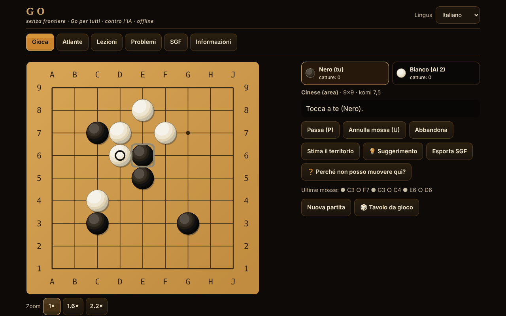

# Go fără frontiere

[English](README.md) · [Română](README.ro.md) · [Français](README.fr.md) · **Italiano** · [Español](README.es.md) · [Português](README.pt.md) · [Deutsch](README.de.md) · [Magyar](README.hu.md)

**Versione:** 1.2.0 · **Ultimo aggiornamento:** 2026-10-19

Lingue dell'interfaccia: **Română, English, Français, Italiano, Español, Português (PT), Deutsch, Magyar**

Il Go (Baduk, Weiqi, Igo) in un unico file HTML offline: goban 5×5–19×19, quattro set di regole, avversario IA (MCTS), 12 varianti giocabili, lezioni, problemi di tsumego verificati da un solver e SGF.

**Applicazione online:** https://chiuta.github.io/Go-fara-frontiere/

## Che cos'è

Un atlante (18 schede: origine, regole, approssimazioni ⚠, fonti) e una vera partita di Go contro un avversario IA locale (ricerca ad albero Monte-Carlo, non un LLM, non una rete neurale). Il motore delle regole è separato dall'interfaccia e testato in Node. Nessuna richiesta di rete.

## Funzioni (verificate nel codice e nei test)

- **Goban:** 5×5, 7×7, 9×9, 13×13, 19×19; hoshi, coordinate, pietre grandi in SVG scalabile; indicatori: ultima mossa, ko, territorio stimato; anteprima al passaggio del cursore.
- **Regole nel codice:** cattura per libertà della catena; suicidio vietato (giapponesi, cinesi, AGA) o consentito (Tromp–Taylor / personalizzato); ko semplice, superko posizionale (PSK) e situazionale (SSK).
- **Set di regole:** giapponesi (territorio + prigionieri, komi 6,5, ⚠), cinesi (area, 7,5, ⚠), AGA (area; le pietre di passo contano solo per la parità, NON si sommano al punteggio ad area, 7,5, ⚠), Tromp–Taylor (formali, punteggio automatico, senza marcatura delle pietre morte, 7,5), personalizzato. Komi modificabile; con handicap: giapponesi/TT 0,5, AGA 0,5+(h−1), cinesi h.
- **Handicap 2–9** con le posizioni standard su 9×9, 13×13, 19×19.
- **Fine partita:** due passi → marcatura delle pietre morte (clic su un gruppo) con suggerimento automatico dell'IA (con conferma) → punteggio dettagliato (pietre, territorio, prigionieri, komi, punti neutri).
- **Modalità:** contro l'IA (scegli il colore o a caso), due giocatori sullo stesso schermo, Rengo 2 contro 2 (il compagno e gli avversari possono essere IA), Phantom Go ⚠ contro l'IA.
- **IA:** MCTS (UCT + RAVE) con simulazioni leggere (catture/fughe dall'atari, schemi 3×3, non riempie i propri occhi, evita il self-atari), 5 livelli con iterazioni e tempo configurabili, pulsante «Interrompi / pensa meno», gira in un Web Worker (da Blob) e, se non è consentito, sul thread principale a fette di ~20 ms.
- **Varianti dell'atlante giocabili:** Atari-Go (Capture Go / Ponnuki-Go: prima cattura; facoltativamente obiettivo di 5 o 10 pietre), Go su goban piccolo (5×5, 7×7), NoGo, Rengo, Phantom Go ⚠, Byo-yomi con orologio funzionante (tempo base + periodi).
- **Suggerimento** (💡, nelle partite con pietre visibili): l'IA locale propone una mossa per te (ricerca Monte-Carlo, indicativa), mostrata come mossa da confermare o annullare.
- **Salvataggio automatico:** una partita non conclusa viene salvata in locale dopo ogni mossa; alla successiva apertura, la scheda «Gioca» offre «Continua la partita» o «Elimina il salvataggio» (verificato tramite riproduzione; i salvataggi corrotti vengono respinti).
- **Lezioni interattive** (6): pietre, libertà, cattura, ko, due occhi, seki.
- **12 problemi di tsumego**, ciascuno con una soluzione confermata da un solver a forza bruta (vedi «Che cosa garantisce il solver»); riscontro corretto/errato con la risposta della difesa; «Mostra la soluzione» passo passo.
- **SGF:** esportazione (con mosse, handicap, komi, risultato); importazione e riproduzione con un parser rigoroso (FF[4], solo la linea principale, limiti: 2 MB, 30.000 nodi, profondità 256; nulla viene eseguito); «Continua il gioco da qui».
- **Interfaccia:** tastiera completa (frecce + Invio, P = passo, U = annulla), modalità «conferma la mossa» (predefinita su touchscreen), zoom 1×/1,6×/2,2× su mobile, 390 px senza scorrimento orizzontale; annullamento solo contro l'IA o con conferma; senza suoni.
- **Interfaccia in 8 lingue** (RO/EN/FR/IT/ES/PT/DE/HU; FR/IT/ES/PT/DE/HU sono tradotte automaticamente, non verificate da madrelingua) con rilevamento automatico; testi lunghi (atlante, lezioni, «Informazioni»): RO + EN; in FR/IT/ES/PT/DE/HU viene mostrato l'inglese, con la nota «testo in inglese». La parità delle chiavi è verificata con uno script.
- **Casualità:** `crypto.getRandomValues` con campionamento per rifiuto (colore casuale, semi dell'IA); opzione «Seme» per partite riproducibili.
- **Accessibilità:** aria-live, focus visibile, bersagli tattili ≥ 44 px (misurato), contrasto ≥ 4,5:1 (misurato), `prefers-reduced-motion`, `<noscript>`, `lang` dinamico.

## Nuove funzioni (1.1.0)

Si aprono tutte dal pulsante «Tavolo da gioco» (partite in due, analisi, sfida del giorno, torneo, accessibilità). Non c'è alcun server e non si aggiungono richieste di rete oltre a quelle indicate di seguito.

- **Partita in due tramite FFF.p2p** (WebRTC, segnalazione manuale tramite testo o codice QR, senza server). L'host è autoritativo; l'ospite applica solo le mosse numerate restituite dall'host (lockstep, con somma di controllo della posizione). Mossa, passo, abbandono, marcatura delle pietre morte e conferma del punteggio sono sincronizzati; patta/nuova partita si propongono e si accettano. Limiti: senza orologio, senza IA, senza annullamento della mossa nella partita online, senza ripresa dopo il ricaricamento della pagina. L'indirizzo IP è visibile all'avversario; un NAT simmetrico può richiedere STUN/TURN (STUN pubblico facoltativo, solo con l'esplicito consenso nella finestra di dialogo).
- **Analizzatore locale**: stima della probabilità di vittoria e del punteggio con MCTS a seme fisso (800/500/250 iterazioni in base alla dimensione del goban), quindi stesso risultato per la stessa posizione; «Revisione» della partita corrente con grafico e le mosse che cambiano la valutazione di ≥ 20 punti. È una stima statistica, non un motore di livello professionale.
- **Sfida del giorno**: goban 9×9 con pietre collocate a partire dalla data del calendario (la stessa per tutti nello stesso giorno), più il problema di tsumego del giorno tra i 12 esistenti; serie di giorni consecutivi memorizzata in locale. Senza rete.
- **«Perché non posso muovere?»**: ogni mossa illegale riceve una spiegazione (punto occupato, ko con la mossa vietata, superko con il numero della mossa, suicidio con la dimensione della catena, NoGo ecc.), annunciata anche per gli screen reader; pulsante dedicato e tasto `?`.
- **Tastiera e annunci audio**: cursore sul goban con le frecce, Invio/Spazio per giocare, `W` (stato), `C` (coordinate), `L` (ultima mossa), `S` (punteggio); regione aria-live e, facoltativamente, voce (Web Speech, locale) tramite il modulo `tts` del kit.
- **Torneo Elo locale**: tu + avversari IA (Elo 500 + 200·livello), andata e ritorno, classifica ricalcolata dai risultati; le partite tra IA sono simulate su 5×5/7×7/9×9 con iterazioni ridotte (Tromp–Taylor); la classifica Elo è relativa e indicativa.
- **Kit FFF** applicato: `core, label, bundle, qr, p2p, tts` (la finestra di trasparenza, `app.json`). La CSP resta `default-src 'none'`; sono stati ricalcolati solo gli hash degli script.

## Varianti

| Nome | Giocabile? | ⚠ Approssimazioni |
|---|---|---|
| Go (classico), 9×9 / 13×13 / 19×19 | sì | — |
| Regole giapponesi (territorio) | sì | ⚠ seki: gli occhi all'interno di un seki non vengono rilevati; ko semplice (senza «senza risultato»); senza regole di arbitraggio |
| Regole cinesi (area) | sì | ⚠ superko posizionale al posto della regola ufficiale di ripetizione; komi 7,5 (valore moderno) |
| Regole AGA | sì | ⚠ verificate in audit rispetto al testo AGA del 1991; situazionale scelto per la ripetizione; senza arbitraggio |
| Tromp–Taylor | sì | — (formali; suicidio consentito, punteggio automatico) |
| Go su goban piccolo (5×5, 7×7) | sì | — |
| Handicap 2–9 | sì | ⚠ posizioni tradizionali solo su 19×19; su 9×9/13×13 estrapolate (verificato in audit) |
| Atari-Go / Capture Go / Ponnuki-Go (obiettivo 1, 5 o 10) | sì | — |
| NoGo | sì | — (chi non ha più una mossa legale perde) |
| Rengo 2 contro 2 | sì | — (i giocatori della squadra giocano a turno; IA per i posti liberi) |
| Phantom Go | sì | ⚠ l'IA non conosce le tue pietre nascoste e può tentare punti occupati; punteggio ad area; senza esportazione SGF durante la partita |
| Byo-yomi | sì | — (orologio con periodi; si perde allo sforamento) |
| Go a coppie, toroidale, esagonale, a tre, Ing, Nuova Zelanda | solo nell'atlante | — |

## Che cosa garantisce il solver di tsumego

Per ogni problema, una ricerca alfa-beta con tabella di trasposizione, sulla piccola area mostrata, ha confermato che la prima mossa indicata permette al giocatore di forzare l'obiettivo (gruppo bersaglio catturato, o vivo incondizionatamente secondo l'algoritmo di Benson) in al massimo D semimosse contro QUALSIASI difesa, compreso il passo; l'insieme delle mosse vincenti è stato verificato anche a D+2. Non garantisce: ko, seki o «vivo in seki» non contano come successo; solo ko semplice; l'area è isolata (i muri segnati con un quadrato sono permanenti); non pretende l'unicità nella partita intera. I 12 problemi sono: 6 forme di spazio degli occhi (3 in fila, 3 piegato, 4 a T, 4 quadrato, 5 grappolo, 5 croce) da uccidere, 4 da rendere vivi, e 2 piccole catture trovate tramite ricerca. Un insieme più ricco di tesuji (snapback, scala, rete) non è stato incluso: non ho trovato problemi che il solver confermi e che siano anche naturali.

## Manuale d'uso

1. Scheda «Gioca»: scegli la variante, il goban, il set di regole, la modalità e il livello dell'IA; «Inizia la partita». (Oppure da «Atlante» → «▶ Gioca» per una preimpostazione.)
2. Muovi con clic/tocco (su mobile confermi la mossa) o con la tastiera: frecce = cursore, Invio = posa la pietra, P = passo, U = annulla.
3. Il pulsante «Stima il territorio» mostra una stima statistica; «Interrompi / pensa meno» abbrevia il pensiero dell'IA.
4. Dopo due passi marchi le pietre morte: clic su un gruppo (o «Suggerisci automaticamente»), poi «Conferma il punteggio». In Tromp–Taylor il punteggio è automatico.
5. «Esporta SGF» scarica la partita; la scheda «SGF» carica e riproduce un file o un testo incollato.
6. «Lezioni» e «Problemi» danno un riscontro immediato; i progressi sono conservati in locale (se il browser lo consente).

## Livello dell'IA (descrizione onesta)

Non è un LLM e non ha una rete neurale. MCTS con simulazioni leggere: ~7.700 simulazioni/s su 9×9 e ~1.600/s su 19×19 in Node (la macchina di test); nel browser varia. I livelli 1–5 significano 0 / 100 / 500 / 2.500 / 10.000 iterazioni (con limite di tempo). Misurato su 9×9, komi 7,5, regole cinesi, colori alternati (`tests/match.js`, `tests/vs_random.js`):

| Incontro (9×9, komi 7,5, colori alternati) | Risultato | Partite |
|---|---|---|
| Livello 1 (euristico, 0 iterazioni) contro casuale | 34–6 (85%) | 40 |
| Livello 2 (100 iterazioni) contro casuale | 100–0 (100%) | 100 |
| Livello 3 (500 iterazioni) contro casuale | 40–0 (100%) | 40 |
| Livello 2 contro livello 1 | 40–0 | 40 |
| Livello 3 contro livello 2 | 31–9 (78%) | 40 |
| Livello 4 (2.500) contro livello 3 | 21–9 (70%) | 30 |
| Livello 5 (10.000) contro livello 4 | 15–5 (75%) | 20 |

Con 20–40 partite, l'intervallo di confidenza (95%) è dell'ordine di ±15–20 punti percentuali per le righe con ≤ 40 partite; le differenze tra i livelli sono reali, ma i valori esatti no. Gli incontri sono IA contro IA (lo stesso motore), quindi le differenze di forza tra i livelli sono probabilmente sovrastimate rispetto agli esseri umani.

Il rango NON è misurato (non esistono un motore classificato né giocatori umani di riferimento nell'ambiente di compilazione); qualsiasi equivalente in kyu sarebbe una speculazione, quindi non se ne afferma alcuno. I livelli 1–2 sono per principianti assoluti. Su 19×19 è molto più debole e più lenta. L'IA non bara: riceve solo il goban, la cronologia delle mosse e le regole; nel Phantom Go gioca solo con le proprie pietre e con quelle rivelate.

## Test (giro 8)

`tests/fff-r8.test.mjs` (Playwright, rete bloccata, `node tests/fff-r8.test.mjs`): 10 sezioni, 120 verifiche, 0 fallimenti — P2P tra due pagine (loopback), analizzatore deterministico, sfida del giorno determinata dalla data, spiegazioni per le mosse illegali, tastiera, torneo Elo, axe-core con 0 violazioni (inclusi i dialoghi e la finestra del kit), 0 `pageerror`/violazioni CSP, nessun overflow orizzontale a 360×740 e 1280×800. L'app esiste solo in tema scuro, quindi il contrasto è verificato in un solo tema.

## Test precedenti (fuori dal pacchetto)

Eseguiti da `scratchpad/new/games_work/Go-fara-frontiere/` (fuori dal pacchetto):

- `node tests/run.js` — 158 verifiche, 0 fallimenti: configurazioni classiche (scala/ladder e snapback trovati tramite ricerca e riprodotti con l'implementazione di riferimento, ko, seki, suicidio, cattura prima del suicidio), superko, punteggio giapponese vs cinese su posizioni con risultato calcolato a mano (identità del punteggio: differenza di area meno differenza di territorio = pietre poste dal Nero meno pietre poste dal Bianco, secondo Sensei's Library), handicap, orologio byo-yomi, SGF (andata e ritorno su 600 partite generate; rifiuto dei file troppo grandi, troppo profondamente annidati, con valori enormi o malformati).
- Confronto con un'implementazione di riferimento indipendente (flood-fill a forza bruta): 100.000 posizioni casuali in 588 partite, 602.976 verifiche di legalità, 0 divergenze (in `tests/run.js`).
- `node tests/fuzz.js 9 500` — 500 partite IA contro IA su 9×9 (52.291 mosse), ogni mossa validata dal riferimento: 0 mosse illegali, 0 invarianti violati. `node tests/fuzz.js 13 100` — 100 partite su 13×13 (20.839 mosse): 0 illegali. `node tests/fuzz.js var 120` — NoGo / Capture-Go: 0 illegali.
- `node tests/vs_random.js 100 100` — l'MCTS con 100 iterazioni batte il giocatore casuale 100–0 su 9×9 (requisito ≥ 95%).
- `node tests/tsume_verify.js` — risolve di nuovo i 12 problemi: la soluzione memorizzata, la profondità minima, la stabilità a D+2, la confutazione di ogni mossa sbagliata.
- `node tests/i18n-parity.js` — 254 chiavi × 7 lingue, segnaposto identici, tutte le chiavi usate nel codice esistono. `node tests/rng.js` (uniformità di `secureInt`, seme riproducibile), `node tests/contrast.js` (≥ 4,5:1), `node tests/stamp_overflow.js` (regressione per un errore trovato nelle partite lunghe: overflow del contatore Int32 del flood-fill).
- Playwright (`pw/ui.js`, `pw/ui2.js`, `pw/ui3.js`): 84 verifiche dell'interfaccia, 0 fallimenti — tastiera, annullamento, cambio di lingua, esportazione/importazione SGF, SGF non valido respinto, risoluzione tramite interfaccia di tutti i 12 problemi, partita 5×5 completa fino alla marcatura e al punteggio, tutte le 12 preimpostazioni giocabili, stima del territorio, orologio byo-yomi, mobile 390 px (senza scorrimento orizzontale, bersagli ≥ 44 px, conferma della mossa), `localStorage` bloccato, senza Worker (fallback), 0 richieste di rete, 0 errori di console.

## Riservatezza e rete

Senza account né telemetria; per impostazione predefinita nessuna richiesta di rete. Solo se avvii esplicitamente «Partita in due» si apre una connessione WebRTC diretta verso l'avversario (segnalazione copiata manualmente; STUN pubblico solo con esplicito consenso). CSP rigorosa (`default-src 'none'`, script consentito solo tramite hash SHA-256, `worker-src blob:`, senza `connect-src`). `localStorage` (in try/catch) solo per lingua, impostazioni, problemi risolti, statistiche locali e salvataggio automatico di una sola partita non conclusa (`gff.save.v1`: le impostazioni, le mosse, il tuo colore e il seme; non per il Phantom Go né per le partite con orologio; eliminato alla fine della partita o con «Elimina il salvataggio»). I link Buy Me a Coffee nel piè di pagina si aprono solo al clic (`rel=noopener`).

## Limiti e avvertenze

- Le regole (komi, ko, suicidio, seki, punteggio, handicap) sono state verificate in audit rispetto a Wikipedia «Rules of Go»/«Komi», al testo AGA del 1991 (British Go Association) e alle regole giapponesi del 1989 (CMU); ne sono derivate correzioni (pietre di passo AGA, komi con handicap). Le regole cinesi ufficiali e quelle della Nihon Ki-in 2003 non è stato possibile leggerle per intero (⚠).
- «Seme» riproduce la partita solo se l'IA non è interrotta dal limite di tempo (le iterazioni possono variare in base alla velocità della macchina).
- Seki: i punti con libertà comuni sono neutri, ma gli occhi all'interno di un seki non vengono rilevati; ko semplice senza «senza risultato» nelle regole giapponesi; limite di sicurezza a 4·n² mosse (patta).
- La stima del territorio e il suggerimento delle pietre morte sono statistici e possono sbagliare.
- Il Phantom Go è approssimato (l'IA non ha informazioni sulle tue pietre nascoste; può tentare punti occupati).
- L'IA è debole su 19×19; non è un giocatore di livello da club.
- Le varianti «solo nell'atlante» non sono implementate.
- Partita in due: senza orologio/IA/annullamento, senza ripresa dopo il ricaricamento; l'SGF e le catture non sono sincronizzati separatamente. L'analizzatore e le simulazioni del torneo usano iterazioni ridotte e sono approssimativi.

## Fonti

Sensei's Library (Japanese rules, Chinese rules, AGA rules, Tromp–Taylor rules, Ko, Superko, Komi, Handicap, Seki, Scoring) · le regole Tromp–Taylor · American Go Association · la specifica SGF FF[4] · D. B. Benson (1976, vita incondizionata) · Kocsis & Szepesvári (2006, UCT) · Gelly & Silver (2007, RAVE). Verificate in parte online in audit (vedi il rapporto di audit).

## Esecuzione locale

Scarica `index.html` e aprilo in un browser; funziona senza internet.

## Cronologia / Changelog

### 14 ottobre 2026 — versione 1.1.0
- Partita in due tramite FFF.p2p (lockstep), analizzatore locale, sfida del giorno, «perché non posso muovere?», gioco da tastiera con annunci audio, torneo Elo locale; lingua ungherese (parziale); kit FFF (`core,label,bundle,qr,p2p,tts`); test `tests/fff-r8.test.mjs`. Nessuna regressione delle regole (motore di gioco invariato).

### 12 ottobre 2026 — versione 1.0.0
- 1.0.0 — 2026-10-12: la versione e la data dell'ultimo aggiornamento sono mostrate nell'app

### 11 ottobre 2026 (terzo passaggio)
- La nota sul komi con handicap (RO/EN): AGA «h−0,5» e «0,5 + (h−1)» sono lo stesso valore, ora formulato come tale (prima sembrava che fossero due formule). CSP: hash ricalcolato.

### 11 ottobre 2026 (secondo passaggio)
- Salvataggio automatico della partita in corso con «Continua la partita» (validazione rigorosa + riproduzione, nuovo testo in tutte le 7 lingue); pulsante «Suggerimento» che propone una mossa con il motore MCTS locale; CSP: hash ricalcolato.

### 11 ottobre 2026
- Accessibilità: la barra delle schede è racchiusa in un riferimento `<nav>`, il widget di sostegno ha un ruolo di riferimento; axe-core segnala 0 violazioni a 1280 e 360 px.
- HTML riparato: rimosso un `</body></html>` duplicato alla fine del file; l'hash CSP dello script è stato ricalcolato (verificato con CSP attiva, senza bypass).
- Licenza: la dicitura «licenza non dichiarata» nell'app è stata sostituita con la licenza MIT, in linea con il file `LICENSE`.

## Licenza

MIT — vedi il file `LICENSE`

## Autore

Alexio — Alexandru-Ionuț Chiuță · alexio@trom.tf

## Riepilogo

Go offline in un unico file (Baduk/Weiqi/Igo): 5×5–19×19, regole giapponesi/cinesi/AGA/Tromp–Taylor (approssimazioni ⚠ documentate), handicap 2–9, IA MCTS (5 livelli, Web Worker), due giocatori, Rengo 2 contro 2, Atari-Go/Ponnuki-Go, NoGo, Phantom Go ⚠, orologio byo-yomi, 6 lezioni interattive, 12 problemi di tsumego ciascuno confermato da un solver a forza bruta, importazione/esportazione SGF con parser rigoroso. Interfaccia in 8 lingue (6 tradotte automaticamente, non verificate), testi lunghi RO+EN. Novità della 1.1.0: partita in due via WebRTC con segnalazione manuale/QR (senza server, lockstep), analizzatore MCTS locale a seme fisso e revisione della partita, sfida del giorno basata sulla data, spiegazioni «perché non posso muovere?», gioco da tastiera con annunci vocali, torneo Elo locale. Motore testato contro un riferimento indipendente a flood-fill su 100.000 posizioni casuali, 500 partite IA contro IA su 9×9 e 100 su 13×13 senza mosse illegali. Senza rete, senza telemetria. Licenza: MIT (vedi LICENSE).
