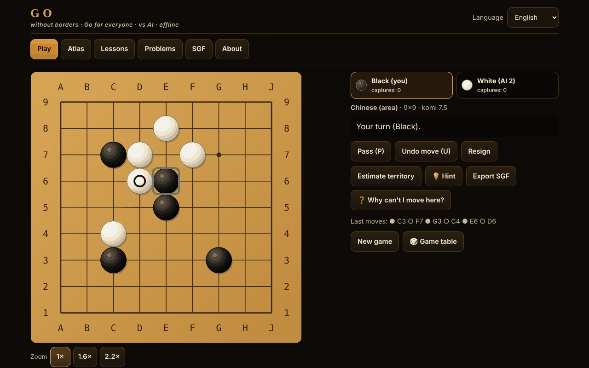

# Go fără frontiere

**English** · [Română](README.ro.md) · [Français](README.fr.md) · [Italiano](README.it.md) · [Español](README.es.md) · [Português](README.pt.md) · [Deutsch](README.de.md) · [Magyar](README.hu.md)

**Version:** 1.2.9 · **Last updated:** 2026-10-23

Interface languages: **Română, English, Français, Italiano, Español, Português (PT), Deutsch, Magyar**

Go (Baduk, Weiqi, Igo) in a single offline HTML file: 5×5–19×19 board, four rule sets, AI opponent (MCTS), 12 playable variants, lessons, tsume problems verified by a solver, and SGF.

**Live app:** https://chiuta.github.io/Go-fara-frontiere/

## What it is

An atlas (18 sheets: origin, rules, approximations ⚠, sources) and an actual game of Go against a local AI opponent (Monte-Carlo tree search, not an LLM, not a neural network). The rules engine is separate from the interface and tested in Node. No network requests.

## Features (verified in code and tests)

- **Boards:** 5×5, 7×7, 9×9, 13×13, 19×19; hoshi, coordinates, large stones in scalable SVG; markers: last move, ko, estimated territory; preview on hover.
- **Rules in code:** capture by chain liberties; suicide forbidden (Japanese, Chinese, AGA) or allowed (Tromp–Taylor / custom); simple ko, positional superko (PSK) and situational superko (SSK).
- **Rule sets:** Japanese (territory + prisoners, komi 6.5, ⚠), Chinese (area, 7.5, ⚠), AGA (area; pass stones count only for parity, they are NOT added to the area score, 7.5, ⚠), Tromp–Taylor (formal, automatic scoring, no marking of dead stones, 7.5), custom. Editable komi; with handicap: Japanese/TT 0.5, AGA 0.5+(h−1), Chinese h.
- **Handicap 2–9** with standard positions on 9×9, 13×13, 19×19.
- **End of game:** two passes → marking of dead stones (click on a group) with an automatic suggestion from the AI (with confirmation) → detailed score (stones, territory, prisoners, komi, neutral points).
- **Modes:** against the AI (you choose the colour, or random), two players on the same screen, 2-vs-2 Rengo (the partner and the opponents may be AI), Phantom Go ⚠ against the AI.
- **AI:** MCTS (UCT + RAVE) with light playouts (captures/escapes from atari, 3×3 patterns, does not fill its own eyes, avoids self-atari), 5 levels with configurable iterations and time, a "Stop / think less" button, runs in a Web Worker (from a Blob) and, if that is not allowed, on the main thread in slices of ~20 ms.
- **Playable atlas variants:** Atari-Go (Capture Go / Ponnuki-Go: first capture; optionally a target of 5 or 10 stones), small-board Go (5×5, 7×7), NoGo, Rengo, Phantom Go ⚠, Byo-yomi with a working clock (main time + periods).
- **Hint** (💡, in games with visible stones): the local AI proposes a move for you (Monte-Carlo search, indicative), shown as a move to confirm or cancel.
- **Autosave:** an unfinished game is saved locally after every move; on the next opening, the "Play" tab offers "Continue game" or "Delete save" (verified by replay; corrupt saves are rejected).
- **Interactive lessons** (6): stones, liberties, capture, ko, two eyes, seki.
- **12 tsume-go problems**, each with a solution confirmed by a brute-force solver (see "What the solver guarantees"); correct/wrong feedback with the defender's answer; "Show the solution" step by step.
- **SGF:** export (with moves, handicap, komi, result); import and replay with a strict parser (FF[4], main line only, limits: 2 MB, 30,000 nodes, depth 256; nothing is executed); "Continue the game from here".
- **Interface:** full keyboard (arrows + Enter, P = pass, U = undo), "confirm move" mode (default on touch screens), zoom 1×/1.6×/2.2× on mobile, 390 px with no horizontal scroll; undo only against the AI or with confirmation; no sounds.
- **Interface and content in 8 languages** (RO/EN/FR/IT/ES/PT/DE/HU; FR/IT/ES/PT/DE/HU are machine-translated, not verified by native speakers) with autodetection; the long texts (atlas, 6 interactive lessons, tsume problem names, "About", komi note) are translated into all the languages too. Left as they are: the "sources" field of the atlas sheets (citations, proper names) and the artistic name "Ecoul Stringurilor". Key parity is checked by a script. The Go terminology (e.g. hu "felület" for area scoring) deserves a review by a native player.
- **Randomness:** `crypto.getRandomValues` with rejection sampling (random colour, AI seeds); a "Seed" option for reproducible games.
- **Accessibility:** aria-live, visible focus, touch targets ≥ 44 px (measured), contrast ≥ 4.5:1 (measured), `prefers-reduced-motion`, `<noscript>`, dynamic `lang`.

## New features (1.1.0)

All of them open from the "Game table" button (two-player games, analysis, daily challenge, tournament, accessibility). There is no server, and no network requests are added beyond those below.

- **Two-player game via FFF.p2p** (WebRTC, manual signalling through text or QR code, no server). The host is authoritative; the guest applies only the numbered moves returned by the host (lockstep, with a position checksum). Move, pass, resign, marking of dead stones and score confirmation are synchronised; draw/new game are proposed and accepted. Limits: no clock, no AI, no move undo in the online game, no resume after the page is reloaded. The IP address is visible to the opponent; a symmetric NAT may require STUN/TURN (public STUN optional, only with explicit consent in the dialog).
- **Local analyzer**: win-probability and score estimate with MCTS using a fixed seed (800/500/250 iterations depending on board size), hence the same result for the same position; a "Review" of the current game with a graph and the moves that change the evaluation by ≥ 20 points. It is a statistical estimate, not a professional-level engine.
- **Daily challenge**: a 9×9 board with stones placed from the calendar date (the same for everyone on the same day), plus the day's tsume problem from the existing 12; streak of consecutive days stored locally. No network.
- **"Why can't I move?"**: every illegal move gets an explanation (occupied point, ko with the prohibited move, superko with the move number, suicide with the chain size, NoGo, etc.), also announced for screen readers; a dedicated button and the `?` key.
- **Keyboard and audio announcements**: cursor on the board with the arrows, Enter/Space to play, `W` (status), `C` (coordinates), `L` (last move), `S` (score); aria-live region and, optionally, voice (Web Speech, local) through the kit's `tts` module.
- **Local Elo tournament**: you + AI opponents (Elo 500 + 200·level), round-robin home and away, standings recalculated from the results; AI-vs-AI games are simulated on 5×5/7×7/9×9 with reduced iterations (Tromp–Taylor); the Elo ranking is relative and indicative.
- **FFF kit** applied: `core, label, bundle, qr, p2p, tts` (the transparency window, `app.json`). The CSP remains `default-src 'none'`; only the script hashes were recalculated.

## Variants

| Name | Playable? | ⚠ Approximations |
|---|---|---|
| Go (classic), 9×9 / 13×13 / 19×19 | yes | — |
| Japanese rules (territory) | yes | ⚠ seki: eyes inside a seki are not detected; simple ko (no "no result"); no arbitration rules |
| Chinese rules (area) | yes | ⚠ positional superko instead of the official repetition rule; komi 7.5 (the modern value) |
| AGA rules | yes | ⚠ checked at audit against the 1991 AGA text; situational chosen for repetition; no arbitration |
| Tromp–Taylor | yes | — (formal; suicide allowed, automatic scoring) |
| Small-board Go (5×5, 7×7) | yes | — |
| Handicap 2–9 | yes | ⚠ traditional positions only on 19×19; on 9×9/13×13 extrapolated (checked at audit) |
| Atari-Go / Capture Go / Ponnuki-Go (target 1, 5 or 10) | yes | — |
| NoGo | yes | — (whoever has no legal move left loses) |
| 2-vs-2 Rengo | yes | — (the team's players alternate; AI for free seats) |
| Phantom Go | yes | ⚠ the AI does not know your hidden stones and may try occupied points; area scoring; no SGF export during the game |
| Byo-yomi | yes | — (clock with periods; you lose on overtime) |
| Pair Go, toroidal, hexagonal, three-player, Ing, New Zealand | atlas only | — |

## What the tsume solver guarantees

For each problem, an alpha-beta search with a transposition table, on the small displayed area, confirmed that the first move indicated allows the player to force the goal (target group captured, or unconditionally alive according to Benson's algorithm) in at most D half-moves against ANY defence, including a pass; the set of winning moves was also verified at D+2. It does not guarantee: ko, seki or "alive in seki" do not count as success; only simple ko; the area is isolated (the walls marked with a square are permanent); it does not claim uniqueness in the whole game. The 12 problems are: 6 eye-space shapes (3 in a row, 3 bent, 4 T, 4 square, 5 bulky, 5 cross) to kill, 4 to make alive, and 2 small captures found by search. A richer set of tesuji (snapback, ladder, net) was not included: I did not find problems that the solver confirms and that are also natural.

## User guide

1. "Play" tab: choose the variant, the board, the rule set, the mode and the AI level; "Start game". (Or from "Atlas" → "▶ Play" for a preset.)
2. Move by click/tap (on mobile you confirm the move) or with the keyboard: arrows = cursor, Enter = place the stone, P = pass, U = undo.
3. The "Estimate territory" button displays a statistical estimate; "Stop / think less" shortens the AI's thinking.
4. After two passes you mark the dead stones: click on a group (or "Suggest automatically"), then "Confirm score". In Tromp–Taylor the score is automatic.
5. "Export SGF" downloads the game; the "SGF" tab loads and replays a file or a pasted text.
6. "Lessons" and "Problems" have immediate feedback; progress is kept locally (if the browser allows).

## AI level (an honest description)

It is not an LLM and has no neural network. MCTS with light playouts: ~7,700 playouts/s on 9×9 and ~1,600/s on 19×19 in Node (the test machine); in the browser it varies. Levels 1–5 mean 0 / 100 / 500 / 2,500 / 10,000 iterations (with a time limit). Measured on 9×9, komi 7.5, Chinese rules, alternating colours (`tests/match.js`, `tests/vs_random.js`):

| Match (9×9, komi 7.5, alternating colours) | Result | Games |
|---|---|---|
| Level 1 (heuristic, 0 iterations) vs random | 34–6 (85%) | 40 |
| Level 2 (100 iterations) vs random | 100–0 (100%) | 100 |
| Level 3 (500 iterations) vs random | 40–0 (100%) | 40 |
| Level 2 vs level 1 | 40–0 | 40 |
| Level 3 vs level 2 | 31–9 (78%) | 40 |
| Level 4 (2,500) vs level 3 | 21–9 (70%) | 30 |
| Level 5 (10,000) vs level 4 | 15–5 (75%) | 20 |

With 20–40 games, the confidence interval (95%) is of the order of ±15–20 percentage points for the rows with ≤ 40 games; the differences between levels are real, but the exact values are not. The matches are AI vs AI (the same engine), so the differences in strength between levels are probably overestimated relative to humans.

The rank is NOT measured (there is no rated engine or reference human players in the build environment); any kyu equivalent would be speculation, so none is claimed. Levels 1–2 are for absolute beginners. On 19×19 it is much weaker and slower. The AI does not cheat: it receives only the board, the move history and the rules; in Phantom Go it plays only with its own stones and the revealed ones.

## Tests (round 8)

`tests/fff-r8.test.mjs` (Playwright, network blocked, `node tests/fff-r8.test.mjs`): 10 sections, 120 checks, 0 failures — P2P between two pages (loopback), deterministic analyzer, date-determined daily challenge, explanations for illegal moves, keyboard, Elo tournament, axe-core with 0 violations (including dialogs and the kit window), 0 `pageerror`/CSP violations, no horizontal overflow at 360×740 and 1280×800. The app is dark-theme only, so contrast is checked in a single theme.

## Earlier tests (outside the package)

Run from `scratchpad/new/games_work/Go-fara-frontiere/` (outside the package):

- `node tests/run.js` — 158 checks, 0 failures: classic configurations (ladder and snapback found by search and replayed with the reference implementation, ko, seki, suicide, capture before suicide), superko, Japanese vs Chinese scoring on positions with a hand-computed result (score identity: area difference minus territory difference = stones placed by Black minus stones placed by White, according to Sensei's Library), handicap, byo-yomi clock, SGF (round-trip on 600 generated games; rejection of files that are too large, too deeply nested, with huge values or malformed).
- Comparison with an independent reference implementation (brute-force flood-fill): 100,000 random positions in 588 games, 602,976 legality checks, 0 divergences (in `tests/run.js`).
- `node tests/fuzz.js 9 500` — 500 AI-vs-AI games on 9×9 (52,291 moves), each move validated by the reference: 0 illegal moves, 0 invariants violated. `node tests/fuzz.js 13 100` — 100 games on 13×13 (20,839 moves): 0 illegal. `node tests/fuzz.js var 120` — NoGo / Capture-Go: 0 illegal.
- `node tests/vs_random.js 100 100` — MCTS with 100 iterations beats the random player 100–0 on 9×9 (requirement ≥ 95%).
- `node tests/tsume_verify.js` — re-solves the 12 problems: the stored solution, the minimum depth, stability at D+2, refutation of every wrong move.
- `node tests/i18n-parity.js` — 254 keys × 7 languages, identical placeholders, all keys used in the code exist. `node tests/rng.js` (uniformity of `secureInt`, reproducible seed), `node tests/contrast.js` (≥ 4.5:1), `node tests/stamp_overflow.js` (regression for a bug found in long games: Int32 counter overflow in the flood-fill).
- Playwright (`pw/ui.js`, `pw/ui2.js`, `pw/ui3.js`): 84 UI checks, 0 failures — keyboard, undo, language change, SGF export/import, invalid SGF rejected, solving all 12 problems through the UI, a complete 5×5 game through marking and scoring, all 12 playable presets, territory estimate, byo-yomi clock, mobile 390 px (no horizontal scroll, targets ≥ 44 px, move confirmation), blocked `localStorage`, no Worker (fallback), 0 network requests, 0 console errors.

## Privacy and network

No account or telemetry; no network requests by default. Only if you explicitly start "Two-player game" is a direct WebRTC connection opened to the opponent (signalling copied manually; public STUN only with explicit consent). Strict CSP (`default-src 'none'`, script allowed only by SHA-256 hash, `worker-src blob:`, no `connect-src`). `localStorage` (in try/catch) only for language, settings, solved problems, local statistics and the autosave of a single unfinished game (`go-fara-frontiere.save.v1`: the settings, the moves, your colour and the seed; not for Phantom Go or games with a clock; deleted at the end of the game or with "Delete save"). The Buy Me a Coffee links in the footer open only on click (`rel=noopener`).

## Limits and warnings

- The rules (komi, ko, suicide, seki, scoring, handicap) were checked at audit against Wikipedia "Rules of Go"/"Komi", the 1991 AGA text (British Go Association) and the 1989 Japanese rules (CMU); corrections resulted (AGA pass stones, komi in handicap games). The official Chinese rules and Nihon Ki-in 2003 could not be read in full (⚠).
- "Seed" reproduces the game only if the AI is not stopped by the time limit (iterations may vary with the machine's speed).
- Seki: points with shared liberties are neutral, but eyes inside a seki are not detected; simple ko without "no result" in Japanese rules; safety limit at 4·n² moves (draw).
- The territory estimate and the dead-stone suggestion are statistical and may be wrong.
- Phantom Go is approximated (the AI has no information about your hidden stones; it may try occupied points).
- The AI is weak on 19×19; it is not a club-level player.
- The "atlas only" variants are not implemented.
- Two-player game: no clock/AI/undo, no resume after reload; the SGF and the captures are not synchronised separately. The analyzer and the tournament simulations use reduced iterations and are approximate.

## Sources

Sensei's Library (Japanese rules, Chinese rules, AGA rules, Tromp–Taylor rules, Ko, Superko, Komi, Handicap, Seki, Scoring) · the Tromp–Taylor rules · American Go Association · the SGF FF[4] specification · D. B. Benson (1976, unconditional life) · Kocsis & Szepesvári (2006, UCT) · Gelly & Silver (2007, RAVE). Partly checked online at audit (see the audit report).

## Running locally

Download `index.html` and open it in a browser; it works without internet.

## History / Changelog

### 1.2.9 — 2026-10-23

- Fix: the version shown in the footer was stale (1.2.6); CSP hashes recalculated.

### 1.2.8 — 2026-10-23

- Storage: keys now carry the app prefix (`go-fara-frontiere.prefs.v1`, `go-fara-frontiere.save.v1`, `go-fara-frontiere.r8.*`); existing data is migrated automatically at startup from the old key(s) (`gff.prefs.v1`, `gff.save.v1`, `gff_r8_*`), and older `.fff.json` backups still import (fff-kit 1.2.0).
- Dialogs: the native `alert`/`confirm`/`prompt` boxes were replaced with accessible, translated `FFF.dialog` dialogs (keyboard, focus trap, Escape) with the same behavior (fff-kit 1.2.0).

### 1.2.6 — 2026-10-22

fff-kit 1.1.4: touch targets and minimum text size. Touch targets/text fixed in the app.

### 1.2.5 — 2026-10-22

fff-kit 1.1.2: PBKDF2 with 600,000 iterations, anti-clickjacking protection.

### 1.2.4 — 2026-10-22

replacing a game in progress (from the atlas, from an SGF record, or when starting an online game) asks for confirmation in the kit’s inline dialog (translated into 8 languages) instead of the blocking `window.confirm()`; visible keyboard focus; checkbox targets of at least 24 px; test `tests/r9-confirm.test.mjs`.

### 1.2.3 — 2026-10-22
- The “Skip” link and the board types in the variants atlas (toroidal, hexagonal) are translated; the NoGo source line no longer mixes Romanian and English; the name and description in the transparency panel (fff-info) and in the meta description now follow the interface language and update when it changes.

### 1.2.2 — 2026-10-22
- Translation fix: the Rengo source reference no longer contains Romanian text.

### 1.2.1 — 2026-10-19
- All the long texts (About, 6 lessons, 12 tsume names, level texts, komi note, the atlas sheets) are translated into fr, it, es, pt, de, hu; the "text in English" note no longer appears. Machine translations, not verified by native speakers.

### 14 October 2026 — version 1.1.0
- Two-player game via FFF.p2p (lockstep), local analyzer, daily challenge, "why can't I move?", keyboard play with audio announcements, local Elo tournament; Hungarian language (partial); FFF kit (`core,label,bundle,qr,p2p,tts`); tests `tests/fff-r8.test.mjs`. No rules regressions (the game engine unchanged).

### 12 October 2026 — version 1.0.0
- 1.0.0 — 2026-10-12: the version and the date of the last update are displayed in the app

### 11 October 2026 (third pass)
- The note about komi in handicap games (RO/EN): AGA "h−0.5" and "0.5 + (h−1)" are the same value, now worded as such (before it looked as if there were two formulas). CSP: hash recalculated.

### 11 October 2026 (second pass)
- Autosave of the game in progress with "Continue game" (strict validation + replay, new text in all 7 languages); a "Hint" button that proposes a move with the local MCTS engine; CSP: hash recalculated.

### 11 October 2026
- Accessibility: the tab bar is wrapped in a `<nav>` landmark, the support widget has a landmark role; axe-core reports 0 violations at 1280 and 360 px.
- Fixed the HTML: removed a duplicate `</body></html>` at the end of the file; the script's CSP hash was recalculated (verified with CSP active, no bypass).
- License: the "license not declared" note in the app was replaced with the MIT license, in line with the `LICENSE` file.

## License

MIT — see the `LICENSE` file

## Author

Alexio — Alexandru-Ionuț Chiuță · alexio@trom.tf

## Summary

Single-file offline Go (Baduk/Weiqi/Igo): 5×5–19×19, Japanese/Chinese/AGA/Tromp–Taylor rules (⚠ approximations documented), handicap 2–9, MCTS AI (5 levels, Web Worker), two-player, 2v2 Rengo, Atari-Go/Ponnuki-Go, NoGo, Phantom Go ⚠, byo-yomi clock, 6 interactive lessons, 12 tsume problems each confirmed by a brute-force solver, SGF import/export with a strict parser. UI in 8 languages (6 machine-translated, unverified), long texts translated too. New in 1.1.0: two-player over WebRTC with manual/QR signalling (no server, lockstep), local fixed-seed MCTS analyzer and game review, date-seeded daily challenge, "why can't I move?" explanations, keyboard play with spoken announcements, local Elo tournament. Engine tested against an independent flood-fill reference on 100,000 random positions, 500 AI-vs-AI games on 9×9 and 100 on 13×13 without illegal moves. No network, no telemetry. License: MIT (see LICENSE).
