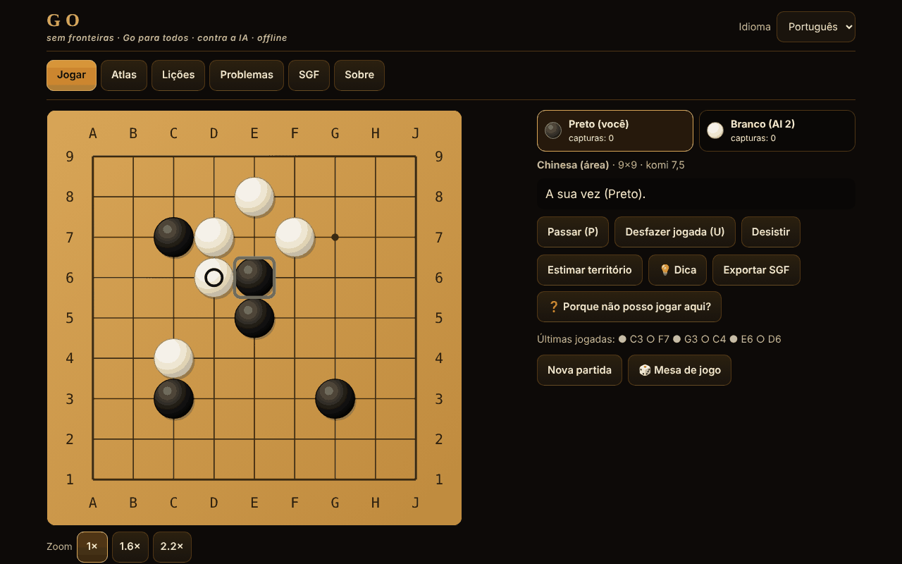

# Go fără frontiere

[English](README.md) · [Română](README.ro.md) · [Français](README.fr.md) · [Italiano](README.it.md) · [Español](README.es.md) · **Português** · [Deutsch](README.de.md) · [Magyar](README.hu.md)

**Versão:** 1.2.7 · **Última atualização:** 2026-10-23

Idiomas da interface: **Română, English, Français, Italiano, Español, Português (PT), Deutsch, Magyar**

O Go (Baduk, Weiqi, Igo) num único ficheiro HTML offline: tabuleiro de 5×5 a 19×19, quatro conjuntos de regras, adversário de IA (MCTS), 12 variantes jogáveis, lições, problemas de tsumego verificados por um solucionador e SGF.

**Aplicação online:** https://chiuta.github.io/Go-fara-frontiere/

## O que é

Um atlas (18 fichas: origem, regras, aproximações ⚠, fontes) e um jogo real de Go contra um adversário de IA local (pesquisa em árvore Monte-Carlo, não um LLM, não uma rede neuronal). O motor de regras está separado da interface e testado em Node. Nenhum pedido de rede.

## Funcionalidades (verificadas no código e nos testes)

- **Tabuleiros:** 5×5, 7×7, 9×9, 13×13, 19×19; hoshi, coordenadas, pedras grandes em SVG escalável; marcas: última jogada, ko, território estimado; pré-visualização ao passar o cursor.
- **Regras no código:** captura por liberdades da cadeia; suicídio proibido (japonesas, chinesas, AGA) ou permitido (Tromp–Taylor / personalizado); ko simples, superko posicional (PSK) e situacional (SSK).
- **Conjuntos de regras:** japonesas (território + prisioneiros, komi 6,5, ⚠), chinesas (área, 7,5, ⚠), AGA (área; as pedras de passe contam apenas para a paridade, NÃO se somam à pontuação por área, 7,5, ⚠), Tromp–Taylor (formais, pontuação automática, sem marcação de pedras mortas, 7,5), personalizado. Komi editável; com handicap: japonesas/TT 0,5, AGA 0,5+(h−1), chinesas h.
- **Handicap 2–9** com posições padrão em 9×9, 13×13, 19×19.
- **Fim do jogo:** dois passes → marcação das pedras mortas (clique num grupo) com sugestão automática da IA (com confirmação) → pontuação detalhada (pedras, território, prisioneiros, komi, pontos neutros).
- **Modos:** contra a IA (escolhe a cor, ou aleatória), dois jogadores no mesmo ecrã, Rengo 2 contra 2 (o parceiro e os adversários podem ser IA), Phantom Go ⚠ contra a IA.
- **IA:** MCTS (UCT + RAVE) com simulações ligeiras (capturas/fugas de atari, padrões 3×3, não preenche os próprios olhos, evita o self-atari), 5 níveis com iterações e tempo configuráveis, botão «Parar / pensar menos», corre num Web Worker (a partir de um Blob) e, se não for permitido, no fio principal em fatias de ~20 ms.
- **Variantes do atlas jogáveis:** Atari-Go (Capture Go / Ponnuki-Go: primeira captura; opcionalmente objetivo de 5 ou 10 pedras), Go em tabuleiro pequeno (5×5, 7×7), NoGo, Rengo, Phantom Go ⚠, Byo-yomi com relógio funcional (tempo base + períodos).
- **Sugestão** (💡, em jogos com pedras visíveis): a IA local propõe uma jogada para si (pesquisa Monte-Carlo, indicativa), apresentada como jogada a confirmar ou cancelar.
- **Gravação automática:** um jogo por terminar é guardado localmente após cada jogada; na abertura seguinte, o separador «Jogar» oferece «Continuar o jogo» ou «Apagar a gravação» (verificada por repetição; as gravações corrompidas são rejeitadas).
- **Lições interativas** (6): pedras, liberdades, captura, ko, dois olhos, seki.
- **12 problemas de tsumego**, cada um com uma solução confirmada por um solucionador de força bruta (ver «O que garante o solucionador»); resposta certa/errada com a réplica da defesa; «Mostrar a solução» passo a passo.
- **SGF:** exportação (com jogadas, handicap, komi, resultado); importação e repetição com um analisador rigoroso (FF[4], apenas a linha principal, limites: 2 MB, 30 000 nós, profundidade 256; nada é executado); «Continuar o jogo a partir daqui».
- **Interface:** teclado completo (setas + Enter, P = passar, U = anular), modo «confirmar a jogada» (predefinido em ecrã tátil), zoom 1×/1,6×/2,2× no telemóvel, 390 px sem deslocação horizontal; anular apenas contra a IA ou com confirmação; sem sons.
- **Interface e conteúdo em 8 idiomas** (RO/EN/FR/IT/ES/PT/DE/HU; FR/IT/ES/PT/DE/HU são traduções automáticas, não verificadas por falantes nativos) com deteção automática; os textos longos (atlas, 6 lições interativas, nomes dos problemas de tsume, «Sobre», nota sobre o komi) também estão traduzidos para todos os idiomas. Permanecem inalterados: o campo «fontes» das fichas do atlas (citações, nomes próprios) e o nome artístico «Ecoul Stringurilor». A paridade das chaves é verificada por um script. A terminologia do Go (p. ex. hu «felület» para a contagem por área) merece revisão por um jogador nativo.
- **Aleatoriedade:** `crypto.getRandomValues` com amostragem por rejeição (cor aleatória, sementes da IA); opção «Semente» para jogos reproduzíveis.
- **Acessibilidade:** aria-live, foco visível, alvos táteis ≥ 44 px (medido), contraste ≥ 4,5:1 (medido), `prefers-reduced-motion`, `<noscript>`, `lang` dinâmico.

## Novas funcionalidades (1.1.0)

Todas se abrem a partir do botão «Mesa de jogo» (jogos a dois, análise, desafio do dia, torneio, acessibilidade). Não há servidor e não se acrescentam pedidos de rede além dos seguintes.

- **Jogo a dois através de FFF.p2p** (WebRTC, sinalização manual por texto ou código QR, sem servidor). O anfitrião é a autoridade; o convidado aplica apenas as jogadas numeradas devolvidas pelo anfitrião (lockstep, com soma de controlo da posição). Jogada, passe, desistência, marcação das pedras mortas e confirmação da pontuação estão sincronizados; o empate/novo jogo propõem-se e aceitam-se. Limites: sem relógio, sem IA, sem anular jogada no jogo online, sem retoma após recarregar a página. O endereço IP é visível para o adversário; um NAT simétrico pode exigir STUN/TURN (STUN público opcional, apenas com acordo explícito na caixa de diálogo).
- **Analisador local**: estimativa da probabilidade de vitória e da pontuação com MCTS de semente fixa (800/500/250 iterações consoante o tamanho do tabuleiro), logo o mesmo resultado para a mesma posição; «Revisão» do jogo atual com gráfico e as jogadas que alteram a avaliação em ≥ 20 pontos. É uma estimativa estatística, não um motor de nível profissional.
- **Desafio do dia**: tabuleiro 9×9 com pedras colocadas a partir da data do calendário (a mesma para todos no mesmo dia), mais o problema de tsumego do dia entre os 12 existentes; série de dias consecutivos guardada localmente. Sem rede.
- **«Porque não posso jogar?»**: qualquer jogada ilegal recebe uma explicação (ponto ocupado, ko com a jogada proibida, superko com o número da jogada, suicídio com o tamanho da cadeia, NoGo, etc.), anunciada também para leitores de ecrã; botão dedicado e tecla `?`.
- **Teclado e anúncios de áudio**: cursor no tabuleiro com as setas, Enter/Espaço para jogar, `W` (estado), `C` (coordenadas), `L` (última jogada), `S` (pontuação); região aria-live e, opcionalmente, voz (Web Speech, local) através do módulo `tts` do kit.
- **Torneio Elo local**: o utilizador + adversários de IA (Elo 500 + 200·nível), ida e volta, classificação recalculada a partir dos resultados; os jogos entre IA são simulados em 5×5/7×7/9×9 com iterações reduzidas (Tromp–Taylor); a classificação Elo é relativa e indicativa.
- **Kit FFF** aplicado: `core, label, bundle, qr, p2p, tts` (a janela de transparência, `app.json`). A CSP continua `default-src 'none'`; apenas os hashes dos scripts foram recalculados.

## Variantes

| Nome | Jogável? | ⚠ Aproximações |
|---|---|---|
| Go (clássico), 9×9 / 13×13 / 19×19 | sim | — |
| Regras japonesas (território) | sim | ⚠ seki: os olhos dentro de um seki não são detetados; ko simples (sem «sem resultado»); sem regras de arbitragem |
| Regras chinesas (área) | sim | ⚠ superko posicional em vez da regra oficial de repetição; komi 7,5 (o valor moderno) |
| Regras AGA | sim | ⚠ verificadas na auditoria face ao texto AGA de 1991; situacional escolhido para a repetição; sem arbitragem |
| Tromp–Taylor | sim | — (formais; suicídio permitido, pontuação automática) |
| Go em tabuleiro pequeno (5×5, 7×7) | sim | — |
| Handicap 2–9 | sim | ⚠ posições tradicionais apenas em 19×19; em 9×9/13×13 extrapoladas (verificado na auditoria) |
| Atari-Go / Capture Go / Ponnuki-Go (objetivo 1, 5 ou 10) | sim | — |
| NoGo | sim | — (perde quem ficar sem jogada legal) |
| Rengo 2 contra 2 | sim | — (os jogadores da equipa jogam à vez; IA para os lugares livres) |
| Phantom Go | sim | ⚠ a IA não conhece as suas pedras ocultas e pode tentar pontos ocupados; pontuação por área; sem exportação SGF durante o jogo |
| Byo-yomi | sim | — (relógio com períodos; perde-se ao exceder o tempo) |
| Go a pares, toroidal, hexagonal, a três, Ing, Nova Zelândia | apenas no atlas | — |

## O que garante o solucionador de tsumego

Para cada problema, uma pesquisa alfa-beta com tabela de transposição, na pequena zona apresentada, confirmou que a primeira jogada indicada permite ao jogador forçar o objetivo (grupo-alvo capturado, ou vivo incondicionalmente segundo o algoritmo de Benson) em, no máximo, D meias-jogadas contra QUALQUER defesa, incluindo um passe; o conjunto das jogadas vencedoras foi também verificado a D+2. Não garante: o ko, o seki ou «vivo em seki» não contam como sucesso; apenas ko simples; a zona está isolada (as paredes marcadas com um quadrado são permanentes); não pretende a unicidade no jogo completo. Os 12 problemas são: 6 formas de espaço de olhos (3 em linha, 3 dobrado, 4 em T, 4 quadrado, 5 cacho, 5 cruz) a matar, 4 a tornar vivas, e 2 pequenas capturas encontradas por pesquisa. Um conjunto mais rico de tesuji (snapback, escada, rede) não foi incluído: não encontrei problemas que o solucionador confirme e que sejam também naturais.

## Manual de utilização

1. Separador «Jogar»: escolha a variante, o tabuleiro, o conjunto de regras, o modo e o nível da IA; «Iniciar o jogo». (Ou a partir de «Atlas» → «▶ Jogar» para uma predefinição.)
2. Jogue com clique/toque (no telemóvel confirma a jogada) ou com o teclado: setas = cursor, Enter = colocar a pedra, P = passar, U = anular.
3. O botão «Estimar o território» apresenta uma estimativa estatística; «Parar / pensar menos» encurta o pensamento da IA.
4. Após dois passes marca as pedras mortas: clique num grupo (ou «Sugerir automaticamente»), depois «Confirmar a pontuação». Em Tromp–Taylor a pontuação é automática.
5. «Exportar SGF» descarrega o jogo; o separador «SGF» carrega e repete um ficheiro ou um texto colado.
6. «Lições» e «Problemas» dão resposta imediata; o progresso é guardado localmente (se o navegador permitir).

## Nível da IA (descrição honesta)

Não é um LLM e não tem rede neuronal. MCTS com simulações ligeiras: ~7700 simulações/s em 9×9 e ~1600/s em 19×19 em Node (a máquina de teste); no navegador varia. Os níveis 1–5 correspondem a 0 / 100 / 500 / 2500 / 10 000 iterações (com limite de tempo). Medido em 9×9, komi 7,5, regras chinesas, cores alternadas (`tests/match.js`, `tests/vs_random.js`):

| Encontro (9×9, komi 7,5, cores alternadas) | Resultado | Jogos |
|---|---|---|
| Nível 1 (heurístico, 0 iterações) contra aleatório | 34–6 (85 %) | 40 |
| Nível 2 (100 iterações) contra aleatório | 100–0 (100 %) | 100 |
| Nível 3 (500 iterações) contra aleatório | 40–0 (100 %) | 40 |
| Nível 2 contra nível 1 | 40–0 | 40 |
| Nível 3 contra nível 2 | 31–9 (78 %) | 40 |
| Nível 4 (2500) contra nível 3 | 21–9 (70 %) | 30 |
| Nível 5 (10 000) contra nível 4 | 15–5 (75 %) | 20 |

Com 20–40 jogos, o intervalo de confiança (95 %) é da ordem de ±15–20 pontos percentuais para as linhas com ≤ 40 jogos; as diferenças entre níveis são reais, mas os valores exatos não. Os encontros são IA contra IA (o mesmo motor), pelo que as diferenças de força entre níveis estão provavelmente sobrestimadas relativamente aos humanos.

O nível de jogo NÃO é medido (não existe um motor classificado nem jogadores humanos de referência no ambiente de compilação); qualquer equivalente em kyu seria especulação, pelo que não se afirma nenhum. Os níveis 1–2 destinam-se a principiantes absolutos. Em 19×19 é muito mais fraca e lenta. A IA não faz batota: recebe apenas o tabuleiro, o histórico de jogadas e as regras; no Phantom Go joga somente com as suas pedras e com as reveladas.

## Testes (ronda 8)

`tests/fff-r8.test.mjs` (Playwright, rede bloqueada, `node tests/fff-r8.test.mjs`): 10 secções, 120 verificações, 0 falhas — P2P entre duas páginas (loopback), analisador determinista, desafio do dia determinado pela data, explicações para jogadas ilegais, teclado, torneio Elo, axe-core com 0 violações (incluindo caixas de diálogo e a janela do kit), 0 `pageerror`/violações de CSP, sem transbordo horizontal a 360×740 e 1280×800. A aplicação tem apenas tema escuro, pelo que o contraste é verificado num único tema.

## Testes anteriores (fora do pacote)

Executados a partir de `scratchpad/new/games_work/Go-fara-frontiere/` (fora do pacote):

- `node tests/run.js` — 158 verificações, 0 falhas: configurações clássicas (escada/ladder e snapback encontrados por pesquisa e repetidos com a implementação de referência, ko, seki, suicídio, captura antes do suicídio), superko, pontuação japonesa vs chinesa em posições com resultado calculado à mão (identidade de pontuação: diferença de área menos diferença de território = pedras colocadas pelo Preto menos pedras colocadas pelo Branco, segundo a Sensei's Library), handicap, relógio byo-yomi, SGF (ida e volta em 600 jogos gerados; rejeição de ficheiros demasiado grandes, demasiado profundamente aninhados, com valores enormes ou malformados).
- Comparação com uma implementação de referência independente (flood-fill de força bruta): 100 000 posições aleatórias em 588 jogos, 602 976 verificações de legalidade, 0 divergências (em `tests/run.js`).
- `node tests/fuzz.js 9 500` — 500 jogos IA contra IA em 9×9 (52 291 jogadas), cada jogada validada pela referência: 0 jogadas ilegais, 0 invariantes violados. `node tests/fuzz.js 13 100` — 100 jogos em 13×13 (20 839 jogadas): 0 ilegais. `node tests/fuzz.js var 120` — NoGo / Capture-Go: 0 ilegais.
- `node tests/vs_random.js 100 100` — o MCTS com 100 iterações vence o jogador aleatório por 100–0 em 9×9 (requisito ≥ 95 %).
- `node tests/tsume_verify.js` — volta a resolver os 12 problemas: a solução guardada, a profundidade mínima, a estabilidade a D+2, a refutação de cada jogada errada.
- `node tests/i18n-parity.js` — 254 chaves × 7 idiomas, marcadores de posição idênticos, todas as chaves usadas no código existem. `node tests/rng.js` (uniformidade de `secureInt`, semente reproduzível), `node tests/contrast.js` (≥ 4,5:1), `node tests/stamp_overflow.js` (regressão para um erro encontrado em jogos longos: transbordo do contador Int32 do flood-fill).
- Playwright (`pw/ui.js`, `pw/ui2.js`, `pw/ui3.js`): 84 verificações de IU, 0 falhas — teclado, anular, mudança de idioma, exportação/importação SGF, SGF inválido rejeitado, resolução pela IU de todos os 12 problemas, jogo 5×5 completo até à marcação e à pontuação, todas as 12 predefinições jogáveis, estimativa de território, relógio byo-yomi, telemóvel 390 px (sem deslocação horizontal, alvos ≥ 44 px, confirmação da jogada), `localStorage` bloqueado, sem Worker (alternativa), 0 pedidos de rede, 0 erros de consola.

## Privacidade e rede

Sem conta nem telemetria; por predefinição, nenhum pedido de rede. Só se iniciar explicitamente «Jogo a dois» é aberta uma ligação WebRTC direta ao adversário (sinalização copiada manualmente; STUN público apenas com acordo explícito). CSP rigorosa (`default-src 'none'`, script permitido apenas por hash SHA-256, `worker-src blob:`, sem `connect-src`). `localStorage` (em try/catch) apenas para o idioma, as definições, os problemas resolvidos, as estatísticas locais e a gravação automática de um único jogo por terminar (`gff.save.v1`: as definições, as jogadas, a sua cor e a semente; não para o Phantom Go nem para jogos com relógio; apagada no fim do jogo ou com «Apagar a gravação»). As ligações Buy Me a Coffee do rodapé abrem-se apenas ao clicar (`rel=noopener`).

## Limites e avisos

- As regras (komi, ko, suicídio, seki, pontuação, handicap) foram verificadas na auditoria face à Wikipédia «Rules of Go»/«Komi», ao texto AGA de 1991 (British Go Association) e às regras japonesas de 1989 (CMU); daí resultaram correções (pedras de passe AGA, komi com handicap). As regras chinesas oficiais e as da Nihon Ki-in 2003 não puderam ser lidas na íntegra (⚠).
- «Semente» reproduz o jogo apenas se a IA não for interrompida pelo limite de tempo (as iterações podem variar com a velocidade da máquina).
- Seki: os pontos com liberdades comuns são neutros, mas os olhos dentro de um seki não são detetados; ko simples sem «sem resultado» nas regras japonesas; limite de segurança a 4·n² jogadas (empate).
- A estimativa do território e a sugestão das pedras mortas são estatísticas e podem errar.
- O Phantom Go é aproximado (a IA não tem informação sobre as suas pedras ocultas; pode tentar pontos ocupados).
- A IA é fraca em 19×19; não é um jogador de nível de clube.
- As variantes «apenas no atlas» não estão implementadas.
- Jogo a dois: sem relógio/IA/anular, sem retoma após recarregar; o SGF e as capturas não são sincronizados separadamente. O analisador e as simulações do torneio usam iterações reduzidas e são aproximados.

## Fontes

Sensei's Library (Japanese rules, Chinese rules, AGA rules, Tromp–Taylor rules, Ko, Superko, Komi, Handicap, Seki, Scoring) · as regras Tromp–Taylor · American Go Association · a especificação SGF FF[4] · D. B. Benson (1976, vida incondicional) · Kocsis & Szepesvári (2006, UCT) · Gelly & Silver (2007, RAVE). Verificadas parcialmente online na auditoria (ver o relatório de auditoria).

## Execução local

Descarregue `index.html` e abra-o no navegador; funciona sem internet.

## Histórico / Changelog

### 1.2.6 — 2026-10-22

fff-kit 1.1.4: áreas de toque e texto mínimo. Áreas de toque/texto corrigidos na aplicação.

### 1.2.5 — 2026-10-22

fff-kit 1.1.2: PBKDF2 com 600.000 iterações, proteção anti-clickjacking.

### 1.2.4 — 2026-10-22

substituir uma partida em curso (a partir do atlas, de um registo SGF ou ao iniciar uma partida online) pede confirmação na caixa de diálogo integrada do kit (traduzida em 8 idiomas) em vez do `window.confirm()` bloqueante; foco de teclado visível; caixas de seleção de pelo menos 24 px; teste `tests/r9-confirm.test.mjs`.

### 1.2.3 — 2026-10-22
- A ligação «Skip» e os tipos de tabuleiro do atlas de variantes (toroidal, hexagonal) estão traduzidos; a linha de fontes do NoGo já não mistura romeno e inglês; o nome e a descrição do painel de transparência (fff-info) e da meta description acompanham agora o idioma da interface e atualizam-se quando este muda.

### 1.2.2 — 2026-10-22
- Correção de tradução: a referência de fonte do Rengo já não contém texto em romeno.

### 1.2.1 — 2026-10-19
- Todos os textos longos («Sobre», 6 lições, 12 nomes de problemas de tsume, textos de nível, nota sobre o komi, as fichas do atlas) estão traduzidos para fr, it, es, pt, de, hu; a nota «texto em inglês» já não aparece. Traduções automáticas, não verificadas por falantes nativos.

### 14 de outubro de 2026 — versão 1.1.0
- Jogo a dois através de FFF.p2p (lockstep), analisador local, desafio do dia, «porque não posso jogar?», jogo com teclado e anúncios de áudio, torneio Elo local; idioma húngaro (parcial); kit FFF (`core,label,bundle,qr,p2p,tts`); testes `tests/fff-r8.test.mjs`. Sem regressões de regras (motor de jogo inalterado).

### 12 de outubro de 2026 — versão 1.0.0
- 1.0.0 — 2026-10-12: a versão e a data da última atualização são apresentadas na aplicação

### 11 de outubro de 2026 (terceira passagem)
- A nota sobre o komi com handicap (RO/EN): AGA «h−0,5» e «0,5 + (h−1)» são o mesmo valor, agora formulado como tal (antes parecia que eram duas fórmulas). CSP: hash recalculado.

### 11 de outubro de 2026 (segunda passagem)
- Gravação automática do jogo em curso com «Continuar o jogo» (validação rigorosa + repetição, texto novo nos 7 idiomas); botão «Sugestão» que propõe uma jogada com o motor MCTS local; CSP: hash recalculado.

### 11 de outubro de 2026
- Acessibilidade: a barra de separadores está envolvida numa região `<nav>`, o widget de apoio tem papel de região; o axe-core reporta 0 violações a 1280 e 360 px.
- HTML reparado: removido um `</body></html>` duplicado no fim do ficheiro; o hash CSP do script foi recalculado (verificado com CSP ativa, sem contornamento).
- Licença: a menção «licença não declarada» na aplicação foi substituída pela licença MIT, em conformidade com o ficheiro `LICENSE`.

## Licença

MIT — ver o ficheiro `LICENSE`

## Autor

Alexio — Alexandru-Ionuț Chiuță · alexio@trom.tf

## Resumo

Go offline num único ficheiro (Baduk/Weiqi/Igo): 5×5–19×19, regras japonesas/chinesas/AGA/Tromp–Taylor (aproximações ⚠ documentadas), handicap 2–9, IA MCTS (5 níveis, Web Worker), dois jogadores, Rengo 2 contra 2, Atari-Go/Ponnuki-Go, NoGo, Phantom Go ⚠, relógio byo-yomi, 6 lições interativas, 12 problemas de tsumego confirmados cada um por um solucionador de força bruta, importação/exportação SGF com analisador rigoroso. Interface em 8 idiomas (6 traduzidos automaticamente, não verificados), textos longos também traduzidos. Novidades da 1.1.0: jogo a dois por WebRTC com sinalização manual/QR (sem servidor, lockstep), analisador MCTS local de semente fixa e revisão do jogo, desafio do dia baseado na data, explicações «porque não posso jogar?», jogo com teclado e anúncios falados, torneio Elo local. Motor testado contra uma referência independente de flood-fill em 100 000 posições aleatórias, 500 jogos IA contra IA em 9×9 e 100 em 13×13 sem jogadas ilegais. Sem rede, sem telemetria. Licença: MIT (ver LICENSE).
