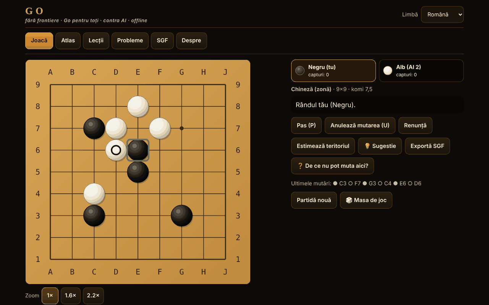

# Go fără frontiere

[English](README.md) · **Română** · [Français](README.fr.md) · [Italiano](README.it.md) · [Español](README.es.md) · [Português](README.pt.md) · [Deutsch](README.de.md) · [Magyar](README.hu.md)

**Versiune:** 1.2.9 · **Ultima actualizare:** 2026-10-23

Limbile interfeței: **Română, English, Français, Italiano, Español, Português (PT), Deutsch, Magyar**

Go (Baduk, Weiqi, Igo) într-un singur fișier HTML offline: tablă 5×5–19×19, patru seturi de reguli, adversar AI (MCTS), 12 variante jucabile, lecții, probleme de tsume verificate de un solver și SGF.

**Live:** https://chiuta.github.io/Go-fara-frontiere/

## Ce este

Un atlas (18 fișe: origine, reguli, aproximări ⚠, surse) și un joc efectiv de Go contra unui adversar AI local (căutare Monte-Carlo pe arbore, nu LLM, nu rețea neuronală). Motorul de reguli este separat de interfață și testat în Node. Nicio cerere de rețea.

## Funcții (verificate în cod și teste)

- **Table:** 5×5, 7×7, 9×9, 13×13, 19×19; hoshi, coordonate, piese mari în SVG scalabil; marcaje: ultima mutare, ko, teritoriu estimat; previzualizare la trecerea cursorului.
- **Reguli în cod:** captură pe libertăți de lanț; sinuciderea interzisă (japoneză, chineză, AGA) sau permisă (Tromp–Taylor / personalizat); ko simplu, superko pozițional (PSK) și situațional (SSK).
- **Seturi de reguli:** japoneză (teritoriu + prizonieri, komi 6,5, ⚠), chineză (zonă, 7,5, ⚠), AGA (zonă; pietrele de pas contează doar pentru paritate, NU se adună la scorul pe zonă, 7,5, ⚠), Tromp–Taylor (formală, scor automat, fără marcarea pietrelor moarte, 7,5), personalizat. Komi editabil; la handicap: japoneză/TT 0,5, AGA 0,5+(h−1), chineză h.
- **Handicap 2–9** cu poziții standard pe 9×9, 13×13, 19×19.
- **Sfârșit de partidă:** două pase → marcarea pietrelor moarte (clic pe grup) cu sugestie automată de la AI (cu confirmare) → scor detaliat (pietre, teritoriu, prizonieri, komi, puncte neutre).
- **Moduri:** contra AI (alegi culoarea sau aleator), doi jucători pe același ecran, Rengo 2 contra 2 (partenerul și adversarii pot fi AI), Phantom Go ⚠ contra AI.
- **AI:** MCTS (UCT + RAVE) cu simulări ușoare (capturi/scăpări din atari, tipare 3×3, nu umple ochi proprii, evită self-atari), 5 niveluri cu iterații și timp configurabile, butonul „Oprește / gândește mai puțin”, rulează într-un Web Worker (din Blob) și, dacă nu e permis, pe firul principal în felii de ~20 ms.
- **Variante de atlas jucabile:** Atari-Go (Capture Go / Ponnuki-Go: prima captură; opțional țintă 5 sau 10 pietre), Go pe tablă mică (5×5, 7×7), NoGo, Rengo, Phantom Go ⚠, Byo-yomi cu ceas funcțional (timp de bază + perioade).
- **Sugestie** (💡, în partidele cu pietre vizibile): AI-ul local propune o mutare pentru tine (căutare Monte-Carlo, orientativă), afișată ca mutare de confirmat sau anulat.
- **Salvare automată:** o partidă nefinalizată se salvează local după fiecare mutare; la următoarea deschidere, fila „Joacă” oferă „Continuă partida” sau „Șterge salvarea” (verificată prin reluare; salvările corupte sunt respinse).
- **Lecții interactive** (6): pietre, libertăți, captură, ko, doi ochi, seki.
- **12 probleme de tsume-go**, fiecare cu soluție confirmată de un solver de forță brută (vezi „Ce garantează solverul”); feedback corect/greșit cu răspunsul apărării; „Arată soluția” pas cu pas.
- **SGF:** export (cu mutări, handicap, komi, rezultat); import și reluare cu parser strict (FF[4], doar linia principală, limite: 2 MB, 30 000 noduri, adâncime 256; nu se execută nimic); „Continuă jocul de aici”.
- **Interfață:** tastatură completă (săgeți + Enter, P = pas, U = anulează), mod „confirmă mutarea” (implicit pe ecran tactil), zoom 1×/1,6×/2,2× pe mobil, 390 px fără scroll orizontal; anulare doar contra AI sau cu confirmare; fără sunete.
- **Interfață și conținut în 8 limbi** (RO/EN/FR/IT/ES/PT/DE/HU; FR/IT/ES/PT/DE/HU sunt traduse automat, neverificate de vorbitori nativi) cu autodetectare; textele lungi (atlasul, cele 6 lecții interactive, numele problemelor tsume, „Despre”, nota despre komi) sunt traduse și ele în toate limbile. Rămân neschimbate: câmpul „surse” al fișelor din atlas (citări, nume proprii) și numele artistic „Ecoul Stringurilor”. Paritatea cheilor este verificată cu un script. Terminologia de Go (de ex. hu „felület” pentru area scoring) merită revizuită de un jucător nativ.
- **Aleatoriu:** `crypto.getRandomValues` cu rejection sampling (culoarea aleatoare, seed-urile AI); opțiune „Seed” pentru partide reproductibile.
- **Accesibilitate:** aria-live, focus vizibil, ținte tactile ≥ 44 px (măsurat), contrast ≥ 4,5:1 (măsurat), `prefers-reduced-motion`, `<noscript>`, `lang` dinamic.

## Funcții noi (1.1.0)

Toate se deschid din butonul „Masa de joc” (jocuri în doi, analiză, provocarea zilei, turneu, accesibilitate). Nu există server și nu se adaugă cereri de rețea în afara celor de mai jos.

- **Joc în doi prin FFF.p2p** (WebRTC, semnalizare manuală prin text sau cod QR, fără server). Gazda este autoritară; oaspetele aplică doar mutările numerotate returnate de gazdă (lockstep, cu sumă de control a poziției). Mutare, pas, abandon, marcarea pietrelor moarte și confirmarea scorului sunt sincronizate; remiză/partidă nouă se propun și se acceptă. Limite: fără ceas, fără AI, fără anulare mutare în partida online, fără reluare după reîncărcarea paginii. Adresa IP este vizibilă adversarului; NAT simetric poate necesita STUN/TURN (STUN public opțional, doar cu acordul explicit din dialog).
- **Analizor local**: estimare de probabilitate de câștig și de scor cu MCTS cu sămânță fixă (800/500/250 de iterații după mărimea tablei), deci același rezultat pentru aceeași poziție; „Recenzie” a partidei curente cu grafic și mutările care schimbă evaluarea cu ≥ 20 de puncte. Este o estimare statistică, nu un motor de nivel profesionist.
- **Provocarea zilei**: tablă 9×9 cu pietre plasate din data calendaristică (aceeași pentru toți în aceeași zi), plus problema de tsume a zilei din cele 12 existente; serie de zile consecutive stocată local. Fără rețea.
- **„De ce nu pot muta?”**: orice mutare ilegală primește o explicație (punct ocupat, ko cu mutarea de interdicție, superko cu numărul mutării, sinucidere cu mărimea lanțului, NoGo etc.), anunțată și pentru cititoare de ecran; buton dedicat și tasta `?`.
- **Tastatură și anunțuri audio**: cursor pe tablă cu săgeți, Enter/Spațiu pentru a juca, `W` (stare), `C` (coordonate), `L` (ultima mutare), `S` (scor); regiune aria-live și, opțional, voce (Web Speech, local) prin modulul `tts` al kitului.
- **Turneu Elo local**: dumneavoastră + adversari AI (Elo 500 + 200·nivel), tur-retur, clasament recalculat din rezultate; meciurile între AI se simulează pe 5×5/7×7/9×9 cu iterații reduse (Tromp–Taylor); clasamentul Elo este relativ și orientativ.
- **Kit FFF** aplicat: `core, label, bundle, qr, p2p, tts` (fereastra de transparență, `app.json`). CSP-ul rămâne `default-src 'none'`; s-au recalculat doar hash-urile scripturilor.

## Variante

| Nume | Jucabil? | ⚠ Aproximări |
|---|---|---|
| Go (clasic), 9×9 / 13×13 / 19×19 | da | — |
| Reguli japoneze (teritoriu) | da | ⚠ seki: ochii din interiorul unui seki nu se detectează; ko simplu (fără „fără rezultat”); fără reguli de arbitraj |
| Reguli chineze (zonă) | da | ⚠ superko pozițional în loc de regula oficială de repetare; komi 7,5 (valoarea modernă) |
| Reguli AGA | da | ⚠ verificate la audit față de textul AGA 1991; situațional ales pentru repetare; fără arbitraj |
| Tromp–Taylor | da | — (formală; sinucidere permisă, scor automat) |
| Go pe tablă mică (5×5, 7×7) | da | — |
| Handicap 2–9 | da | ⚠ poziții tradiționale doar pe 19×19; pe 9×9/13×13 extrapolate (verificat audit) |
| Atari-Go / Capture Go / Ponnuki-Go (țintă 1, 5 sau 10) | da | — |
| NoGo | da | — (cine nu mai are mutare legală pierde) |
| Rengo 2 contra 2 | da | — (jucătorii echipei joacă pe rând; AI pentru locuri libere) |
| Phantom Go | da | ⚠ AI-ul nu cunoaște pietrele tale ascunse și poate încerca puncte ocupate; scor pe zonă; fără export SGF în timpul partidei |
| Byo-yomi | da | — (ceas cu perioade; pierzi la depășire) |
| Go în pereche, toroidal, hexagonal, în trei, Ing, Noua Zeelandă | doar în atlas | — |

## Ce garantează solverul de tsume

Pentru fiecare problemă, o căutare alfa-beta cu tabel de transpoziții, pe zona mică afișată, a confirmat că prima mutare indicată îi permite jucătorului să forțeze scopul (grupul țintă capturat, sau viu necondiționat conform algoritmului Benson) în cel mult D semi-mutări împotriva ORICĂREI apărări, inclusiv pas; mulțimea mutărilor câștigătoare s-a verificat și la D+2. Nu garantează: ko, seki sau „viu în seki” nu contează ca succes; doar ko simplu; zona e izolată (zidurile marcate cu pătrat sunt permanente); nu pretinde unicitatea în partida întreagă. Cele 12 probleme sunt: 6 forme de spațiu de ochi (3 în linie, 3 îndoit, 4 în T, 4 pătrat, 5 grămadă, 5 cruce) de omorât, 4 de făcut vii, și 2 capturi mici găsite prin căutare. Un set mai bogat de tesuji (snapback, ladder, net) nu a fost inclus: nu am găsit probleme pe care solverul să le confirme și care să fie și naturale.

## Manual de utilizare

1. Fila „Joacă”: alege varianta, tabla, setul de reguli, modul și nivelul AI; „Începe partida”. (Sau din „Atlas” → „▶ Joacă” pentru un preset.)
2. Mută cu clic/atingere (pe mobil confirmi mutarea) sau cu tastatura: săgeți = cursor, Enter = pune piatra, P = pas, U = anulează.
3. Butonul „Estimează teritoriul” afișează o estimare statistică; „Oprește / gândește mai puțin” scurtează gândirea AI.
4. După două pase marchezi pietrele moarte: clic pe un grup (sau „Sugerează automat”), apoi „Confirmă scorul”. În Tromp–Taylor scorul este automat.
5. „Exportă SGF” descarcă partida; fila „SGF” încarcă și reia un fișier sau un text lipit.
6. „Lecții” și „Probleme” au feedback imediat; progresul se păstrează local (dacă browserul permite).

## Nivelul AI (descriere onestă)

Nu este un LLM și nu are rețea neuronală. MCTS cu simulări ușoare: ~7 700 de simulări/s pe 9×9 și ~1 600/s pe 19×19 în Node (mașina de test); în browser variază. Nivelurile 1–5 înseamnă 0 / 100 / 500 / 2 500 / 10 000 de iterații (cu limită de timp). Măsurat pe 9×9, komi 7,5, reguli chineze, culori alternate (`tests/match.js`, `tests/vs_random.js`):

| Meci (9×9, komi 7,5, culori alternate) | Rezultat | Jocuri |
|---|---|---|
| Nivel 1 (euristic, 0 iterații) contra aleator | 34–6 (85%) | 40 |
| Nivel 2 (100 iterații) contra aleator | 100–0 (100%) | 100 |
| Nivel 3 (500 iterații) contra aleator | 40–0 (100%) | 40 |
| Nivel 2 contra nivel 1 | 40–0 | 40 |
| Nivel 3 contra nivel 2 | 31–9 (78%) | 40 |
| Nivel 4 (2 500) contra nivel 3 | 21–9 (70%) | 30 |
| Nivel 5 (10 000) contra nivel 4 | 15–5 (75%) | 20 |

Cu 20–40 de jocuri, intervalul de încredere (95%) este de ordinul ±15–20 puncte procentuale pentru rândurile cu ≤ 40 de jocuri; diferențele dintre niveluri sunt reale, dar valorile exacte nu. Meciurile sunt AI contra AI (același motor), deci diferențele de forță între niveluri sunt probabil supraestimate față de oameni.

Rangul NU este măsurat (nu există motor cotat sau jucători umani de referință în mediul de construcție); orice echivalent în kyu ar fi speculație, deci nu se afirmă unul. Nivelurile 1–2 sunt pentru începători absoluți. Pe 19×19 este mult mai slab și mai lent. AI-ul nu trișează: primește doar tabla, istoricul mutărilor și regulile; în Phantom Go joacă numai cu pietrele proprii și cu cele dezvăluite.

## Teste (runda 8)

`tests/fff-r8.test.mjs` (Playwright, rețea blocată, `node tests/fff-r8.test.mjs`): 10 secțiuni, 120 de verificări, 0 eșecuri — P2P între două pagini (loopback), analizor determinist, provocarea zilei determinată de dată, explicații pentru mutări ilegale, tastatură, turneu Elo, axe-core cu 0 încălcări (inclusiv dialoguri și fereastra kitului), 0 `pageerror`/încălcări CSP, fără depășire orizontală la 360×740 și 1280×800. Aplicația este numai în temă întunecată, deci contrastul se verifică într-o singură temă.

## Teste anterioare (în afara pachetului)

Rulate din `scratchpad/new/games_work/Go-fara-frontiere/` (în afara pachetului):

- `node tests/run.js` — 158 de verificări, 0 eșecuri: configurații clasice (scară/ladder și snapback găsite prin căutare și reluate cu implementarea de referință, ko, seki, sinucidere, captură înainte de sinucidere), superko, scor japonez vs chinez pe poziții cu rezultat calculat de mână (identitate de scor: diferența de zonă minus diferența de teritoriu = pietre puse de Negru minus pietre puse de Alb, conform Sensei's Library), handicap, ceas byo-yomi, SGF (round-trip pe 600 de partide generate; respingerea fișierelor prea mari, prea adânc imbricate, cu valori uriașe sau malformate).
- Comparare cu o implementare de referință independentă (flood-fill brut): 100 000 de poziții aleatoare în 588 de partide, 602 976 de verificări de legalitate, 0 divergențe (în `tests/run.js`).
- `node tests/fuzz.js 9 500` — 500 de partide AI contra AI pe 9×9 (52 291 de mutări), fiecare mutare validată de referință: 0 mutări ilegale, 0 invarianți încălcați. `node tests/fuzz.js 13 100` — 100 de partide pe 13×13 (20 839 de mutări): 0 ilegale. `node tests/fuzz.js var 120` — NoGo / Capture-Go: 0 ilegale.
- `node tests/vs_random.js 100 100` — MCTS cu 100 de iterații bate jucătorul aleator 100–0 pe 9×9 (cerință ≥ 95%).
- `node tests/tsume_verify.js` — re-rezolvă cele 12 probleme: soluția stocată, adâncimea minimă, stabilitatea la D+2, refutarea fiecărei mutări greșite.
- `node tests/i18n-parity.js` — 254 de chei × 7 limbi, placeholdere identice, toate cheile folosite în cod există. `node tests/rng.js` (uniformitate `secureInt`, seed reproductibil), `node tests/contrast.js` (≥ 4,5:1), `node tests/stamp_overflow.js` (regresie pentru o eroare găsită în meciuri lungi: depășirea contorului Int32 din flood-fill).
- Playwright (`pw/ui.js`, `pw/ui2.js`, `pw/ui3.js`): 84 de verificări UI, 0 eșecuri — tastatură, undo, schimbarea limbii, export/import SGF, SGF invalid respins, rezolvarea prin UI a tuturor celor 12 probleme, partidă 5×5 completă până la marcare și scor, toate cele 12 presetări jucabile, estimare de teritoriu, ceas byo-yomi, mobil 390 px (fără scroll orizontal, ținte ≥ 44 px, confirmarea mutării), `localStorage` blocat, fără Worker (fallback), 0 cereri de rețea, 0 erori de consolă.

## Confidențialitate și rețea

Fără cont sau telemetrie; implicit fără nicio cerere de rețea. Doar dacă porniți explicit „Joc în doi” se deschide o conexiune WebRTC directă către adversar (semnalizare copiată manual; STUN public doar cu acord explicit). CSP strict (`default-src 'none'`, script permis doar prin hash SHA-256, `worker-src blob:`, fără `connect-src`). `localStorage` (în try/catch) doar pentru limbă, setări, probleme rezolvate, statistici locale și salvarea automată a unei singure partide nefinalizate (`go-fara-frontiere.save.v1`: setările, mutările, culoarea ta și seed-ul; nu pentru Phantom Go sau partide cu ceas; se șterge la sfârșitul partidei sau cu „Șterge salvarea”). Linkurile Buy Me a Coffee din subsol se deschid doar la clic (`rel=noopener`).

## Limite și avertismente

- Regulile (komi, ko, sinucidere, seki, scor, handicap) au fost verificate la audit față de Wikipedia „Rules of Go”/„Komi”, textul AGA 1991 (British Go Association) și regulile japoneze 1989 (CMU); au rezultat corecturi (pietre de pas AGA, komi la handicap). Regulile chineze oficiale și Nihon Ki-in 2003 nu s-au putut citi integral (⚠).
- „Seed” reproduce partida doar dacă AI-ul nu e oprit de limita de timp (iterațiile pot varia după viteza mașinii).
- Seki: punctele cu libertăți comune sunt neutre, dar ochii din interiorul unui seki nu se detectează; ko simplu fără „fără rezultat” la japoneză; limită de siguranță la 4·n² mutări (remiză).
- Estimarea teritoriului și sugestia pietrelor moarte sunt statistice și pot greși.
- Phantom Go este aproximat (AI fără informații despre pietrele tale ascunse; poate încerca puncte ocupate).
- AI-ul este slab pe 19×19; nu este un jucător de nivel de club.
- Variantele „doar în atlas” nu sunt implementate.
- Joc în doi: fără ceas/AI/anulare, fără reluare după reîncărcare; SGF-ul și capturile nu sunt sincronizate separat. Analizorul și simulările din turneu folosesc iterații reduse și sunt aproximative.

## Surse

Sensei's Library (Japanese rules, Chinese rules, AGA rules, Tromp–Taylor rules, Ko, Superko, Komi, Handicap, Seki, Scoring) · regulile Tromp–Taylor · American Go Association · specificația SGF FF[4] · D. B. Benson (1976, viață necondiționată) · Kocsis & Szepesvári (2006, UCT) · Gelly & Silver (2007, RAVE). Verificate parțial online la audit (vezi raportul de audit).

## Rulare locală

Descărcați `index.html` și deschideți-l în browser; funcționează fără internet.

## Istoric / Changelog

### 1.2.9 — 2026-10-23

- Corectat: versiunea afișată în subsol (era 1.2.6); hash-uri CSP recalculate.

### 1.2.8 — 2026-10-23

- Stocare: cheile poartă acum prefixul aplicației (`go-fara-frontiere.prefs.v1`, `go-fara-frontiere.save.v1`, `go-fara-frontiere.r8.*`); datele existente se mută automat la pornire din cheile vechi (`gff.prefs.v1`, `gff.save.v1`, `gff_r8_*`), iar copiile `.fff.json` mai vechi se importă în continuare (fff-kit 1.2.0).
- Dialoguri: casetele native `alert`/`confirm`/`prompt` au fost înlocuite cu dialoguri `FFF.dialog` accesibile și traduse (tastatură, capcană de focus, Escape), cu același comportament (fff-kit 1.2.0).

### 1.2.6 — 2026-10-22

fff-kit 1.1.4: ținte tactile și text minim. Ținte tactile/text corectate în aplicație.

### 1.2.5 — 2026-10-22

fff-kit 1.1.2: PBKDF2 600 000 iterații, protecție anti-clickjacking.

### 1.2.4 — 2026-10-22

înlocuirea unui joc în curs (din atlas, dintr-o înregistrare SGF sau la pornirea unui joc online) cere confirmarea în dialogul inline al kitului (tradus în 8 limbi), nu prin `window.confirm()` blocant; focus de tastatură vizibil; casete de bifat de cel puțin 24 px; test `tests/r9-confirm.test.mjs`.

### 1.2.3 — 2026-10-22
- Linkul „Skip” și tipurile de tablă din atlasul de variante (toroidală, hexagonală) sunt traduse; linia de surse de la NoGo nu mai amestecă româna cu engleza; numele și descrierea din panoul de transparență (fff-info) și din meta description urmează acum limba interfeței și se actualizează la schimbarea ei.

### 1.2.2 — 2026-10-22
- Corecție de traducere: referința sursă de la Rengo nu mai conține text în română.

### 1.2.1 — 2026-10-19
- Toate textele lungi („Despre”, 6 lecții, 12 nume de probleme tsume, textele de nivel, nota despre komi, fișele atlasului) sunt traduse în fr, it, es, pt, de, hu; nota „text în engleză” nu mai apare. Traduceri automate, neverificate de vorbitori nativi.

### 14 octombrie 2026 — versiunea 1.1.0
- Joc în doi prin FFF.p2p (lockstep), analizor local, provocarea zilei, „de ce nu pot muta?”, joc de la tastatură cu anunțuri audio, turneu Elo local; limba maghiară (parțială); kit FFF (`core,label,bundle,qr,p2p,tts`); teste `tests/fff-r8.test.mjs`. Fără regresii de reguli (motorul de joc nemodificat).

### 12 octombrie 2026 — versiunea 1.0.0
- 1.0.0 — 2026-10-12: versiunea și data ultimei actualizări sunt afișate în aplicație

### 11 octombrie 2026 (a treia trecere)
- Nota despre komi la handicap (RO/EN): AGA „h−0,5” și „0,5 + (h−1)” sunt aceeași valoare, acum formulat ca atare (înainte părea că sunt două formule). CSP: hash recalculat.

### 11 octombrie 2026 (a doua trecere)
- Salvare automată a partidei în curs cu „Continuă partida” (validare strictă + reluare, text nou în toate cele 7 limbi); buton „Sugestie” care propune o mutare cu motorul MCTS local; CSP: hash recalculat.

### 11 octombrie 2026
- Accesibilitate: bara de file este încadrată într-un reper `<nav>`, widgetul de sprijin are rol de reper; axe-core raportează 0 încălcări la 1280 și 360 px.
- Reparat HTML-ul: eliminat un `</body></html>` duplicat de la sfârșitul fișierului; hash-ul CSP al scriptului a fost recalculat (verificat cu CSP activ, fără bypass).
- Licență: mențiunea „licență nedeclarată” din aplicație a fost înlocuită cu licența MIT, conform fișierului `LICENSE`.

## Licență

MIT — vezi fișierul `LICENSE`

## Autor

Alexio — Alexandru-Ionuț Chiuță · alexio@trom.tf

## Rezumat

Go (Baduk/Weiqi/Igo) offline într-un singur fișier: 5×5–19×19, reguli japoneze/chineze/AGA/Tromp–Taylor (⚠ aproximări documentate), handicap 2–9, AI MCTS (5 niveluri, Web Worker), doi jucători, Rengo 2 contra 2, Atari-Go/Ponnuki-Go, NoGo, Phantom Go ⚠, ceas byo-yomi, 6 lecții interactive, 12 probleme tsume, fiecare confirmată de un solver prin forță brută, import/export SGF cu parser strict. Interfață în 8 limbi (6 traduse automat, neverificate), texte lungi traduse și ele. Noutăți în 1.1.0: joc în doi prin WebRTC cu semnalizare manuală/QR (fără server, lockstep), analizor MCTS local cu sămânță fixă și revizuirea partidelor, provocare zilnică pe bază de dată, explicații „de ce nu pot muta?”, joc cu tastatura cu anunțuri vocale, turneu Elo local. Motorul a fost testat față de o referință independentă flood-fill pe 100.000 de poziții aleatorii, 500 de partide AI contra AI pe 9×9 și 100 pe 13×13, fără mutări ilegale. Fără rețea, fără telemetrie. Licență: MIT (vezi LICENSE).
